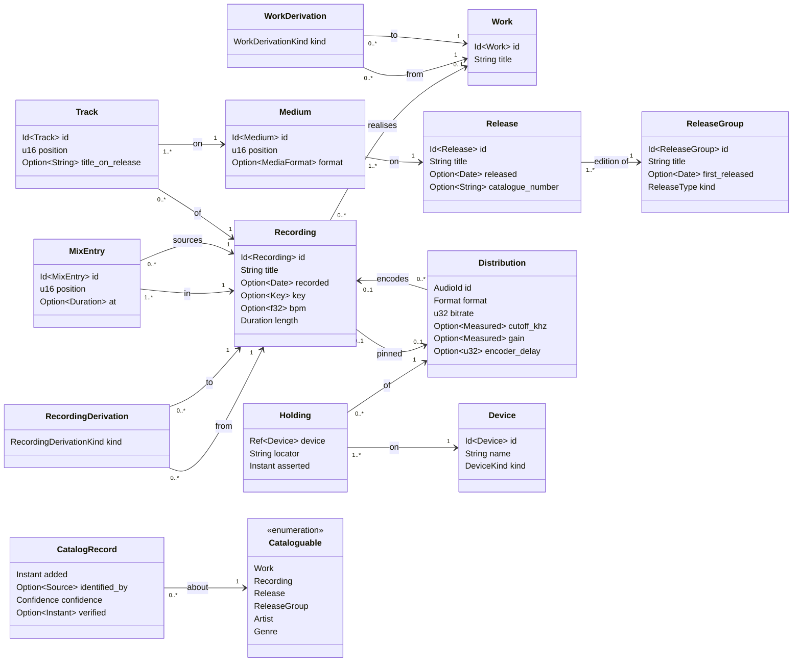
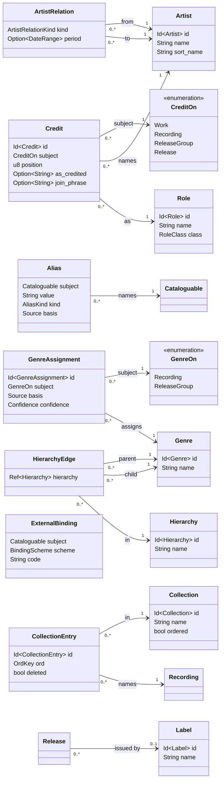

# Domain model

**Status: proposal.** Nothing here is built. This is what a library entry is, what a file is, and what a view returns.

It does not decide persistence — SQLite, Parquet or text is #40, and downstream of this. It does not decide sync;
`library-sync-design.md` owns that, and this document assumes its conclusions: the catalogue is a projection of an
append-only history, no machine is an authority, and merge is "union the logs, last wins per field, surface collisions".

---

## 1. The grain

**A view returns recordings.** Always. Every navigable surface is a projection of one cube whose observed value is a
`Recording` — the playable semantic artefact — and everything else is something you slice or group by.

This is already load-bearing in `tree-view-design.md`, unstated:

```rust
pub struct ViewSpec {
    pub source: Source,
    pub filter: Option<Predicate>,   // the slice
    pub levels: Vec<Level>,          // the grouping path
    pub leaf: Option<SortExpr>,      // ordering of the observations
}
```

There is no way to express a view whose leaves are not rows. A `Level` is a grouping identity; the leaves fall out of
it. "Show me the genres" is not a terminal — it is a level with recordings underneath.

Three consequences:

**A file is not in the grain.** Whether a physical copy exists is not a condition on existing. `available` is a value to
filter and sort on, so a recording you have decided about and do not own is an ordinary row, and a wishlist is
`available = none` rather than a feature.

**A track on a release is not an observation.** It is contained by the release and traversed to reach the recording, so
it is not identifiable, and a recorded mix names a `Recording`.

**The effective grain varies by slice, and that is correct.** Browse by release and a recording held on both _Big
Science_ and the anthology appears twice — you are looking at albums, and it is on both. Browse by genre and it appears
once. The playback pool de-duplicates by recording; the view must not.

---

## 2. The model

Two layers, and separating them is what keeps a growing link-web from turning into soup: a **reference layer** of
maintained artefacts — artists, roles, genres, hierarchies, bindings — under an **observation layer** that points at it.
Every link in both is a typed struct with constrained endpoints, which is why a generic `(subject, predicate, object)`
edge is declined in §8.

### The observation layer



### The reference layer



### Entities

| entity            | is                              | carries                                                              |
| ----------------- | ------------------------------- | -------------------------------------------------------------------- |
| **Work**          | a composition                   | title; composer credits                                              |
| **Recording**     | **one performance — the grain** | title, recorded date, key, bpm, length; performer credits            |
| **Release**       | one edition                     | title, release date, catalogue number                                |
| **Release Group** | the album across editions       | title, first release date, type                                      |
| **Medium**        | a disc or side                  | its position on the release, its physical format                     |
| **Track**         | a recording's slot              | its position on the medium, the title as printed there               |
| **Artist**        | a person or ensemble            | name, sort name                                                      |
| **Label**         | an imprint                      | name                                                                 |
| **Genre**         | a concept in the vocabulary     | name                                                                 |
| **Collection**    | a curated set, ordered or not   | name, whether its order means anything                               |
| **Device**        | a machine holding copies        | name, kind                                                           |
| **Distribution**  | **an encoding** of a recording  | `audio_id`, format, bitrate, cutoff, gain, encoder delay — the bytes |
| **Holding**       | a copy, on one device           | which distribution, which device, a locator, when the claim was made |

`Work` is optional on a `Recording`. 16% of this library has no MusicBrainz id and some music never will; a recording
that realises no known work is an ordinary row, not a broken one.

### Associations are stored on the child

**Every to-one association is a scalar reference on the child** — `Medium.release`, `Track.medium`,
`Holding.distribution` — and no entity stores a collection of its children. "The tracks of a medium" is a derived index,
never a stored field. The API still presents containment; only the storage direction changes.

This is not a weaker claim about the relation. A single scalar reference makes multi-parenting **unrepresentable**, and
a required one makes membership mandatory — a parent-side `Vec` cheerfully represents a track on two media, or on none.
Containment is asserted by the shape of the reference, not by which struct holds the pointer.

It also keeps merges trivial. An insert is a new row, and rows in an append-only log never conflict; a parent-side
collection would make adding a track a rewrite of the parent, to be reconciled against every other rewrite of that
parent. Moving a release between groups is likewise one field write rather than a paired remove-and-add across two
records, which can interleave into "in both groups" or "in neither".

Genuinely many-to-many groupings — box sets, series, collections — go through a membership row, not a second parent
reference. `CollectionEntry` exists for that and nothing else.

The rule holds for every arrow, including the ones it is tempting to exempt: a `Credit` names the work or recording it
is on rather than being held in a list there, and a `CatalogRecord` names its subject.

### Order is a field

If an ordering is meaningful it is an explicit `position` on the row, never carried by a container's sequence. If no
such field is justified, the collection is a set and callers sort at query time.

An explicit position can be validated for gaps and duplicates, and it syncs as a scalar register. An index position
cannot be checked, because it cannot disagree with itself and so can never reveal that the source data was wrong.

### Containment: release, medium, track

A release holds ordered media; a medium holds ordered tracks; a track names a recording. This is MusicBrainz's shape and
the Music Ontology's, and neither has a join entity here.

### Derivation happens at two levels

**A cover is not a derivation.** Three files here title _Buckets of Rain_ — Dylan's, Neko Case's and David Gray's — and
all three carry `composer: Bob Dylan`. The tags say one work, three recordings, which is the same relation as Casals and
Rostropovich both playing the first cello suite. So a cover realises the existing `Work`, and a live version is a
`Recording` with a `recorded` date. Neither is a kind of derivation.

**Remix, edit, dub, mashup and sample relate recordings.** They name a _version_, and the version is the recording. The
library settles this on its own evidence: of the three Callisto remixes held here, not one carries a composer tag. At
work level, recording that they are remixes would mean minting a phantom work for the original and one per remix — four
entities nobody will ever verify — solely to hang the relation on. At recording level it costs nothing, and a remix
realises the same `Work` as its source when one is known, so "every version of Callisto" is recordings-of-work rather
than a closure over invented works.

Sampling makes the point sharpest, and it is not a claim about production technique: Blawan sampled the Fugees'
_recording_, and a licence clears a master separately from a composition. Which recording was used is the fact.

```rust
enum WorkDerivationKind      { Arrangement, Medley, Quotation }        // compositional acts
enum RecordingDerivationKind { Remix, Edit, Dub, Mashup, Sample }      // version-of-a-version
```

**`Remaster` is deliberately absent from both.** A remaster is the same recording issued again — a new `Release` and new
`Distribution`s — not a derived anything. Nothing in this library disputes it: zero of 5774 tagged files carry a
remaster tell in an album or track title.

### A DJ mix is a tracklist

A recorded mix is a `Recording` whose sources are named by ordered, timed entries — not by a bag of derivation rows,
which would drop the two facts a tracklist is made of.

```rust
struct MixEntry {
    mix: Ref<Recording>,
    source: Ref<Recording>,
    position: u16,
    at: Option<Duration>,   // where it enters
}
```

Same shape as a collection entry, stored on the child, order as a field. Because the entries name recordings, a mix can
answer the question a DJ actually asks: _which version_ of Callisto is in there.

### Credits, and what a release printed

A `Credit` places an artist on a work, a recording, a release group or a release, with a role and a position. One
mechanism covers `LMFAO feat. Natalia Kills`, `composed by Bach`, `conducted by Barenboim` and `remixed by Joris Voorn`.

The subject is a **sum type**, not four optional references, so "credited to nothing" and "credited to both a work and a
release" are unrepresentable. It reaches up to `ReleaseGroup` and `Release` because "browse by album artist" is the
most-used level in any player: deriving it by aggregating a release's recording credits is a guess, and it leaves
various-artists with no authoritative marker.

```rust
struct Credit {
    subject: CreditOn,
    artist: Ref<Artist>,
    role: Ref<Role>,
    position: u8,
    as_credited: Option<String>,   // the printed form, when it differs from the label
    join_phrase: Option<String>,   // the connector to the next credit
}
```

`as_credited` names one artist as printed and `join_phrase` is the connector between them, so together they reconstruct
the line on the sleeve. `Stephan Bodzin vs. Marc Romboy` is two credits joined by `" vs. "`, not one artist with a
strange name — which is why the library holds that act under two spellings today and splits its play count.

Display reads `as_credited ?? artist.name`; grouping and search always resolve through the reference, so a printed form
never fragments the artist dimension.

### Artists relate to artists

```rust
enum ArtistRelationKind { MemberOf, AliasOf }
```

The composer tag in this library is mostly not naming cover originals but band members and pseudonyms — `Black Francis`
on 40 Pixies files, `Paul Hartnoll/Phil Hartnoll` on 34 Orbital files, `Marc Leclair` on Akufen. "Everything by this
artist under any name" is a first-order question for a collection like this one.

### A resolved string is a claim, not a rename

Ten files arrive tagged `Emmy Lou Harris` carrying MBID `35ef61ca…`. They resolve to the existing artist and the
recordings take a `Ref<Artist>`. **The string's job ends there** — it was used to find an identity, never to edit the
authority record. So there is no label contest at ingest and no precedence rule to invent. `Artist.name` stays
`Emmylou Harris`, and 171 recordings sit under one artist with their play counts intact.

**The label is ours, defaulted from the binding.** `Artist.name` is an ordinary register, seeded from the bound
authority's spelling or from the library-majority spelling when nothing is bound. A default is not a dependency: an
upstream rename is a new fact, surfaced for adoption and never applied on its own. Renaming locally is one field write
that reinterprets every credit at once, which is what a fixed id is for.

**The losing spelling is kept as an alias.**

```rust
struct Alias {
    subject: Cataloguable,       // artists, works and genres all have labels
    value: String,
    kind: AliasKind,             // SearchHint | LegalName | …
    basis: Source,               // TagVariant | MusicBrainz | Manual
}
```

This is authority control as libraries have always done it — an authorised heading with see-references — and it is
`skos:prefLabel`/`altLabel` without the RDF. Three things follow, and the second is the one that matters:

1. **Search** indexes labels together with aliases, so typing "Emmy Lou" finds her.
2. **The matcher learns.** The next file tagged `Emmy Lou Harris` with no MBID hits the alias exactly and resolves
   confidently, where before it needed a fuzzy guess or a provisional. The alias table is this library's accumulated
   knowledge of how the world misspells things.
3. **Audit.** The claimed string survives in the ingest event's basis, so "why does this file point at that artist" has
   a stored answer.

`basis` is load-bearing rather than decorative. An alias minted from a tag records what one file claimed, not that the
spelling is legitimate, so a typo does not acquire the authority of a sleeve credit: matching weights `TagVariant` below
`MusicBrainz` and `Manual`, and a bad one is pruned by its basis without touching the aliases that were earned.

**An alias is not a redirect.** An alias is another name for one entity; a redirect (§3) is two entities that turned out
to be one, where the loser's _id_ forwards. Both keep old references working, and a merge usually mints both — the
losing entity's label becomes an alias of the winner.

### An encoding is not a copy

A `Distribution` is an **encoding**; a `Holding` is a **copy of it on a device**. DCAT is explicit that a distribution
is "a specific representation or serialization of a dataset, _not_ a physical copy", and it carries `spdx:checksum` —
which here is `audio_id`. The copy is FRBR's `Item`, or the Music Ontology's `MusicalItem`.

Every field of an encoding is a fact about the bytes and travels; only the locator belongs to a machine.

```rust
struct Distribution {              // an encoding
    id: AudioId,
    recording: Option<Ref<Recording>>,
    format: Format,
    bitrate: u32,
    cutoff_khz: Option<Measured<f32>>,
    gain: Option<Measured<ReplayGain>>,
    encoder_delay: Option<u32>,
}

struct Holding {                   // a copy on a device
    distribution: AudioId,
    device: Ref<Device>,
    locator: String,               // the device's kind says how to read it
    asserted: Instant,             // when that device last said so
}
```

Keeping them apart is what lets spectral cutoff and ReplayGain be measured **once** rather than once per machine per
file, and what lets "is there a good copy of this anywhere" be answered on a laptop holding 2% of the library.

**A distribution's id is its content.** This is the one deliberate exception to §3's rule that `Id<T>` is a locally
minted UUID, and it is forced: two devices scanning the same file must arrive at the same distribution without talking
to each other, or a union merge produces two rows for one encoding. `library-sync-design.md` §2 requires exactly this —
"identical on every device, generated without coordination, and stable under retagging". The rule holds for everything
editorial; an encoding is not editorial.

**Presence is never stored.** A local copy is checked by resolving its locator when you need it, which has to happen
anyway, so a stored `present` flag would only be something that can go stale.

**A remote holding is an assertion with an age, and the UI must say so.** You cannot stat another machine's disk, so a
holding is the claim "device X had this, there, as of X's last sync". Availability across the library is therefore
bounded by sync recency — inherent to a disconnected design rather than a defect — and a row reads "on asnas, as of
Tuesday" rather than as a live fact.

**Holdings are the one table where merge is not union**, because union resurrects: delete a file on m1 and a stale
replica would hand the row back. They are **single-writer** — only the owning device ever writes its own — so a
convention suffices: **a device publishes its holding set whole, and the new set replaces that device's previous one.**
That suits how the set is produced, since a scan yields the complete list rather than a diff, and it self-heals, since a
device whose holdings have drifted is corrected by its next scan.

**Measured fields carry the version of what measured them.** `cutoff_khz` and `gain` are functions of the bytes _and_ of
the analyser, so "measured once, travels forever" would quietly become "measured once, with the old code" the day the
FFT parameters or the ReplayGain implementation change. `Measured<T>` stamps the analyser version, exactly as `AudioId`
stamps its `SCHEME`, so a re-measure pass can target stale rows.

### Which copy represents, which copy plays, which copy is pinned

Three questions, one stored answer.

```
canonical(rec)   the encoding that represents this recording   derived, identical on every device
for_playback     which copy this machine opens right now       derived, differs per device
rec.pinned       a human overruling the first                  stored, empty almost always
```

**The default is computed and never stored.** `canonical` is `argmax` over the recording's distributions — a fold, like
`max()`. When a better encode arrives the answer changes by itself. Persisting it would be caching a fold as a synced
field: stale on every new distribution, rewritten by every device, syncing derived data.

**The pin is a stored override**, `Recording.pinned: Option<Ref<Distribution>>`. It is a pin rather than a preference
because that is what it is — a judgement the policy cannot reconstruct, the vinyl rip that measures worse and sounds
right. It hangs off `Recording` and names a `Distribution` because a pin is about **an encoding**, about how something
sounds; pinning a `Holding` would say "prefer the laptop's copy", which nobody means. It must survive the file moving, a
device dying, or a second machine acquiring the same encode.

The policy is **total** and **blind to the machine it runs on**:

```
order by   verdict_rank, cutoff DESC, bitrate DESC, format_rank, id
```

The trailing `id` makes the winner deterministic between near-identical candidates rather than whichever the iterator
reached first. Reading no holding and no setting means every replica computes the same canonical without coordinating —
agreement through determinism, the same trick as content-derived ids. `format_rank` is a fixed global ordering and is
**not** the `playback_prefers` setting: one says what best represents the recording everywhere, the other what this
laptop would rather open. The policy is **versioned**, like the analyser, because canonical choices feed the re-buy list
and the quality tables, so a changed ordering should read as an explainable diff.

**Defined once, at the model.** Every leaf showing a recording also wants _its_ format, bitrate and quality, and a
recording with three encodings has three answers. The argmax is a derived index the library maintains, and no caller
reaches past it to raw distributions for display. If it ever shows in a profile it is materialised — rebuilt locally,
never synced.

**A dangling pin is information, not an error.** If a pinned distribution loses its last holding, the policy answers
again and a row lands in the review queue.

Roon, Plex and MDM survivorship arrived at this shape independently: computed default, explicit override, no stored
automatic choice.

### Collections, including the one genuinely mutable ordered list

A collection and a playlist are one entity. A playlist is a collection whose order means something; a collection is a
playlist whose order does not. The UI is free to keep calling an ordered one a playlist.

```rust
struct Collection { id: Id<Collection>, name: String, ordered: bool }
struct CollectionEntry {
    collection: Ref<Collection>,
    recording: Ref<Recording>,
    ord: OrdKey,        // fractional index: a key strictly between its neighbours
    deleted: bool,      // a tombstone, so remove-vs-edit resolves predictably
}
```

Membership is row existence, so concurrent adds union cleanly. `ord` is a fractional index — inserting between two
entries mints a key between theirs and touches no other row, so concurrent inserts land in a deterministic total order
after merge. Removal is a flag rather than a delete. Key compaction, when keys grow long, is a local rewrite followed by
ordinary field sync.

**Membership lives in the library only.** Nothing is serialised to files; a collection travels between machines as rows
like everything else. Export to `.m3u8` is a deliberate command for other programs to read, not a mirrored directory and
not a per-collection sync burden.

### Genre is assigned, and the assignment is a fact in its own right

```rust
struct GenreAssignment {
    subject: GenreOn,           // ReleaseGroup by default; Recording where it differs
    genre: Ref<Genre>,
    basis: Source,              // tag, Discogs, MusicBrainz, manual, inferred
    confidence: Confidence,
}
```

Row existence means multi-genre falls out and devices union cleanly, and the assignment carries _why_ it was made and
how confident it is — which is exactly what `genre-uncertain.tsv` tracks today and throws away at the end of every pass.

**The default subject is the release group**, because that is how this library is curated and where the data lives:
querying the release found genres for 3 of 49 records, the group for 130 of 429. Recording-level assignments are the
override, and they are needed — on a various-artists or mix compilation each track's genre differs from the container's,
and a classical release mixing works has no single genre.

### Enumerations, entities, attributes

Everything below can be grouped by, which is what "dimension" means in a `ViewSpec`. In the _model_ they are not alike,
and conflating them is how `label` ended up inside `albumartist`.

| kind            | examples                                 | test                                                |
| --------------- | ---------------------------------------- | --------------------------------------------------- |
| **entity**      | Artist, Work, Release, Label, Collection | identifiable — **things point at it**               |
| **enumeration** | genre, key, credit role, derivation kind | a controlled vocabulary **with internal structure** |
| **attribute**   | bpm, length, bitrate, cutoff             | a value; nothing references it, no vocabulary       |

`key` and `bpm` are both fields on a recording and are not the same kind of field. `key` draws on a vocabulary with
relations you traverse — the circle of fifths is why #50 can be "a derived field over `key`, one function, then
`sort: key_distance(…)`". `bpm` is a number you band with an expression.

### Which vocabularies get to be entities

Calling something an enumeration does not say whether it is _data_ or _code_. The test is operational:

> **Does adding a value require writing behaviour?** Then it is a Rust `enum`, and a new variant should be a compile
> error until that behaviour exists. **Does it only need grouping and filtering?** Then it is a codelist — an entity
> with an id, aliases, hierarchy, merge and external bindings.

| vocabulary                                      | is                      | because                                                               |
| ----------------------------------------------- | ----------------------- | --------------------------------------------------------------------- |
| **genre**                                       | entity codelist         | open-ended, hierarchical, aliased, externally bound                   |
| **credit role**                                 | entity codelist, seeded | grows in practice; behaviour branches on its **class**, not its value |
| **key**                                         | `enum`                  | closed by music theory, and every code needs behaviour written for it |
| `WorkDerivationKind`, `RecordingDerivationKind` | `enum`                  | small, closed; the player branches on them                            |
| `Format`, `MediaFormat`, `Confidence`, `Source` | `enum`                  | closed, no structure, exhaustively matched                            |
| bpm, cutoff, length, bitrate                    | nothing — an attribute  | no vocabulary exists to control                                       |

**Genre is fully promoted**, and every mechanism in this document applies to it unchanged:

```rust
struct Genre { id: Id<Genre>, name: String }          // id meaningless, label mutable
struct Hierarchy { id: Id<Hierarchy>, name: String }
struct HierarchyEdge { hierarchy: Ref<Hierarchy>, parent: Ref<Genre>, child: Ref<Genre> }
```

Hierarchy membership is edge-row existence, so it unions across devices and there is no `Genre.children`. External
identifiers bind onto locally minted concepts exactly as MBIDs bind onto artists, so **the vocabulary is ours**, with
Discogs' and MusicBrainz's as exact-match bindings. The 169 assertions in `tools/genre/propose.py` — `IMPLIES` as
narrower-of, `RENAME` as aliases, `BROAD` as top concepts — become model data, and the Python dictionary stops being
load-bearing.

**Keeping the derivation kinds as enums is the load-bearing half of the rule.** Promoting them would make the set of
derivation _semantics_ user-editable while the code implementing those semantics stayed closed, and the two would drift.
The test exists to stop "everything gets identity", which is a triple store arriving through a different door.

**Credit role is a codelist whose behaviour lives one level up.** Roles proliferate — remixer, conductor, soloist,
arranger — and the player almost never branches on which one. Where it must, it branches on a compiled-in class:

```rust
enum RoleClass { Composer, Performer, Production }
struct Role { id: Id<Role>, name: String, class: RoleClass }
```

That keeps "composer credits belong on a `Work`, performer credits on a `Recording`" enforceable while the role list
stays open. A seeded list with provisional roles minted at ingest satisfies both.

**Key is an enum, and Camelot is a function over it — not a hierarchy.** A key codelist with Camelot as a stored second
hierarchy would be data that can disagree with music theory, and by the rule's own test adding a key _does_ require
writing behaviour, since its position on the circle of fifths and its Camelot code are behaviour. So `Key` is closed,
both orderings are derived, and there is no mapping table to maintain.

### The codelist is a maintained artefact

The genre list, its hierarchies and its bindings are small, slow-moving and precious. They are exported as one file,
kept in git, and diffed after a tagging pass; a snapshot taken before a bulk retag is all the versioning a one-owner
library needs, and it makes `genre-uncertain.tsv` a diff against a versioned artefact rather than against a shadow
database.

What is **not** taken from SDMX is the concept-scheme / codelist split — concepts as meanings, codes as representations.
At agency scale that separation earns its keep; at personal scale a genre concept and its code are one row, and
`ExternalBinding` covers the case the split exists for.

### There is no such thing as "year"

```
recorded          when the performance happened          Recording
released          when this edition came out             Release
first_released    when the album first appeared          Release Group
added             when I acquired it                     CatalogRecord
```

`Track.date` currently smears the middle two, and #59's "album order by release date" is really the **release group's**
first release date. The reissue trap — a 2015 remaster carrying `date=2015` — is those two levels collapsed into one
column.

### CatalogRecord

Metadata about _the entry in this catalogue_, distinct from metadata about the music: when it was added, what identified
it, how confidently, and when that was last verified. Its subject is any catalogued thing, not only a recording, because
the ingest ladder mints provisional artists and works too — at the point where the least is known, which is exactly
where provenance matters most.

---

## 3. Identity

**Two things are called identity, and they are different.**

|             | what it is                     | lifetime                                                   |
| ----------- | ------------------------------ | ---------------------------------------------------------- |
| `Id<T>`     | the identity a reference names | durable, travels, persisted                                |
| `Handle<T>` | an arena index                 | process-local, invalidated on rebuild, **never persisted** |

```rust
pub struct Id<T> { uuid: Uuid, _marker: PhantomData<T> }
pub struct Ref<T> { id: Id<T>, resolved: Option<Handle<T>> }
```

`Id<Recording>` and `Id<Release>` do not unify — the type is the tag, at no runtime cost. `TrackId(u32)` is the `Handle`
half and stays exactly what it is: `history.rs` is right that "a history keyed by id would silently reattach to
different tracks", but that rejects the arena index, not identity.

**A reference points at something at least as portable as itself — never less.** Something local may name something
global: a `Holding` names its `Distribution`, a copy naming the encoding it holds. The reverse cannot be written, since
a `Recording` naming one machine's copy would be inert on every other machine. This is the cheapest of the model's
invariants to check and it decides several arrow directions on its own.

**A reference is valid when its target is absent.** `Ref` carries the id and _may_ carry the resolution. A recording
with no distribution, or a release not currently loaded, is normal.

**The key is ours; foreign identifiers are bindings.** MusicBrainz merged a recording id out from under this library —
`183105b5…` now redirects to `859d0860…`. Were the MBID the key, someone else's editorial decision would change an
entry's identity. So `Id<T>` is a locally minted UUID and MusicBrainz ids, AcoustIDs and `audio_id` are bindings onto
it.

| binds           | identifies                                  | in gmuse                |
| --------------- | ------------------------------------------- | ----------------------- |
| `audio_id`      | an **encoding** — these exact bytes         | XXH3 over packets (#35) |
| AcoustID        | a **signal** — the content, however encoded | Chromaprint (#57)       |
| MB recording id | a **performance**, canonically named        | `UFID`, 83% of files    |

**One mechanism, every subject.** Artists, works, releases and genres all carry other people's identifiers, and Discogs'
genre codes bind onto our concepts exactly as an MBID binds onto an artist.

```rust
struct ExternalBinding { subject: Cataloguable, scheme: BindingScheme, code: String }
```

That is `skos:exactMatch` without the RDF.

### Merge, and why an id never dies

Two `Artist` rows will turn out to be the same person — the credits census found 236 recordings with multi-valued artist
tags, and splitting those will mint duplicates. So merge is a first-class operation, not a repair script.

The losing `Id<T>` becomes a **permanent redirect** to the winner rather than disappearing. An `id_redirect(old, new)`
map consulted at resolution time is enough: every old reference keeps resolving and nothing in the event log is
rewritten. A redirect is also the honest record of a judgement that could be wrong, and it can be undone. A destructive
merge cannot.

### Resolution at ingest, and provisional entities

Tags are claims, not facts. The boundary resolves them against the catalogue in order:

1. a MusicBrainz id in the tags, with redirects applied
2. an acoustic fingerprint match (#57)
3. a name and title match, including aliases, above a stated threshold
4. otherwise a **provisional** entity, flagged for review

**Ingest is total.** A validator that refuses bad tags makes a library of this age unimportable — 16% of these files
carry no MusicBrainz id and some never will. Provisional entities let bad input degrade to "needs review" rather than to
rejection or, far worse, to a silently invented fact. `Confidence` on the `CatalogRecord` records the degradation, which
is what makes it reviewable later instead of indistinguishable from certainty.

Past this boundary everything is a typed reference and nothing downstream touches a raw tag string.

### A provisional entity is never merged without being shown

Nothing can collect a provisional entity, because whatever minted it still points at it. The question is whether gmuse
may change an entity's identity on its own. **It may not.** Finding them needs no new mechanism, because `confidence` is
already a field:

```
filter: confidence == Provisional
levels: [artist]
sort:   -recordings           the 32-track case ranks above the 1-track one
```

**The population is small.** 183 distinct artist strings in this library collapse into 3 groups by normalised name, and
one of those — `Emmylou Harris` / `Emmy Lou Harris` — never becomes provisional at all, since both spellings carry MBID
`35ef61ca…` and resolve at step 1. Two real cases.

**The rate falls as it is worked**, because every manual merge mints an alias and that alias makes step 3 fire on the
next file carrying the variant. The list is self-limiting.

**And an automatic merge contradicts §4**, which rules that a disagreement is "stop and show me" and explicitly not a
precedence question. `ANTIGONE` and `Antigone` differ only in case and are _probably_ one act — but Antigone is also a
French techno producer, and "probably" applied silently is how a wrong merge survives for years unnoticed.

If provisionals ever accumulate faster than they are cleared, the upgrade is **staged** merging rather than automatic: a
queue of proposals carrying basis and confidence, accepted by a keystroke. That is the propose / review / apply shape
`tools/` already uses, and it moves the searching to the machine while leaving the deciding with the owner.

### The artefact ladder

SDMX stacks Annotable → Identifiable → Nameable → Versionable → Maintainable. Here: **Identifiable** is kept and is the
test used throughout — _is anything pointing at it?_ **Nameable** is kept and thin: one language, so `String`.
**Versionable** collapses, though `valid_from`/`valid_to` returns as SCD Type 2 below. **Maintainable** collapses
entirely — one library, one owner, and §4 refuses `is_final`.

---

## 4. Change

Not one merge rule. Fields differ in nature, and pretending otherwise loses data quietly.

| class           | example                   | SCD    | on conflict                            |
| --------------- | ------------------------- | ------ | -------------------------------------- |
| **identity**    | `Id<T>`                   | Type 0 | cannot conflict — minted, never edited |
| **structural**  | which release, which work | Type 2 | correction event, **surfaced**         |
| **descriptive** | genre, collection, notes  | Type 1 | multi-value register                   |
| **event**       | plays, skips, ratings     | fact   | union; cannot conflict by construction |
| **local**       | locator, `seen`, mtime    | —      | never merged                           |

**Structural fields are correctable, not final.** They demonstrably change: MusicBrainz corrected two track titles
during an import and merged a recording id away entirely. A change is an event carrying `(field, from, to, basis)`, so
nothing is lost, and a conflict is two corrections from the same base — which requires causality, which is `device:seq`
on every event (#36).

**A play event names the distribution it played, where one is known.** The recording is what the event is _about_ and
what conforms with the library cube; the distribution pins which encoding — and through it which release — a play came
from. That answers "which of these four releases did I actually listen to" with data instead of a policy, and when it is
absent the policy applies once, at the model, rather than differently in each query.

**A disagreement between a file's tags and the library is an error, not a precedence question.** It is a bad binding, a
library error, or a stale export. None is resolved by a rule about who wins; all three are "stop and show me", which is
the discipline `genre-uncertain.tsv` already follows.

---

## 5. Navigating the dimensions

A `Level` groups. These are the shapes the model must support.

| shape                             | example                                       | needs                                              |
| --------------------------------- | --------------------------------------------- | -------------------------------------------------- |
| **hierarchy over entities**       | release group → release → recording           | 1:N drill-down                                     |
| **flat**                          | label, collection                             | one level                                          |
| **multi-valued**                  | genre, credited artist                        | a row appears under **each** value — `Level.multi` |
| **computed**                      | `bpm_band(4)`, `decade`, `key_wheel_position` | an expression, not a join                          |
| **hierarchy inside a vocabulary** | genre broad → genre specific                  | **traversal within the enumeration**               |
| **graph**                         | derivations, a remix of a remix               | transitive closure with a depth bound              |

The last two are what the current view design cannot express, and both are already being faked.

### The vocabulary hierarchy is currently a string

The library's genre convention is `Broad; Style; Style` — broad term first, so `genre="*electronic*"` finds every
electronic record. That convention exists because there is no way to express a two-level genre hierarchy in a view. With
the hierarchy in the model:

```
levels: [genre@1, genre@2]        broad, then specific — what the string convention imitates
filter: genre under Electronic    what `genre="*electronic*"` is faking
```

and the compound string stops being load-bearing.

**Hierarchies are separate from the vocabulary**, as in SDMX and unlike SKOS's `skos:broader` on the concept itself. One
genre list can carry several hierarchies — one for browsing, another for filtering — without the concepts changing.

### Many-valued dimensions do not sum, and that is correct

A recording credited to three artists contributes a row to three artist marginals. The marginals therefore do not sum to
the grand total, and this is not a defect to be fixed by picking one artist — picking one is how `label` ended up inside
`albumartist`. It is documented per dimension instead, so a count reads as "recordings under this artist" and never as a
partition of the library.

Genre behaves the same way, and a hierarchy makes it sharper: a row under `Techno` is also under `Electronic`, so the
two levels of one dimension double-count by construction.

### Derivation is a graph, and wants a bounded traversal

```
derived_from(rec)                          anything — "any version of this"
derived_from(rec, kind = Remix)            just the remixes
derived_from(rec, kind in {Remix, Edit})   dance-floor variants
derived_from(rec, depth <= 2)              a remix of a remix, and no further
derived_from(work, kind = Arrangement)     the other traversal, one level up
```

Two relations, one traversal shape. Recording derivations answer "which versions", work derivations answer "which
arrangements", and neither reaches into the other. The depth bound matters: without it a cycle in the data hangs a
render.

---

## 6. Shape of the leaf

Every level resolves to recordings, and a recording is playable whether or not a copy is present. So a level's displayed
row needs counts that are different questions:

```
Electronic ──────── 412 recordings, 389 available, 3 with no good copy
  └ Techno ──────── 118 recordings, 118 available
```

`available` counts holdings on reachable devices; "no good copy" is an aggregate over measured cutoff. Both are measures
over the group, which `SortExpr::Agg` already supports.

### Analysis is a recording fact; encoder delay is an encoding fact

BPM, key, beatgrid and loudness describe the audio, so they hang off `Recording` and survive a re-encode — the same
argument that put ratings and plays there.

Cue points want to be recording-level for exactly that reason, and there is a trap. **Absolute sample positions differ
between encodings of the same audio:** an MP3's encoder delay and padding shift every offset, so a cue set against one
file lands early against another. The fix is not to make cues encoding-level — that reintroduces the loss re-encoding
was supposed to stop being. Cues are stored against a canonical timeline, each `Distribution` records its own encoder
delay (LAME's gapless header carries it), and the offset is corrected at load.

This is unbuilt and belongs to the two-deck work, but it is recorded here because it decides where a field lives, which
is expensive to change later.

---

## 7. Prior art

| model               | takes                                                                           | leaves                                |
| ------------------- | ------------------------------------------------------------------------------- | ------------------------------------- |
| **FRBR / IFLA LRM** | Work / Expression / Manifestation / Item; derivation between works              | strict disjointness                   |
| **OpenWEMI**        | classes need not be disjoint; an item may stand alone — for incomplete data     | RDF                                   |
| **Music Ontology**  | derivation between recordings; a track is a manifestation, not a join           | the RDF stack; a dormant vocabulary   |
| **MusicBrainz**     | the working shape; 83% of these files carry its ids                             | its editorial cadence as our identity |
| **DCAT / DCAT-AP**  | Distribution as a representation; themes as concepts in a scheme; CatalogRecord | triples, URIs, open world             |
| **SDMX**            | codelists; hierarchies separate from lists; the artefact ladder; `Ref`          | XML; versioning as identity           |
| **Kimball**         | grain, conformed dimensions, SCD types                                          | star-schema denormalisation           |
| **beets**           | the warning that this can be over-modelled                                      | its two flat tables                   |

**Two deliberate departures.** `Recording` is one class where the Music Ontology splits a `Performance` from the
`Signal` it produced. That split earns its place in classical cataloguing, and MusicBrainz manages thirty million
recordings without it; here `MixEntry` already carries the case that argued for it — a mix as an event over a timeline —
and the only remaining case is a performance captured as two masters, which this library does not have. If it ever holds
two distinct masters of one performance, this is the decision to reopen.

And a **cover realises the existing work** rather than deriving a new one, which no prior model needed to say because
none of them invented the alternative.

**Two cubes, one shared dimension.** The event log is a transaction fact table whose grain is one event; the library is
the dimension space. They conform on `Recording`, which is why `sort: -play_count` already works and why ratings and
history slot in cheaply.

---

## 8. What is taken from RDF, and what is not

The vocabularies are good. The encoding is not a requirement.

**Taken:** typed relations as first-class things; controlled vocabularies with internal structure; the discipline that a
reference is to an identity rather than to a copy.

**Left:** triples as the storage form — Rust has structs. URIs as identifiers — a typed `Id<T>` is stronger and cheaper.
Reification for statement-level metadata — an edge is a struct, so a `Credit` simply has fields. Blank nodes.
`InternationalString` — one language. The open-world assumption — this library is closed, and absent means absent.

A generic `(subject, predicate, object)` edge table is declined for the same reason. It buys one recursive query and
pays by making every predicate untyped and unconstrained, which is a triple store arriving through the back door.

Where RDF needs a workaround, use Rust:

```rust
enum RecordingDerivationKind { Remix, Edit, Dub, Mashup, Sample }
enum WorkDerivationKind      { Arrangement, Medley, Quotation }
enum RoleClass               { Composer, Performer, Production }

enum CreditOn { Work(Id<Work>), Recording(Id<Recording>), ReleaseGroup(Id<ReleaseGroup>), Release(Id<Release>) }

struct Release { id: Id<Release>, title: String }

// Containment stored on the child; the parent holds no collection.
struct Medium {
    id: Id<Medium>,
    release: Ref<Release>,
    position: u16,
    format: Option<MediaFormat>,
}
struct Track {
    id: Id<Track>,
    medium: Ref<Medium>,
    position: u16,
    recording: Ref<Recording>,
    title_on_release: Option<String>,
}

struct Recording {
    id: Id<Recording>,
    work: Option<Ref<Work>>,             // credits point here; there is no credits: Vec
    pinned: Option<Ref<Distribution>>,
}
```

A closed vocabulary is an `enum`, not a string that might be a URI. Ordering is a `position` field, not `rdf:_1 rdf:_2`.
Extensibility where it is genuinely open — genre, credit role — is a codelist with its own identity. And a subject that
may be one of four things is a sum type, where RDF would allow all four at once.

---

## 9. Worked examples

### One recording, two releases

```
Recording  "Big Science" — Laurie Anderson              rating 4
  ├─ track of      Big Science (1982)             disc 1, track 2
  ├─ track of      Talk Normal: Anthology (2000)  disc 1, track 3
  ├─ Distribution  192k, cutoff 19.1 kHz
  └─ Distribution  128k, cutoff 15.9 kHz
```

104 recordings in this library are already held twice. Today they are unrelated tracks: play one and the other's count
does not move, and the quality audit flags the 128k copy while a 192k copy of the same performance sits unremarked.

### A composition performed many times

```
Work "Cello Suite No. 1"  ←composed by── Artist "J.S. Bach"
  ├─ Recording  Rostropovich 1991   ←performed by── Artist "Mstislav Rostropovich"
  └─ Recording  Casals 1936         ←performed by── Artist "Pablo Casals"
```

The NAS holds 403 classical files whose folder names are already improvising this, in four different syntaxes:

```
Frederic Chopin                                      composer as artist
Glenn Gould / BACH_-_French_Suites                   performer / composer - work
J.S. Bach (Mstislav Rostropovich) / Cello_Suites     composer (performer) / work
Alarm Will Sound performs Aphex Twin / Acoustica     performer "performs" composer / release
```

A missing entity always surfaces as a string doing two jobs.

### A cover realises the work; a remix derives from the recording

```
Work "Buckets of Rain"                    composed by Bob Dylan
  ├─ Recording  Bob Dylan
  ├─ Recording  Neko Case
  └─ Recording  David Gray

Work "Callisto"                           unknown here — no composer tag
  └─ Recording  Callisto
       ├──remix──▶ Recording  Callisto (Joris Voorn Remix)
       └──remix──▶ Recording  Callisto (Dominik Eulberg Remix)
```

All three _Buckets of Rain_ files carry `composer: Bob Dylan`. 2250 files carry a composer and none carries a work id.

The Callisto remixes carry no composer at all, which is why their derivation cannot live at work level: there is no work
to relate. `The Bug — Poison Dart (Original Mix)` is the tell that this matters — you only label something "Original
Mix" in a world where remixes exist. 263 titles here carry a version marker and 36 base titles are held in more than one
version.

"Every version of Callisto" is recordings-of-work where the work is known, and one hop of recording derivations where it
is not.

### One encoding, two machines

```
Distribution v1:8fb0…   320k, cutoff 19.8 kHz          measured once
  ├─ Holding  laptop  /Users/g/MusicLibrary/…/03 Callisto.mp3   as of now
  └─ Holding  asnas   /Volumes/Media/Music/…/03 Callisto.mp3    as of Tuesday
```

The laptop can answer "is there a good copy anywhere" without holding one, and neither machine re-measures the cutoff.

### Replacing a bad rip

```
before   Recording "Isn't Love" ── Distribution  320k declared, 15.7 kHz  ← lying
after    Recording "Isn't Love" ── Distribution  320k, 19.8 kHz
```

The recording did not change, so plays and ratings never move. Keeping the old encoding or deleting it are both
ordinary: the model is neutral, because history hangs off the recording.

### Decided about, not owned — and unidentifiable

```
Recording "…"  rating 5
  └─ (no Distribution)                                available = none

Distribution  v1:8fb0…   no Recording bound           Holding on laptop
```

The second is 16% of this library, and it must not be second class.

---

## 10. What it buys

The rule from `vision-and-future.md` §4: a capability enters as a field, a predicate, an event or a view spec — never a
subsystem. Every line below is one of those four.

**Listening.** Pools hold recordings, so shuffle stops offering the same performance twice because you own it on the
album _and_ the anthology.

**Search.**

```
available = none                     decided about, not owned
holdings > 1                         where duplicates are held
best_cutoff < 17k                    recordings with no good copy — the re-buy list
genre under Electronic               a hierarchy, not a substring
derived_from(x, kind = Remix)        every version of Callisto
credit(role = remixer) = Pan-Pot     everything Pan-Pot has remixed
on_releases > 1                      also on a compilation
confidence == Provisional            what the ingest ladder was unsure about
```

**The DJ instrument.** A mix is a sequence of `(what, when, transition)`, and everything turns on `what`. Files break
the day one is replaced — this library replaced four in a day. Recordings survive re-rips, format changes and
reorganisation, and so do cue points, BPM and beat grids, which are properties of a performance and not of an encoding.

A recorded mix is not a special case: it is a `Recording` whose `MixEntry` rows name the recordings it played, in order,
with entry times. "What is this mix made of" and "what mixes is this in" are one query in both directions, for bought
mixes and yours.

**The UI.** An Elektron box is coherent because one grid means one thing. Under this model
`levels: [release_group, release, recording]` and `levels: [key_wheel_position, bpm_band(4), recording]` are the same
widget over the same cube, and a mix-compatibility view is configuration rather than a screen someone builds.

---

## 11. Open question

**Do two devices that catalogue the same library independently mint the same entities?** A `Distribution` is safe, since
its id is its content. A `Recording` is not: it is a locally minted UUID, so two machines cataloguing the same files
before they have ever synced produce two recordings per song. Reconciling through the `audio_id` → recording binding at
first sync is the likely answer, but that is a mechanism rather than a decision. This is the cost of the ruling in §3
that our keys are ours, and it is worth paying — it just has to be paid somewhere.

It cannot arise until a second machine runs gmuse, so it is not urgent.

### Keeping this document honest

Two mechanical passes, worth running after any revision:

1. **Every collection field**, in every struct and both diagrams, checked against the child-side rule in §2.
2. **Every worked example in §9**, type-checked against the diagrams as if it were instance data.

And one specific to this library: **every claim with a number in it, re-run.** The claims here are census results, and a
census is only true of the library it was taken from.

---

## 12. Related

`vision-and-future.md` §4, §2 · `tree-view-design.md` (`ViewSpec`) · `library-sync-design.md` §1, §6 · #63 (this model)
· #62 (mutation API) · #40 (persistence) · #35 (audio identity) · #36 (event ids) · #57 (AcoustID) · #38 (availability)
· #59 (dates by level) · #60 (credits) · #26

Design input that shaped this document is kept alongside it:
[`domain-model-second-opinion.md`](domain-model-second-opinion.md), [`domain-model-review.md`](domain-model-review.md),
[`domain-model-vocabularies.md`](domain-model-vocabularies.md).

Sources: [OpenWEMI](https://journal.code4lib.org/articles/18412) ·
[Music Ontology](https://motools.sourceforge.net/doc/musicontology.html) ·
[ISMIR 2007](https://archives.ismir.net/ismir2007/paper/000417.pdf) · [DCAT 3](https://www.w3.org/TR/vocab-dcat-3/) ·
[DCAT-AP](https://semiceu.github.io/DCAT-AP/releases/3.0.1/) · [LRMoo](https://cidoc-crm.org/lrmoo) ·
[MusicBrainz schema](https://musicbrainz.org/doc/MusicBrainz_Database/Schema) ·
[beets flexible attributes](https://beets.io/blog/flexattr.html)
