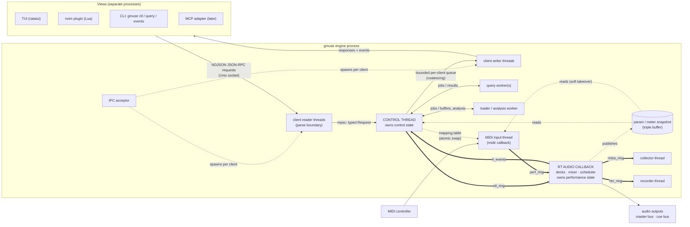
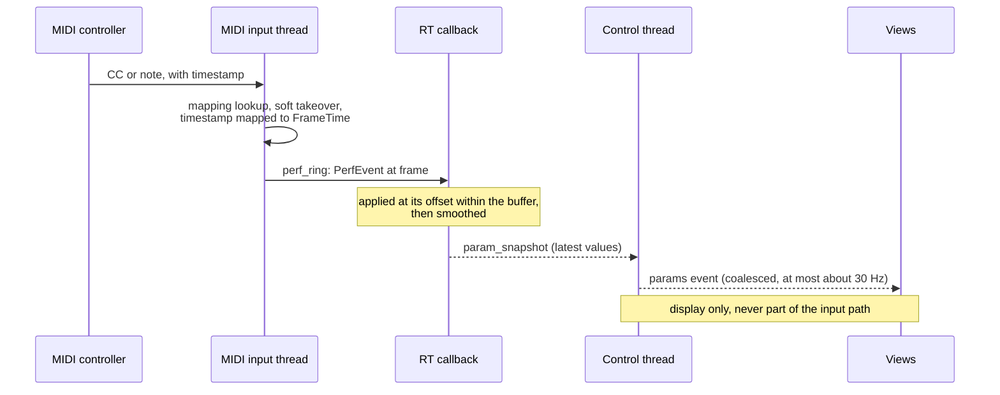
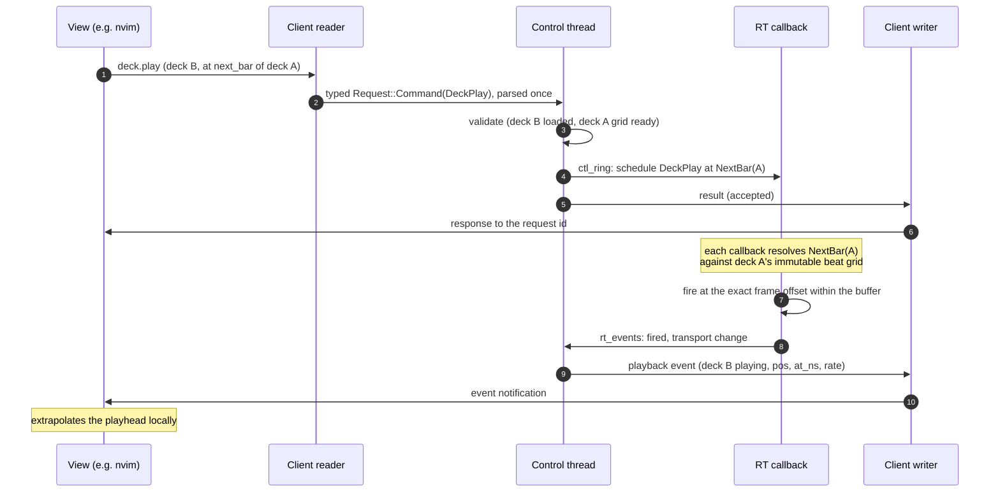

# GMUSE Engine / IPC Architecture

**Status:** Draft v0.2 (2026-09-11) **Audience:** implementing agent and project author **Scope:** process model, engine
threading, control-plane protocol, the library plane's interface, performance input, sample-accurate scheduling,
automation, and the view clients. **Out of scope (separate documents):** the library's _domain model_, query-language
semantics, sync architecture, and two-deck DJ mode.

v0.2 adds §8, the library plane. v0.1 scoped the library out entirely, which read as though the librarian did not exist
— and a document that fixes process boundaries cannot leave out half of what the process holds. What is out of scope is
the **model**; what belongs here is the **interface**: who reads, who writes, what crosses the socket, and what the
engine publishes when the library changes.

Normative keywords (MUST, MUST NOT, SHOULD, MAY) follow RFC 2119. Rust type sketches are illustrative: field names and
serde layout may change, but the boundaries and invariants may not change without revising this document.

Items marked **[verify]** are claims about third-party library behaviour that were not confirmed against current docs.
Check them before depending on them.

---

## 1. Summary

GMUSE is split into one long-running **engine** process and any number of **views**. The engine owns all domain and
audio state. The views are the TUI, the Neovim plugin, the CLI, and later an agent/MCP adapter and a macOS media-key
adapter. Views talk to the engine over a local Unix domain socket. Playback continues when views attach and detach, as
with tmux or mpd.

The engine has four planes and one feedback path.

- **The control plane** connects views and the engine through JSON-RPC 2.0 messages framed as NDJSON on a Unix socket.
  It is flexible, introspectable, and not time-critical. It carries commands, queries, subscriptions, and events.
- **The performance plane** carries MIDI (and later OSC) input through an engine input thread to the real-time audio
  callback. It never touches the socket or the control thread.
- **The audio plane** is the real-time callback: decks, mixer, scheduler, DSP, and the cue and master buses.
- **The library plane** is the librarian: the fact log, the projection folded from it, and the named operations that
  write. It lives in the engine process but is otherwise as separate from the audio plane as the two are from each
  other, and it is the one plane with a **second, non-socket access path** for bulk reads (§8).
- **The feedback path** runs from the RT callback to the control thread and then to views. It carries throttled,
  coalesced state for display.

**Guiding rule:** views send _intents_ and render _extrapolated state_. Anything timed to the sample or to a human
gesture lives inside the engine, next to the audio clock. The socket carries no audio-rate data and no timing.

**Precedents:** tmux (client/server in one binary, auto-starting server), mpd with ncmpcpp/mpc (including mpd's `idle`
subscription), Mopidy (a core with swappable frontends), `cmus-remote`, LSP and MCP (JSON-RPC between an engine and many
clients), and the router control-plane/data-plane split.

"Engine" here means the process, not the audio path: it holds the librarian as well. The two are separate subsystems
that happen to share an address space, for the reason §8 gives — the player consults the library continuously, and a
process boundary there would buy nothing.

This document revises the earlier three-thread invariant (UI, decoder, RT callback). The UI thread moves out of the
process, and its role inside the engine becomes the **control thread**. The decoder and RT callback invariants are
retained and made stricter. **That revision is not authorised by this document**: `music-player-tui.md` marks the
three-thread architecture INVARIANT, and its 2026-08-31 entry names it as one of three boundaries that may move only
when "argued and recorded here". This document is the argument; the Decision Log entry in that brief is what makes it
so, and it must be written before any of this is built.

---

## 2. Goals and non-goals

### Goals

- Several simultaneous views of one engine, all using the same public protocol.
- Every user-visible action is a named, typed, scriptable command, reachable from keys, the socket, the CLI, and the
  agent.
- DJ mode with sample-accurate quantized actions, low-latency MIDI performance input, a two-bus mixer (master and
  headphone cue), automation lanes, and mix recording.
- An engine that runs headless with a null audio backend, for tests and CI.
- No async runtime.

### Non-goals

- Network transparency. The socket is local only; there is no TCP listener.
- Multi-user access control beyond filesystem permissions on the socket.
- Streaming audio over IPC.
- Windows support.
- Real-time performance control _from views_. Views may edit automation and send control-plane parameter changes, but
  live gestures come from the performance plane.

---

## 3. Invariants

These are normative. A change that violates one requires revising this document first.

**I1. The engine never blocks on a view.** No engine thread may wait on a client socket write, a slow client, or
client-side state. Per-client output is bounded and non-blocking (see §7.10).

**I2. The RT callback is real-time safe.** It does not allocate or free memory, take locks, perform syscalls or file
I/O, log through a blocking logger, or run unbounded loops. It communicates only through lock-free SPSC rings (rtrb) and
atomics or lock-free snapshots. Heap objects that the RT side retires, such as old deck buffers or replaced lanes, are
sent back over a ring and dropped on another thread.

**I3. Each ring has one producer.** rtrb is single-producer, single-consumer. Each thread that sends to the RT callback
has its own ring (§5.2). Never share a producer handle between threads.

**I4. Each ingress has a single parse boundary.** Every ingress (socket JSON, `cmd.exec_line` text, CLI arguments, MIDI
bytes, and the keymap inside each view) parses into typed domain values exactly once, at its edge. Nothing downstream
handles untyped data. This extends the existing "typed `Command` enum as single parse boundary" decision.

**I5. There is no async runtime.** Use std threads, blocking Unix-socket I/O, and channels.

**I6. The control thread does only cheap state transitions.** Library queries, analysis, decoding, and file I/O run on
worker threads against snapshots. A cue press must never wait behind a query (head-of-line blocking).

**I7. Performance input never goes through the control thread or the socket.** MIDI and OSC go from the input thread to
the performance ring to the RT callback.

**I8. Timing never depends on message arrival.** A command that must happen at a musical moment carries a `When` (§10),
which the engine resolves against the audio clock. Arrival latency is therefore irrelevant for quantized actions.

**I9. Wire commands are context-free.** Commands carry explicit identifiers, never view state such as the cursor,
selection, or current pane. A view resolves "the thing under the cursor" into IDs before sending.

**I10. Only stable identities go on the wire.** Internal arena indices (`TrackId(u32)`) are never exposed bare. See
§7.6.

**I11. Every view is a protocol client, including the TUI.** No frontend gets privileged in-process access to the
engine's control or performance state, and no view holds authoritative state. A frontend that bypasses the protocol lets
the protocol decay. **Library reads are the one exemption, and are governed by I15 rather than by this rule.**

**I12. No audio-rate data crosses the socket.** Samples, per-sample positions, and meters at audio rate never go over
IPC. Waveform overviews and beat grids are analysis artifacts, sent once per track load.

**I13. The reported position is the sounding position.** Playback positions published to views are compensated for
output latency (§11.5).

**I14. The audio side owns performance state.** Fader, EQ, rate, crossfader, gain, and jog state live on the RT side.
The control thread and views hold read-only copies that come through the feedback path.

**I15. Library reads may bypass the socket; library writes may not.** A `shelf` read subcommand, `gmuse_core`, or a
Python tool may open the library directly and read it, with no engine running. Every **write** is one of the named
operations (§8.4) and goes through the librarian, which is the process's single appender. A direct read may be stale,
and that is safe by construction: nothing it produces is believed without being re-checked against current state when it
is applied (§8.3).

**I16. The control thread never folds and never scans.** It holds an `Arc<Catalogue>` and reads it. Folding is librarian
work, published by atomic swap (§8.5); a scan is a librarian job (§8.9). A full fold is hundreds of milliseconds, which
I6 does not permit.

**I17. Only user-facing grains cross the wire.** A recording is what a person chooses and may be referenced by a view; a
holding is which bytes on which device and may not. The librarian resolves one to the other (§8.6).

---

## 4. Components and process model

### 4.1 Process diagram

Diagrams in this document are Mermaid and are illustrative. Where a diagram and a table disagree, the table is
normative: the channel table in §5.2 governs the channels, and the ownership table in §6 governs state.

Thick edges are lock-free SPSC rings. Dotted edges are spawning, atomic publication, or snapshot reads.



### 4.2 Binary and subcommands

There is a single `gmuse` binary, following the tmux model:

| Invocation                                   | Behaviour                                                                                                            |
| -------------------------------------------- | -------------------------------------------------------------------------------------------------------------------- |
| `gmuse engine [--foreground] [--null-audio]` | Runs the engine daemon. `--null-audio` uses a virtual output clock (§14).                                            |
| `gmuse`                                      | Starts the TUI. Connects to the socket, spawns `gmuse engine` in the background if no engine answers, then attaches. |
| `gmuse ctl <command…>`                       | Sends one command, either typed arguments or passed through as `cmd.exec_line`, prints the result, and exits.        |
| `gmuse query <expr> [--json]`                | Runs a query and prints the results (NDJSON with `--json`).                                                          |
| `gmuse events [--topics …]`                  | Subscribes and prints events as NDJSON. Useful for debugging and for the agent.                                      |
| `gmuse mcp` (later)                          | Runs an MCP stdio server that maps tools onto protocol methods.                                                      |
| `gmuse shelf <op>`                           | The library operations. Read-only ones work with no engine (I15); writing ones go to the engine, auto-starting it.   |

This supersedes today's `--remote <CMD>`, which is a second, ad-hoc IPC mechanism over the same socket-shaped problem.
It should be removed rather than kept alongside: `gmuse ctl` is the same thing with a protocol behind it.

### 4.3 Crate layout

| Crate                      | Contents                                                                                                                                                                                          | Depends on                                                   |
| -------------------------- | ------------------------------------------------------------------------------------------------------------------------------------------------------------------------------------------------- | ------------------------------------------------------------ |
| `gmuse-ids`                | `Id<T>`, the UUIDv5 derivation, and the entity kinds. Tiny and dependency-free, so wire IDs can be real domain IDs without `gmuse-proto` depending on the librarian.                              | uuid                                                         |
| `gmuse-library`            | The librarian: facts, projection, query, and the named operations. Today's `src/facts`, `src/projection`, `src/query`, `src/operations`, `src/model`.                                             | gmuse-ids                                                    |
| `gmuse-proto`              | Wire types (requests, responses, events, errors, IDs, `When`, query AST), serde derives, protocol version constants, and optionally a JSON Schema export. It MUST NOT depend on engine internals. | gmuse-ids, serde, serde_json                                 |
| `gmuse-engine`             | Library crate: control thread, librarian thread, IPC server, RT processing, mixer, scheduler, input thread, and audio backend trait with cpal and null implementations.                           | gmuse-proto, gmuse-library, cpal, symphonia, rubato, rtrb, … |
| `gmuse-core` (PyO3)        | The Python extension the `tools/` passes read through. Depends on `gmuse-library` **directly**, not on the protocol — this is I15's read path, and it must keep working with no engine running.   | gmuse-library, pyo3                                          |
| `gmuse-client`             | Blocking socket client: connect, handshake, request/response correlation, event stream. Used by the TUI, CLI, and MCP adapter.                                                                    | gmuse-proto                                                  |
| `gmuse-tui`                | The ratatui view.                                                                                                                                                                                 | gmuse-client, ratatui, crossterm, nucleo                     |
| `gmuse` (bin)              | Subcommand dispatch.                                                                                                                                                                              | all of the above                                             |
| `nvim/` (Lua, not a crate) | The Neovim plugin.                                                                                                                                                                                | —                                                            |

### 4.4 Responsibilities

| Component                | Owns                                                        | Talks to                        | Must never                                                          |
| ------------------------ | ----------------------------------------------------------- | ------------------------------- | ------------------------------------------------------------------- |
| Control thread           | Control state (§6) and versions                             | Client channels, rings, workers | Run queries, do file I/O, block on clients                          |
| RT callback              | Performance state, deck playheads, the scheduled-event list | Rings, snapshot                 | Allocate, free, lock, do I/O (I2)                                   |
| MIDI input thread        | Nothing; stateless apart from soft-takeover pickup state    | `perf_ring`, mapping table      | Go through the control thread or socket                             |
| Query worker             | Nothing; reads immutable snapshots                          | Control thread                  | Mutate state                                                        |
| Loader / analysis worker | Nothing                                                     | Control thread                  | Hand buffers to RT except through the control thread and `ctl_ring` |
| Librarian                | The fact log and the projection                             | Control thread, disk            | Run on the control thread; be bypassed for a write (I15)            |
| Views                    | View state (§6)                                             | The socket only                 | Hold authoritative domain or performance state                      |

---

## 5. Engine threading model

### 5.1 Threads

| Thread                             | Role                                                                                                     | Notes                                                                                                                                                                                                                                                         |
| ---------------------------------- | -------------------------------------------------------------------------------------------------------- | ------------------------------------------------------------------------------------------------------------------------------------------------------------------------------------------------------------------------------------------------------------- |
| **RT audio callback**              | Renders audio: drains rings, runs the scheduler, decks, mixer, and DSP, publishes snapshots              | Owned by cpal. Hard real-time.                                                                                                                                                                                                                                |
| **Control thread**                 | Single owner of control state. Applies commands, assigns versions, emits events, dispatches jobs         | Previously the UI thread. Soft real-time: keep every step short. **Selects over requests, `rt_events` and a tick** — it must wake on its own to read `param_snapshot` and emit coalesced `params` and `meters` events (§7.8), so it is not a blocking `recv`. |
| **Decoder / loader**               | Decodes and prepares deck and playback buffers; loads analysis artifacts                                 | See the open question on decode strategy in §11.2.                                                                                                                                                                                                            |
| **IPC acceptor**                   | Accepts connections and spawns reader and writer threads per client                                      | Blocking `UnixListener::accept`.                                                                                                                                                                                                                              |
| **Client reader** (one per client) | Reads NDJSON lines, parses them into `Request` (the parse boundary), forwards them to the control thread | A malformed line gets an error response; the connection stays open.                                                                                                                                                                                           |
| **Client writer** (one per client) | Drains a bounded per-client queue to the socket                                                          | The only place a slow client is felt (§7.10).                                                                                                                                                                                                                 |
| **MIDI input**                     | midir callback thread. Maps messages to `PerfEvent`s and pushes to `perf_ring`                           | Latency-sensitive but not RT. May read the mapping table through an atomic pointer load.                                                                                                                                                                      |
| **Query worker(s)**                | Evaluate queries against an immutable library snapshot                                                   | Results carry `library_version`.                                                                                                                                                                                                                              |
| **Analysis worker**                | BPM/key detection, beat grids, waveform overviews                                                        | Results are persisted as analysis artifacts keyed on the audio hash.                                                                                                                                                                                          |
| **Librarian**                      | Owns the log and the projection. Appends facts, folds, publishes `Arc<Catalogue>` by atomic swap         | The process's single appender (I15). Never on the control thread (I16).                                                                                                                                                                                       |
| **Scanner** (job)                  | Reconciles holdings with the disk and appends what it finds                                              | 30–70s. Runs at engine start and on `library.scan` (§8.9).                                                                                                                                                                                                    |
| **Collector**                      | Drops heap objects retired by the RT side                                                                | Enforces I2.                                                                                                                                                                                                                                                  |
| **Recorder**                       | Writes captured master-bus audio and the performance log to disk                                         | Fed by `rec_ring`; the RT side never does file I/O.                                                                                                                                                                                                           |

A per-client writer thread is simple and adequate for a handful of clients. A single writer multiplexing non-blocking
sockets is an acceptable alternative if thread count ever matters.

### 5.2 Channels

| Channel            | Type                              | Producer → Consumer                                   | Carries                                                                                                                                                                                           |
| ------------------ | --------------------------------- | ----------------------------------------------------- | ------------------------------------------------------------------------------------------------------------------------------------------------------------------------------------------------- |
| `requests`         | std `mpsc` (or crossbeam-channel) | client readers → control                              | `(ClientId, RequestId, Request)`                                                                                                                                                                  |
| `client_out[c]`    | bounded, per client               | control → writer _c_                                  | Responses and events (coalescing policy in §7.10)                                                                                                                                                 |
| `ctl_ring`         | rtrb SPSC                         | control → RT                                          | `RtCommand`: load deck (owned buffer pointer), transport, `When`-scheduled actions, lane installs, routing changes                                                                                |
| `perf_ring`        | rtrb SPSC                         | MIDI input → RT                                       | `PerfEvent` (§9.3)                                                                                                                                                                                |
| `rt_events`        | rtrb SPSC                         | RT → control                                          | Transport transitions, scheduled event fired or missed, xruns                                                                                                                                     |
| `retire_ring`      | rtrb SPSC                         | RT → collector                                        | Retired heap objects (old deck buffers, replaced lanes, …) to be dropped off the RT thread. This is kept separate from `rt_events` so a large deallocation never runs on the control thread (I6). |
| `rec_ring`         | rtrb SPSC                         | RT → recorder                                         | Master-bus frames while recording                                                                                                                                                                 |
| `param_snapshot`   | triple buffer or seqlock          | RT → control (and the input thread for soft takeover) | Current value of every `ParamId`, deck playheads, meter peaks                                                                                                                                     |
| `mapping_table`    | atomic `Arc` swap (e.g. arc-swap) | control → MIDI input                                  | `MappingTable`                                                                                                                                                                                    |
| `catalogue`        | atomic `Arc` swap (e.g. arc-swap) | librarian → control, query workers                    | The folded projection. Readers hold a pointer; nobody but the librarian folds (I16).                                                                                                              |
| `library_jobs`     | std `mpsc`                        | control → librarian                                   | Named operations (§8.4), facts to append, `advance()` requests                                                                                                                                    |
| `jobs` / `results` | std `mpsc`                        | control ↔ workers                                     | Query, analysis, and load jobs                                                                                                                                                                    |

**Every ring needs a stated policy for being full**, because the RT side has no third option: it may not block and it
may not free.

| Ring          | When full                                                                                                                                                                                                                                           |
| ------------- | --------------------------------------------------------------------------------------------------------------------------------------------------------------------------------------------------------------------------------------------------- |
| `retire_ring` | **Leak the object deliberately** and bump a counter published alongside the xrun count. Freeing on the RT thread violates I2, so a bounded leak is the correct trade. Size the ring so this cannot happen in practice; a non-zero counter is a bug. |
| `rec_ring`    | **Stop the recording and report it.** Dropping frames silently corrupts the take — the worst outcome, and the one a naive implementation produces by default. A recording that stopped and said so is recoverable.                                  |
| `ctl_ring`    | The control thread sees it full and returns `ScheduleFull` (§7.13) rather than queueing.                                                                                                                                                            |
| `perf_ring`   | Drop the oldest event and bump a counter. A dropped gesture is better than a late one.                                                                                                                                                              |

The RT callback drains `ctl_ring` and `perf_ring` once per callback, in a fixed order (§10.3).

---

## 6. State ownership

| Kind                  | Owner          | Changed by                                                         | Examples                                                                                                                                                                                        |
| --------------------- | -------------- | ------------------------------------------------------------------ | ----------------------------------------------------------------------------------------------------------------------------------------------------------------------------------------------- |
| **Control state**     | Control thread | Protocol commands                                                  | Library snapshot pointer, the queue, playlists, `aaa_mode`, which recording is loaded on each deck, cue points, loops (as data), automation lanes, MIDI mapping table, settings, output routing |
| **Performance state** | RT callback    | Performance plane, automation lanes, and control-plane `param.set` | Fader and crossfader positions, EQ bands, deck rate, pitch bend and jog, gain, cue-bus selection                                                                                                |
| **Library state**     | Librarian      | Named operations (§8.4), and facts the player emits                | The fact log, the projection folded from it, holdings, the read cache. The control thread holds an `Arc` to the projection and nothing more.                                                    |
| **View state**        | Each view      | That view's own input                                              | Cursor, selection, scroll, which cmus-style view is shown, fuzzy-filter text and nucleo matcher state, keymap, pending modal state                                                              |

Consequences:

- Library state is listed separately from control state because it has a second access path (§8.1) and a different
  concurrency model (§8.8) — it is not merely a large field on the control thread.
- `aaa_mode` is control state because it determines what plays next. The cmus "views" (library tree, sorted list,
  playlist, queue, browser, filters, settings) are client-side layouts over queries.
- Fuzzy filtering with nucleo is per-keystroke interaction, so it runs in the TUI over a result set fetched from the
  engine. The nvim plugin uses its own picker.
- A view may _request_ a performance-state change through `param.set`, for example a volume change from a menu. The RT
  side still owns the value, and the change reaches the view only through the feedback path.

---

## 7. Control-plane protocol

### 7.1 Transport

- **Socket path:** `$GMUSE_SOCKET` if set. Otherwise `$XDG_RUNTIME_DIR/gmuse/engine.sock`, falling back to
  `$TMPDIR/gmuse/engine.sock` (on macOS, `$TMPDIR` is per-user).
- The directory MUST be mode `0700` and the socket `0600`.
- **Single instance:** the engine takes an exclusive `flock` on `engine.lock` in the same directory. If the socket file
  exists but connecting to it fails and the lock is free, the engine removes the stale socket and binds again.
- **Framing:** NDJSON. Each message is one UTF-8 JSON object terminated by `\n`. The maximum line length is 1 MiB;
  longer lines are rejected with an error and the line is discarded.
- **No batches.** JSON-RPC 2.0 permits a top-level array of requests; this protocol does not. One object per line, and a
  line beginning with `[` is a `-32600`. Said explicitly because claiming JSON-RPC 2.0 otherwise implies batch support.
- **Serialization:** JSON only on the socket. postcard remains available for internal use and sync bundles; it is not a
  wire format for views.

### 7.2 Envelope

The envelope is JSON-RPC 2.0.

- **Requests** from a view carry `id`, `method`, and `params`. The engine answers each with exactly one `result` or
  `error` carrying the same `id`.
- **Notifications** from a view carry no `id` and get no reply. Clients SHOULD use requests; notifications are allowed
  for fire-and-forget control.
- **Events** from the engine are notifications with `method: "event"`.
- **Responses have no ordering guarantee.** A client MUST correlate by `id`, and events may be interleaved with
  responses. This is not a licence the implementation may decline to use: queries run on workers and long library
  operations run on the librarian, so a response queue that preserved request order would make a cue press wait behind a
  scan — exactly the head-of-line blocking I6 exists to forbid.

### 7.3 Handshake

The first message on a connection MUST be `hello`:

```json
{
  "jsonrpc": "2.0",
  "id": 1,
  "method": "hello",
  "params": { "protocol": "gmuse/0", "client": "nvim", "client_version": "0.1.0" }
}
```

```json
{
  "jsonrpc": "2.0",
  "id": 1,
  "result": {
    "protocol": "gmuse/0",
    "engine_generation": "8f3a…",
    "stream_generation": 3,
    "engine_now_ns": 123456789012345,
    "sample_rate": 48000,
    "capabilities": ["dj", "automation", "midi"]
  }
}
```

- If the major version differs (`gmuse/N`), the engine returns an error and closes the connection. Minor features are
  advertised through `capabilities`.
- `engine_generation` is a random value chosen at engine start. It scopes any non-stable references (§7.6).
- `stream_generation` counts audio streams opened by this engine. **`FrameTime` is only meaningful within one
  generation** (§10.1): a device disappearing — unplugging the headphone interface mid-set is the likeliest hardware
  event in this design — kills the cpal stream, and the replacement starts counting frames from zero again. Every
  `playback` event carries the generation it was measured in, and a client MUST discard its extrapolation and re-query
  when the value changes. Without it a client silently extrapolates against a clock that has restarted.
- `engine_now_ns` lets the client estimate the clock offset (§7.9).

### 7.4 Method families

| Family        | Methods (illustrative)                                                                                                                                                                                                                                                                                        | Semantics                                                                                   |
| ------------- | ------------------------------------------------------------------------------------------------------------------------------------------------------------------------------------------------------------------------------------------------------------------------------------------------------------- | ------------------------------------------------------------------------------------------- |
| Session       | `hello`, `engine.status`, `engine.shutdown`, `time.now`                                                                                                                                                                                                                                                       | Lifecycle and clock                                                                         |
| Commands      | `player.play`, `player.pause`, `player.seek`, `queue.enqueue`, `queue.move`, `queue.remove`, `queue.clear`, `settings.set_aaa_mode`, `deck.load`, `deck.play`, `deck.cue`, `deck.loop`, `deck.sync`, `param.set`, `lane.put`, `lane.delete`, `mapping.learn`, `mapping.put`, `record.start`, `record.stop`, … | Mutations. Each is one variant of the typed `Command` enum.                                 |
| Text commands | `cmd.exec_line`                                                                                                                                                                                                                                                                                               | A cmus-style command line, parsed by the engine into `Command` (§7.12)                      |
| Library       | `library.apply`, `library.import`, `library.scan`, `library.restore`, `library.remove`, `library.compact`, `library.unfiled`, `library.edit`                                                                                                                                                                  | The named write operations (§8.4). Long-running ones acknowledge and report through events. |
| Queries       | `query.parse`, `query.run`, `queue.get`, `deck.get`, `lane.get`, `mapping.get`, `analysis.get`                                                                                                                                                                                                                | Reads                                                                                       |
| Subscriptions | `sub.subscribe`, `sub.unsubscribe`                                                                                                                                                                                                                                                                            | Topic-based event delivery (§7.8)                                                           |

Method names are part of the public API. Rename them only with a protocol version bump.

**Acknowledgement semantics.** A command's `result` means the command was _accepted_: it was validated, applied to
control state, and, if it is scheduled, placed on the RT schedule. It does not mean the command has _executed_ in the
audio. Execution is reported through events: a `playback` transition when the action fires, or an `engine` event
carrying `ScheduleMissed`. Views MUST NOT treat a `result` for a `When`-scheduled command as confirmation that it has
sounded (see the sequence in §10.4).

### 7.5 Typed mapping (single parse boundary)

Each client reader deserializes a line into one typed value. Everything after that point is typed.

```rust
// gmuse-proto (illustrative)
pub struct Envelope {
    pub id: Option<RequestId>,
    pub request: Request, // decoded from {"method", "params"}
}

pub enum Request {
    Hello(Hello),
    Command(Command),
    ExecLine { line: String },
    Query(QueryRequest),
    Subscribe { topics: Vec<Topic> },
    Unsubscribe { topics: Vec<Topic> },
    TimeNow,
    EngineStatus,
    EngineShutdown,
}

pub enum Command {
    Play,
    Pause,
    Seek { to: SeekTarget },
    Enqueue { ids: Vec<RecordingRef>, at: InsertAt, base_version: Option<Version> },
    QueueMove { from: usize, to: usize, base_version: Version },
    QueueRemove { indices: Vec<usize>, base_version: Version },
    SetAaaMode(AaaMode),
    DeckLoad { deck: DeckId, id: RecordingRef },
    DeckPlay { deck: DeckId, at: When },
    DeckCue { deck: DeckId, at: When },
    DeckLoop { deck: DeckId, start: When, beats: u16 },
    DeckSync { deck: DeckId, master: DeckId },
    ParamSet { param: ParamId, value: f32, at: When },
    LanePut { lane: Lane, base_version: Option<Version> },
    MappingLearn { target: BindingTarget },
    // …
}
```

The exact serde attributes (for example adjacent tagging on `method`/`params`) are left to the implementer. The
constraints are that method names are stable strings and parsing happens in exactly one place.

### 7.6 Identity on the wire

- Views, scripts, nvim buffers, and the agent may hold IDs across reconnects and engine restarts, so wire IDs MUST be
  stable.
- The target is stable domain identities (`RecordingRef` and friends), derived from the library's content-addressed
  identity. **This depends on resolving the open `AudioId` vs `Id<T>` contradiction in the domain model.**
- **Only user-facing grains cross the wire** (I17). `RecordingRef` names a performance; a holding names which bytes on
  which device and stays inside the librarian, which resolves one to the other (§8.6). A holding is device-scoped, so
  putting one on the wire would publish a reference that means nothing on the next machine.
- **Interim:** until that is settled, references MAY be `EngineRef { generation, index }`. The engine rejects any
  reference whose `generation` does not match the running engine with `StaleReference`. A bare `u32` MUST NOT appear on
  the wire.

### 7.7 Versioned collections and concurrent edits

- Any collection that more than one view can edit carries a monotonically increasing `Version`. This covers the queue,
  playlists, lanes, cue lists, and the mapping table.
- A mutation carries `base_version`. If it doesn't match the current version, the engine rejects the edit with
  `StaleVersion { current }`. The client then refetches and retries or reports the conflict.
- Every successful mutation returns the new version in its result.
- `base_version` is optional for append-like commands whose meaning doesn't depend on current contents, such as
  `Enqueue` at the end of the queue.
- **None of this applies to `library.*`.** The log is append-only and convergently minted, so two writes union rather
  than conflict and there is no lost update to detect. See §8.8 for what is checked instead.

### 7.8 Events

Topics:

| Topic      | Payload                                                             | Rate                           |
| ---------- | ------------------------------------------------------------------- | ------------------------------ |
| `playback` | Transport state for the main player and each deck (see below)       | On change only                 |
| `queue`    | `{version}`, optionally with a small diff                           | On change                      |
| `library`  | `{version, scope, ids?}` — shaped by the fact's blast radius (§8.7) | On change                      |
| `decks`    | Load state, analysis readiness, sync master                         | On change                      |
| `params`   | Changed `ParamId` values                                            | Coalesced, at most about 30 Hz |
| `meters`   | Peak and RMS per bus                                                | Optional, at most about 30 Hz  |
| `engine`   | Status, errors, xruns, `resync_required`                            | On occurrence                  |

Events describe _state_, not a sequence of edits that must be replayed. A client that misses events can always recover
by re-querying. This is what allows the coalescing in §7.10.

The playback payload is:

```json
{
  "topic": "playback",
  "deck": "A",
  "state": "playing",
  "recording": "…",
  "pos_frames": 1234567,
  "stream_generation": 3,
  "sample_rate": 48000,
  "at_ns": 123456789999000,
  "rate": 1.02
}
```

Clients extrapolate position locally and redraw on their own timer:

```
pos(t) = pos_frames + (t_engine_ns − at_ns) · 1e-9 · rate · sample_rate    (while playing)
```

The engine emits a new `playback` event only when the state, rate, or position changes discontinuously: play, pause,
seek, rate change (varispeed is just a rate change), track change, or loop wrap. It never emits a steady position
stream.

### 7.9 Clock

- `at_ns` and `engine_now_ns` are nanoseconds on the engine's monotonic clock.
- A client estimates `offset = engine_now_ns − client_monotonic_at_receive` from `hello`, and MAY refine it with
  `time.now`. The error is bounded by one-way socket latency, which is microseconds.
- Clients MUST NOT assume the engine clock and the client clock share an epoch.

### 7.10 Backpressure and robustness

- Each client's outbound queue is bounded.
- When the queue is under pressure, events are **coalesced latest-wins per topic, and per deck or param where
  relevant**. Responses are never dropped.
- If the queue still overflows, pending events are discarded, one `engine` event with `resync_required` is queued, and
  the client must re-query. A client that stays over the limit MAY be disconnected.
- A malformed line produces a `-32700` or `-32600` error response. The connection remains open.
- Client disconnect is a non-event for the engine: its subscriptions are dropped and nothing else changes.

### 7.11 Queries

- The engine owns the query-language parser. `query.parse { text }` returns either the core AST or
  `QueryParse { message, span }`. Clients MUST NOT reimplement the parser.
- `query.run { query: Text(String) | Ast(QueryAst), page: { limit, cursor? } }` returns
  `{ rows, next_cursor?, library_version }`. It runs on a query worker against the snapshot at `library_version`.
- Query-language semantics are defined elsewhere. Open issues from the query-language critique (surface/core
  round-tripping and others) block only `query.*`, not the rest of this protocol.

### 7.12 Text commands

- `cmd.exec_line { line }` accepts the cmus-style command language (for example `seek +10`, `set aaa_mode=album`) and
  parses it engine-side into `Command`.
- The TUI's `:` line, nvim's `:Gmuse …`, and `gmuse ctl` pass-through all use it, so there is exactly one textual
  command parser.
- Typed JSON commands remain canonical; the text form is a convenience that is parsed once at its own boundary.

### 7.13 Errors

| Code   | Name             | Data                                                                    |
| ------ | ---------------- | ----------------------------------------------------------------------- |
| −32700 | Parse error      | —                                                                       |
| −32600 | Invalid request  | —                                                                       |
| −32601 | Method not found | —                                                                       |
| −32602 | Invalid params   | `{field, message}`                                                      |
| 1001   | `StaleVersion`   | `{current}`                                                             |
| 1002   | `StaleReference` | `{expected_generation}`                                                 |
| 1003   | `NotFound`       | `{ref}`                                                                 |
| 1004   | `QueryParse`     | `{message, span}`                                                       |
| 1005   | `CommandParse`   | `{message, span}` (for `cmd.exec_line`)                                 |
| 1006   | `ScheduleFull`   | — (RT scheduled-event capacity reached)                                 |
| 1007   | `NotReady`       | `{reason}` (for example, analysis missing for a beat-quantized command) |
| 1008   | `Unsupported`    | `{capability}`                                                          |

### 7.14 Example transcript

```
→ {"jsonrpc":"2.0","id":1,"method":"hello","params":{"protocol":"gmuse/0","client":"cli"}}
← {"jsonrpc":"2.0","id":1,"result":{"protocol":"gmuse/0","engine_generation":"8f3a…","engine_now_ns":…}}
→ {"jsonrpc":"2.0","id":2,"method":"sub.subscribe","params":{"topics":["playback","queue"]}}
← {"jsonrpc":"2.0","id":2,"result":{}}
→ {"jsonrpc":"2.0","id":3,"method":"queue.enqueue","params":{"ids":["rec:…"],"at":"end"}}
← {"jsonrpc":"2.0","id":3,"result":{"version":42}}
← {"jsonrpc":"2.0","method":"event","params":{"topic":"queue","version":42}}
→ {"jsonrpc":"2.0","id":4,"method":"deck.play","params":{"deck":"B","at":{"next_bar":{"deck":"A"}}}}
← {"jsonrpc":"2.0","id":4,"result":{}}
← {"jsonrpc":"2.0","method":"event","params":{"topic":"playback","deck":"B","state":"playing",…}}
```

---

## 8. Library plane

The librarian owns the fact log and the projection folded from it. It runs **inside the engine process**, on its own
thread, and it is not the control thread.

In-process because the player needs the library continuously — what plays next, how the queue resolves, what `aaa_mode`
means for an album. A process boundary in that path would buy nothing. The RT callback is insulated regardless: I2 means
it never allocates and never locks, so a scan or a fold on a librarian thread cannot reach it.

The domain model itself is out of scope here (`domain-model.md`, `library-api.md`, `access-layers.md`). What this
section fixes is the **interface**: who may read, who may write, what crosses the socket, and what the engine publishes
when the library changes.

### 8.1 Two access paths

The control and performance planes exist because time-critical input must not queue behind flexible input. The library
needs the same split for a different reason: **bulk work must not queue behind interactive work.**

| Path                          | Used by                                                  | Carries                                               |
| ----------------------------- | -------------------------------------------------------- | ----------------------------------------------------- |
| **The socket** (§7)           | Views, and anything interactive                          | Queries with paging, named operations, library events |
| **Direct, in-process** (read) | `shelf` read subcommands, `gmuse_core`, the Python tools | Bulk reads of the whole library                       |

A measuring pass opens 7,267 files. A single identification run takes an hour against a rate limit. Neither belongs on a
JSON socket, and neither needs the engine to be running.

### 8.2 Reads may bypass. Writes may not.

- **Reads** may open the library directly. No engine required.
- **Writes** are the named operations of §8.4 and go through the librarian, which is the process's single appender.

Single-appender is what buys the append-only log its simplicity here: no append lock, no interleaved records, no torn
writes, and the engine always knows the log changed rather than having to poll for it.

### 8.3 Why a stale direct read is safe

This looks like a shortcut and is not. A tool reads a snapshot, spends an hour, and proposes against ids the library may
have changed underneath it.

That path is already designed for. **Nothing a read produces is believed without being re-checked against current state
at the moment it is applied**: `apply` tests each proposal's subject against the library as it stands and reports a
stale one as `unknown` rather than writing it. The same shape as identifying a release from a tag — the outside world
nominates, the library confirms, and the confirmation happens at write time rather than read time.

So the staleness window is real and harmless. What would _not_ be safe is a write path that skipped the check, which is
why writes are the half that does not get to bypass.

### 8.4 Named operations

`library-api.md` requires that nothing be implicit: import, relink and forget are named operations, a scan reconciles
holdings and reads no tags. Those names are the write surface, and there is no other one.

| Method            | Today's equivalent | Notes                                                         |
| ----------------- | ------------------ | ------------------------------------------------------------- |
| `library.apply`   | `shelf apply`      | A file of proposed facts, each checked before it is appended  |
| `library.import`  | `shelf import`     | Catalogue this audio                                          |
| `library.scan`    | `shelf scan`       | Reconcile holdings with what is on disk. Long-running (§8.7)  |
| `library.restore` | `shelf restore`    | Retire or bring back copies                                   |
| `library.remove`  | `shelf remove`     | —                                                             |
| `library.compact` | `shelf compact`    | Drop holdings assertions nothing reads. Long-running          |
| `library.unfiled` | `shelf unfiled`    | File whatever is in no collection                             |
| `library.edit`    | —                  | The facts a view emits directly: collections, ratings, merges |

Read-only `shelf` subcommands — `query`, `render`, `duplicates`, `copies`, `slots`, `verify`, `artists`, `names`, `tree`
— have no method here. They read directly, and several of them are explicitly **reported, never decided**: their output
is a decision brief for a person, which is not a thing to put behind an RPC that returns a result.

### 8.5 The fold, and who does it

Folding is **position-driven, not event-driven** — `access-layers.md` settles this, and the reasons survive intact here:
facts do not only arrive by local append (another device's log merges in), appends come in batches of thousands, and a
failed projection write must not fail an append.

```
advance():  fold from projection.position() to facts.head()
            equal  -> a no-op, one integer comparison
            behind -> fold exactly the gap
```

- Any operation that appended calls `advance()` once when its batch is done.
- A read may call it too. It is cheap and touches only the log.
- **A read may never scan.** A scan is upstream of the log, so nothing downstream can trigger one.

The librarian publishes the result as an `Arc<Catalogue>` by atomic swap — the same mechanism `mapping_table` already
uses for the input thread (§5.2). The control thread and the query workers hold a pointer and never fold: a full fold is
hundreds of milliseconds on this library, which I6 does not permit on the control thread (I16).

### 8.6 What crosses the wire, and at what grain

The library has four grains — recording, appearance, encoding, holding. **Only the user-facing ones go on the wire.**

- A **recording** is what a person chooses: a performance, whatever it is held as. `RecordingRef` is what
  `queue.enqueue` and `deck.load` carry.
- A **holding** is which bytes on which device. It is not user-facing and does not appear in the protocol.

`deck.load { deck, id: RecordingRef }` therefore under-specifies nothing: the **librarian resolves the recording to a
holding** and hands the deck the bytes. One recording may be held as a FLAC and an MP3 (#159) — picking between them is
librarian work against this device's holdings, not a choice to push into a view or onto the wire.

This keeps I10 honest for free. A holding is device-scoped, so putting one on the wire would be publishing a reference
that means nothing to the next machine.

### 8.7 Events: the blast radius is the payload

A `library` event that said only "something changed" would force every view to re-query everything on every fact. The
fact log already classifies this: `Fact::blast()` returns **Narrow** (the fact names its subject), **Wide** (the
affected set is not derivable from the fact), or **Rebuild**.

That maps directly onto what a view needs to be told:

```json
{ "topic": "library", "version": 918273, "scope": "ids", "ids": ["rec:8f3a…", "rel:12b4…"] }
```

| `scope`     | From      | The view should                         |
| ----------- | --------- | --------------------------------------- |
| `"ids"`     | `Narrow`  | Refresh exactly these rows              |
| `"wide"`    | `Wide`    | Re-query whatever it currently displays |
| `"rebuild"` | `Rebuild` | Drop caches and re-query from scratch   |

These coalesce as a lattice, which is what makes §7.10's latest-wins policy well-defined for this topic: two `ids`
events union their lists, `ids` plus `wide` is `wide`, and anything plus `rebuild` is `rebuild`.

`version` is the engine's log position. It is a scalar because the engine is the single appender; facts arriving from
another device come in through an import the engine also performs. It is **not** a global version across devices — sync
identity is a vector clock and lives in the sync design, not on this wire.

### 8.8 No optimistic concurrency on library writes

§7.7's `base_version` / `StaleVersion` applies to mutable collections that two views can edit: the queue, playlists,
lanes, cue lists, the mapping table.

It does **not** apply to library writes, and this is not an oversight. The log is append-only and convergently minted:
two appends union rather than conflict, and two devices that never spoke derive the same id for the same thing. There is
no lost update to detect, so a version check here would be a guard that can never fire — and a guard that never fires is
one a reader will eventually assume is doing something.

What replaces it is the check that does fire: a proposal whose subject the library no longer holds is refused at apply
time (§8.3).

### 8.9 The scan

A scan is filesystem I/O that produces facts, and it takes 30–70 seconds on this library.

- It runs **at engine start**, per the 2026-09-10 decision that a stale cache is the worse failure. Because the engine
  outlives any view, attaching and detaching a TUI does not re-scan — the cost is paid once per engine lifetime rather
  than once per launch.
- It runs on a librarian job thread, never on the control thread.
- It is long-running, so `library.scan` returns once **accepted** and reports progress and completion through `library`
  events — the same acknowledgement semantics §7.4 gives scheduled commands. This is strictly better than today, where a
  scan is a blocking CLI invocation with nowhere to show progress.

### 8.10 Playback writes facts

Playing a track appends `Fact::RecordingPlayed`. The RT callback cannot write it (I2) and the control thread must not do
file I/O (I6), so the control thread observes the transition through `rt_events` and hands the librarian a fact to
append. Ratings and other in-session edits take the same route.

## 9. Performance plane

### 9.1 Ingress

- The engine opens MIDI devices directly through midir (CoreMIDI on macOS). midir's callback thread _is_ the input
  thread.
- OSC over UDP (for example from a tablet surface) MAY be added later. It MUST feed the same mapping step and
  `perf_ring`, but because rtrb is SPSC it needs its own ring (I3).
- Performance input never uses the Unix socket.

### 9.2 Mapping table

```rust
pub struct MappingTable {
    pub bindings: HashMap<MidiKey, Binding>,
}

pub struct MidiKey {
    pub port: PortId,
    pub status: u8,
    pub channel: u8,
    pub number: u8,
}

pub enum Binding {
    Param { param: ParamId, transform: Transform, takeover: Takeover },
    Relative { param: ParamId, step: f32 },  // endless encoders, jog wheels
    Trigger { action: PerfAction },          // cue, play, loop-in, hot cue n, …
}
```

- The table is control state, edited through `mapping.put` and `mapping.learn`, and published to the input thread by
  atomic pointer swap.
- **MIDI learn flow:** `mapping.learn { target }` arms learn mode. The input thread reports the next message it sees,
  and the control thread installs the binding, bumps the table version, and emits an event. The mapping is edited
  through the protocol; the messages it routes never touch the protocol.
- Mappings persist as control state.

### 9.3 Events into the RT side

```rust
pub struct PerfEvent {
    pub at: FrameTime, // engine output-frame clock (§10.1)
    pub kind: PerfKind,
}

pub enum PerfKind {
    SetParam(ParamId, f32),
    NudgeRate { deck: DeckId, delta: f32 },
    Jog { deck: DeckId, ticks: i32 },
    Trigger(PerfAction),
    Touch { param: ParamId, touching: bool }, // for automation touch mode (§12)
}
```

### 9.4 Timestamps

- Incoming MIDI messages carry timestamps. The input thread maps each one into the engine's output-frame clock, using
  the mapping between frame time and host time that the RT side publishes from cpal callback timestamps.
- The RT side applies events at their frame offset _within_ the buffer (§10.2), not at buffer boundaries. Otherwise
  every unquantized press gets up to one buffer of jitter.
- An event whose target frame is earlier than the current buffer start is applied at offset 0.
- **[verify]** Check midir's timestamp base on CoreMIDI, and how it relates to the host time behind cpal's
  `StreamInstant`. This is the clock-alignment open question in §16.

### 9.5 Absolute vs relative controls, and soft takeover

- Absolute controls (faders, pots) send positions; relative controls (encoders, jog wheels) send deltas.
- After the parameter has been moved by something other than the physical control (automation, `param.set` from a view,
  a preset), the next movement of an absolute control would make the value jump. Absolute bindings therefore use **soft
  takeover**: incoming values are ignored until the physical control crosses the current parameter value (read from
  `param_snapshot`), after which it tracks normally. This is the same approach Mixxx uses.
- Relative controls need no takeover.

### 9.6 Smoothing

- Continuous parameters are smoothed on the RT side, with a 10–20 ms ramp per `ParamId`, consistent with the mixer EQ
  design. Smoothing also absorbs residual arrival jitter.
- Triggers (cue, play, hot-cue jumps) are not smoothed, but discontinuous playhead jumps MUST be declicked with a short
  crossfade of a few milliseconds.

### 9.7 Sequence: a live gesture



---

## 10. Audio plane: scheduling

### 10.1 `When`

```rust
pub enum When {
    Now,                                     // offset 0 of the next processed buffer
    Frame(FrameTime),                        // engine output-frame clock
    TrackFrame { deck: DeckId, frame: u64 }, // fires when that deck's playhead crosses `frame`
    NextBeat { deck: DeckId },
    NextBar { deck: DeckId },
    Beat { deck: DeckId, index: BeatIndex },
}
```

- `FrameTime` (u64) counts frames rendered since the current stream started. It is the engine's authoritative clock, and
  it is **scoped to a `stream_generation`** (§7.3). When a stream dies and is replaced, the engine bumps the generation,
  drops every pending scheduled event with `ScheduleMissed`, and emits `playback` events carrying the new generation. A
  `When::Frame` from a previous generation is refused, not reinterpreted.
- **Beat-relative variants are resolved by the RT callback**, not the control thread. The deck's beat grid is immutable
  per load and is delivered to the RT side together with the deck buffer (reading an immutable array is RT-safe).
  Resolving at processing time removes the race where a "next beat" computed on the control thread has already passed by
  the time the command arrives.
- Beat-relative targets resolve to track positions, so they automatically follow varispeed.
- If a beat-relative command targets a deck whose grid isn't available yet, the control thread rejects it with
  `NotReady`.

### 10.2 Sub-block processing

- The RT callback keeps a fixed-capacity, preallocated list of pending scheduled events. The control thread tracks how
  full it is and rejects commands that would overflow it with `ScheduleFull`.
- Each callback splits the buffer into segments at event offsets and renders each segment with the state in force for
  it. Timing resolution is one frame, independent of buffer size. This is the "buffer-size-independent DSP" requirement.

### 10.3 Ordering and missed targets

- Rings are drained in a fixed order each callback: `perf_ring`, then `ctl_ring`. Events at the same frame apply in
  (ring order, then enqueue order). This is deterministic and documented, not musically meaningful.
- An explicit `Beat { index }` or `TrackFrame` target that has already passed when first processed is dropped, and
  `ScheduleMissed` is reported through `rt_events`. It is never fired late silently.
- `NextBeat` and `NextBar` cannot miss.

### 10.4 Sequence: a quantized command



The response (step 6) arrives before the action sounds. Arrival latency anywhere in steps 1–5 is irrelevant as long as
the command is accepted before the target bar.

---

## 11. Decks, mixer, buffers

### 11.1 Buses

- The **master bus** feeds the main output. The **cue bus** feeds the headphone output (a separate device, or a channel
  pair on the same interface).
- Per-deck cue enable and cue/master mix are performance parameters.
- **Mix recording** taps the master bus into `rec_ring`, and the recorder thread writes it to disk. During recording the
  performance log (§12.3) is written alongside.

### 11.2 Decode strategy (settled in direction, deferred in detail)

- DJ operations (loops, cue jumps, reverse playback, scratching) need random access to decoded audio around the
  playhead, which a forward-streaming decoder doesn't provide.
- **Decks fully decode into RAM at load**, on the loader thread. A 6-minute stereo track at 48 kHz is about 138 MB as
  f32, or about 69 MB as i16. This is not a leaning: continuous varispeed, jog and reverse over a streaming decoder is
  not a thing that can be made to work, so the memory is the price of the feature.
- **Ordinary library playback streams.** Long tracks and full albums make full decoding wasteful, and none of the
  random-access operations apply.
- The two paths are therefore different, and the decoder thread's design must not harden around streaming only.
- **Everything else about two-deck DJ mode — buffer lifecycle, scratch modelling, what a deck _is_ — is its own design
  phase and is deliberately not settled here.** What this document fixes is that the engine has room for it: decks own
  their buffers, buffers are allocated off the RT thread, and `retire_ring` already exists to take them back.
- Deck buffers are allocated off the RT thread, handed over through `ctl_ring` as owned pointers, and returned through
  `retire_ring` to the collector (I2).

### 11.3 Rate, varispeed, scratch

- Varispeed and beatmatching use rubato with a smoothed ratio.
- **[verify]** rubato's sinc resamplers are believed to allow only a bounded relative range of ratio change around the
  configured ratio, and they do not handle reverse playback.
- Scratch mode therefore uses a separate, simpler interpolator (cubic or Hermite) that reads the deck buffer at platter
  velocity, including near zero and in reverse. Crossfade between the resampler and the scratch path when switching
  modes.

### 11.4 Analysis artifacts

- Beat grids, BPM, key, and waveform overviews (peak and RMS at a few resolutions) are computed by the analysis worker
  and stored keyed on the audio-stream hash, like cue points.
- They are delivered once per load: the grid to the RT side, and waveform overviews to views through `analysis.get`.
  They never stream.

### 11.5 Sounding position

- cpal's output callback info provides both a callback instant and a playback instant
  (`OutputCallbackInfo::timestamp()`). **[verify]** Confirm the exact API in the pinned cpal version.
- The RT side publishes the frame-to-host-time mapping using the _playback_ instant, so `at_ns` in `playback` events and
  the MIDI timestamp mapping both refer to when audio reaches the output, not when it was computed.
- Without this, waveform playheads sit visibly ahead of the audio.

---

## 12. Automation

### 12.1 Lanes

```rust
pub struct Lane {
    pub param: ParamId,
    pub points: Vec<(When, f32, Curve)>,
}

pub enum Curve {
    Step,
    Linear,
    Exponential,
    SCurve,
}
```

- A lane is control state, versioned, and edited through `lane.put`. One message carries the whole lane; editing is
  ordinary control-plane work and never real-time.
- The control thread builds an RT-ready representation off the RT thread and installs it through `ctl_ring`. The old
  lane is sent through `retire_ring` to the collector.
- The RT side interpolates lanes sample-accurately within the sub-block processing of §10.2.

### 12.2 Modes and precedence

Each parameter has a mode that decides who wins when a lane and live input target the same `ParamId`:

| Mode    | Behaviour                                                                                                                                                                                                   |
| ------- | ----------------------------------------------------------------------------------------------------------------------------------------------------------------------------------------------------------- |
| `Off`   | The lane is ignored; live input and `param.set` apply.                                                                                                                                                      |
| `Read`  | The lane wins; live input is ignored.                                                                                                                                                                       |
| `Touch` | Live input overrides while the control is being touched (`PerfKind::Touch`, or an inactivity timeout for controls without touch sensing), then the parameter hands back to the lane with a smoothed return. |
| `Latch` | Live input wins from the first touch until playback stops or the mode changes.                                                                                                                              |
| `Write` | Live input applies and is recorded into the lane (§12.3).                                                                                                                                                   |

A control-plane `param.set` counts as a touch for precedence purposes.

### 12.3 Performance log

- Live gestures and automation are the same kind of data: timestamped parameter values from different sources.
- The engine MAY log every applied `PerfEvent` with its `FrameTime` as an append-only performance log. This parallels
  the append-only Listen log.
- The log feeds `Write` mode (turning a gesture into a lane), replayable and editable mixes, and mix recording metadata.
- The log is written by the recorder thread from a ring, never by the RT side directly.

---

## 13. Views

### 13.1 TUI (`gmuse-tui`)

- Built on ratatui and crossterm, and connects through `gmuse-client` like every other view (I11).
- Auto-starts the engine if it isn't running.
- Its keymap maps crossterm key events to `Command` locally. The cmus interaction model (views, keybindings, `aaa_mode`
  semantics) is the UX target.
- The vim-style modal input layer (modes, counts, operator-pending state, a configurable keymap) SHOULD be a small
  reusable module so other Rust TUIs can share it.
- The cmus views are client-side layouts over queries; the `:` line uses `cmd.exec_line`; fuzzy filtering uses nucleo
  locally.
- **Keyboard DJ control is not a design dependency.** Hold-to-preview needs key-release events. Those require the kitty
  keyboard protocol, requested with crossterm's keyboard enhancement flags (`REPORT_EVENT_TYPES`). **[verify]** tmux is
  believed not to forward release events, so a keyboard DJ view would have to run directly in kitty. MIDI is the
  intended performance ingress.

### 13.2 Neovim plugin (`nvim/`)

- **Transport:** a `vim.uv` pipe connected to the socket, line buffering, and `vim.json` for encoding and decoding.
  Every buffer or UI mutation from an event MUST go through `vim.schedule`.
- **Queue as buffer, oil-style:** one line per entry, with the stable ID kept in an extmark or a concealed prefix.
  - `:w` diffs the buffer against the snapshot taken at the last `queue.get` and emits `queue.move` and `queue.remove`
    commands against `base_version`.
  - On `StaleVersion`, the plugin refetches and reports the conflict rather than overwriting.
- **Library browsing:** buffers populated by `query.run`, with paging.
- **Search:** snacks.picker or fzf-lua, fed by `query.run`.
- **Status line:** now-playing shown in the status line and driven by `playback` events, with position drawn by a local
  timer using the extrapolation formula in §7.8.
- **Commands:** `:Gmuse <line>` sends the line through `cmd.exec_line`.

### 13.3 CLI

- `gmuse ctl`, `gmuse query`, and `gmuse events` (§4.2).
- `--json` output is stable NDJSON, suitable for jq, fzf pipelines, and the agent.

### 13.4 Later adapters

- **MCP adapter** (`gmuse mcp`): a stdio MCP server exposing tools that map one-to-one onto protocol methods. Tool
  schemas MAY be generated from `gmuse-proto`, for example with schemars.
  - **One-to-one is the wrong default for the whole surface.** `engine.shutdown`, `cmd.exec_line` (an open-ended command
    language) and the `library.*` writes are not things to hand an agent by default. The adapter exposes an explicit
    allow-list, and destructive library operations stay off it — consistent with `shelf copies`, `shelf slots` and
    friends being **reported, never decided**: those exist to brief a person, and an agent acting on one unasked is the
    exact failure they were designed against.
- **macOS Now Playing and media keys:** an adapter process that subscribes to `playback` and sends `player.*` commands.

---

## 14. Testing strategy

- **Protocol types:** serde round-trip tests for every `Request`, response, and event type. Golden NDJSON transcripts
  are checked into the repo, and changing a golden file is a deliberate API change.
- **Parse boundaries:** property tests or fuzzing of each boundary: socket JSON, `cmd.exec_line`, `query.parse`, and
  MIDI byte parsing. Malformed input must produce errors, never panics.
- **Null audio backend:** an `AudioBackend` trait with cpal and null implementations. The null backend drives the RT
  processing function from a virtual clock, faster than real time if needed. The engine must run fully headless under
  `--null-audio` for tests and CI.
- **RT processing as a plain function:** the core render step (`process(&mut RtState, out: &mut [f32], frames, clock)`)
  is callable without cpal.
  - Test sample-accurate scheduling by scheduling an impulse or step at frame _N_ and asserting the discontinuity lands
    exactly at _N_ across buffer sizes of 64, 256, and 1024.
  - Also test beat-relative resolution under varispeed, soft takeover, and each automation mode.
- **RT safety:** wrap the callback in an allocation guard in debug builds (for example the `assert_no_alloc` crate) so
  an accidental allocation fails loudly.
- **Integration:** spawn `gmuse engine --null-audio`, drive it with `gmuse ctl` or `gmuse-client`, and assert on the
  `gmuse events` transcript. Include a concurrent-edit test (two clients, `StaleVersion`) and a slow-client test
  (coalescing and `resync_required`).

---

## 15. Phased implementation plan

Each phase ends with its tests passing. Earlier phases MUST NOT take shortcuts that violate the invariants, even
temporarily; in particular, the TUI never gets in-process access.

0. **Record the Decision Log entry** in `music-player-tui.md` that authorises revising the three-thread INVARIANT.
   Nothing below may be built first. _Exit:_ the entry exists and names what moved and why.
1. **Extract the engine.** Split `gmuse-ids`, `gmuse-library`, `gmuse-proto` and `gmuse-engine`; move the decoder and RT
   callback into the engine library; move the librarian onto its own thread behind an `Arc<Catalogue>` swap. Rename the
   UI thread's role to the control thread and add the null backend. `gmuse_core` keeps reading `gmuse-library` directly
   — if that breaks, I15 has been violated. _Exit:_ the headless engine plays a queue under `--null-audio`, and the
   Python tools still run with no engine present.
2. **Control plane.** Add the Unix socket server, NDJSON JSON-RPC envelope, handshake, commands, `queue.*`,
   subscriptions and `playback` events, versioning, backpressure, and `gmuse-client`, plus `gmuse ctl`, `gmuse events`,
   and golden transcripts. _Exit:_ the engine can be controlled entirely from the CLI.
3. **Library plane.** The `library.*` named operations, the scan at engine start, blast-radius-shaped `library` events,
   and the writing `shelf` subcommands routed through the engine. _Exit:_ a fact appended by one client reaches another
   as a `scope: "ids"` event naming exactly what changed, and no process but the engine appends.
4. **TUI as a client.** Port the existing TUI onto `gmuse-client` with auto-start and move the keymap client-side.
   _Exit:_ day-to-day cmus replacement works through the socket.
5. **nvim plugin v0.** Connection, status line, the queue as a buffer with diff-to-commands, and `:Gmuse`. _Exit:_ the
   queue can be edited from nvim while the TUI stays in sync through events.
6. **Scheduling.** Add `When`, sub-block processing, the preallocated event list, analysis artifacts (beat grid), and
   RT-side beat resolution. _Exit:_ sample-accurate scheduling tests pass across buffer sizes.
7. **Decks and performance plane.** Two decks, the two-bus mixer and cue output, full-decode deck buffers with the
   collector, the MIDI input thread, the mapping table and learn flow, soft takeover, smoothing, declicking, and
   sounding-position compensation. _Exit:_ manual beatmatching on a controller, with headphone cueing.
8. **Automation and recording.** Lanes, modes and precedence, the performance log, `Write` mode, and mix recording.
   _Exit:_ record a mix, then replay its performance log to identical audio under the null backend.
9. **Adapters.** The MCP adapter, then the macOS Now Playing adapter.

`query.*` can land in any phase after 3, once the query-language issues are resolved. Until then, views can use
`queue.get` and a minimal listing query.

**Phases 0-3 are the whole of the restructuring.** Everything from 4 on is new capability built on a boundary that is
already correct, which is the property worth protecting: if phase 3 ships with the library plane half-done, every later
phase inherits the ambiguity this revision was written to remove.

---

## 16. Open questions

1. **Stable wire IDs:** blocked on resolving `AudioId` vs `Id<T>`. `EngineRef { generation, index }` is the interim
   (§7.6). The **grain** half of this is settled — recordings cross the wire, holdings do not (I17, §8.6) — so what
   remains is only how the id is derived.
2. **Clock alignment:** how midir or CoreMIDI timestamps map to cpal `StreamInstant` and host time, and how to publish
   the frame-to-host-time mapping to the input thread without locks (§9.4).
3. **Engine lifecycle:** whether the engine exits when paused with no clients attached, or runs until `engine.shutdown`.
   Now also a library question: an engine that exits re-scans on the next start (§8.9), so a short-lived engine pays
   30–70s repeatedly.
4. **Engine lifetime versus the tools.** The scan runs at engine start, so a long-lived engine and a tool that imports
   files behind it disagree until the next scan. Whether the engine watches the music tree, or the ingestion passes end
   by calling `library.scan`, is undecided — the second is simpler and fits `ingestion-flow.md`'s ordering.
5. **Output routing:** handling the cue bus on a separate device versus a channel pair, and clock drift between two
   devices.
6. **Takeover without touch sensing:** the inactivity timeout used for `Touch` mode.
7. **OSC:** whether to add it at all, and its ring and authentication story if exposed beyond localhost (which is
   currently a non-goal).
8. **Two-deck DJ mode** as a whole — buffer lifecycle, scratch modelling, what a deck is. Its own design phase (§11.2).

**Closed by this revision.** _Decode strategy_ (§11.2: decks decode fully, library playback streams). _Query paging
across library versions_ (§8.5: a cursor pins a projection snapshot, which is affordable because a snapshot loads in
milliseconds and is stat-guarded). _Which grain the wire carries_ (I17).

---

## 17. Glossary

- **Control plane:** the flexible, not time-critical path between views and the engine (socket, JSON-RPC, control
  thread).
- **Performance plane:** the low-latency path from hardware input to the RT callback, bypassing the control plane.
- **Audio plane:** the RT callback and everything it renders.
- **Feedback path:** RT state published back to the control thread and views, throttled and coalesced.
- **Control state / performance state / view state:** see §6.
- **`When`:** a musical or sample-time target for an action, resolved by the engine against the audio clock.
- **Sounding position:** the playhead position of the audio currently leaving the output device.
- **Library plane:** the librarian — the fact log, the projection folded from it, and the named operations that write.
  In the engine process, on its own thread, with a second non-socket path for bulk reads (§8).
- **Librarian:** the owner of library state, and the process's only appender.
- **Fold:** deriving the projection from the log. Cheap, deterministic, and something a read may do. Distinct from a
  **scan**, which discovers facts from the disk and is something a read may never do.
- **Blast radius:** how much of the projection folding one fact can reach — narrow, wide, or a rebuild. It is what a
  `library` event carries (§8.7).
- **Soft takeover:** ignoring an absolute control until it crosses the current parameter value, so the value doesn't
  jump.
- **Coalescing:** replacing queued state events with the latest value per topic, which is safe because events are state,
  not deltas.
