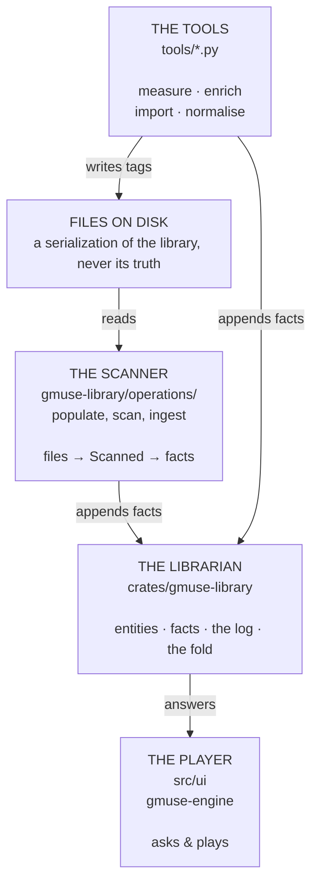

# The layers, and what may talk to what

**Status: built, and the boundary is now a crate boundary.** The librarian is `crates/gmuse-library/`; the player and
the command language are the root crate; the audio path and the engine are `crates/gmuse-engine/`. The direction rule
below stopped being a ratchet and became a **compile error**, because a crate cannot depend on the crate that depends on
it. The tools still write tags, which is the one file-writing §5 sanctions.

**This file described the pre-crate tree until 2026-09-13** (#250) — every path in it had moved, and §6's "not true yet"
list had inverted without anything failing. That is worth knowing about a document you are told to read before adding a
caller, and it is what #252 is about.

---

## 1. Four systems, one library



The librarian is the only thing that knows what the library _is_. Everything else either tells it something or asks it
something.

---

## 2. The direction rule

> **The model must not know that any of the others exist.**

**Now enforced by cargo, not by a test.** `gmuse-library` does not depend on the root crate and cannot: a dependency
cycle is a build failure. So "the model must not know that any of the others exist" is no longer a property anyone has
to remember — it is the reason the crate split was worth doing.

`crates/gmuse-library/src/model/seam.rs` still walks the tree and still fails if anything in the librarian imports `ui`,
`cmd`, `audio`, `ratatui` or `crossterm`. It is belt and braces now rather than the only line of defence, and it caught
two live mistakes on the way here — a renderer's sort key, and a trait keyed by a type it should have named from its own
side.

The reverse is fine and expected. The player reaches into the model constantly; that is what a seam is for.

**The player's side reached zero and the ratchet became an assertion** (#86). `src/ui/` names `Store` no times, because
there is no longer a `Store` type to name: every read that went through it goes to the librarian, which answers
`rows::Listing`. The test now asserts zero rather than "no worse than today", so a new leak is a failure instead of a
number to chase.

One thing that ratchet taught, recorded in §13: the walk it depends on used to return an empty list for a directory that
had moved, which turned the whole test into `assert!(0 <= 0)`. `read()` now fails loudly when its argument is not a
directory. A boundary test that reads nothing passes for the wrong reason.

---

## 3. Writing: nothing mutates, everything records

There is no "update the library" call. There is only **appending a fact**.

```rust
Fact::RecordingCatalogued { recording, title, artist }
Fact::CreditAsserted { subject, artist, role, basis, position, as_credited, join_phrase }
Fact::TrackPlaced { track, medium, recording, position, title_on_release }
Fact::GenreAssigned { subject, genre, basis, confidence }
Fact::EncodingMeasured { encoding, cutoff_hz, analyser }
Fact::RecordingRated { recording, stars }
Fact::RecordingPlayed { recording, encoding }
```

Three things follow, and they are the reason for the shape:

**A fact carries who said so.** `basis` distinguishes a Discogs genre from a hand-typed one; `confidence` distinguishes
a MusicBrainz match from a guess. A tag write throws both away — which is why the current genre pipeline's careful
`genre-uncertain.tsv` is discarded at the end of every pass.

On an assignment those two fields are not the same kind of field, and the fold treats them differently. **`basis` is
part of the claim's identity; `confidence` is an attribute riding on it.** So `(subject, concept, basis)` is what makes
a row exist — Discogs saying Techno and a person saying Techno are two rows, because they are two independent pieces of
evidence and their agreeing is the most useful thing the pair says. `confidence` is last-writer-wins within one row, so
re-scoring an import updates in place while a human's disagreement lands beside it. Nothing ever edits another
asserter's claim.

A retraction is keyed one field shorter — `(subject, concept)`, no basis — because it answers the question rather than
arguing with one asserter. Otherwise retracting would mean retracting once per source that ever said it, and the next
import would put it back.

### Who appends, and who proposes

Two routes write to the library and they are not equals.

| author                                  | route                                             | basis                                                             | gate                              |
| --------------------------------------- | ------------------------------------------------- | ----------------------------------------------------------------- | --------------------------------- |
| a person in the UI, acting on one thing | direct append to this device's log                | `Manual`, confidence `Confirmed`                                  | none — the person _is_ the review |
| any tool, matcher or import             | `proposal.rs` JSONL → a person reads it → `apply` | the tool's own source (`Discogs`, `MusicBrainz`, `TagVariant`, …) | mandatory                         |

No tool writes `Source::Manual`, and no tool appends to a log directly. **Volume is the whole reason.** A person
mis-tags one recording; a matching pass mis-tags six hundred in a minute, and the three of 607 that the identification
pass got wrong were found only by reading the file. A tool that could write `Manual` would be laundering its guesses
into the one basis nothing downstream second-guesses. `model/seam.rs` asserts it.

(`Manual` is the existing name for what the addendum calls `Human`. It is on the wire in every proposal file, and the
two say the same thing.)

### What a title is evidence of

A filename says more than a title. `Modulo Tierra (Nolah Remix)` names **who**; `Alors on danse (Radio Edit)` says
**which version**; `Initiation (Orbital remix) (radio edit)` says both, and each goes to its own fact. Reading them is
what turns a bracketed string from something the matcher has to be suspicious of into evidence it can corroborate.

Both readers match against a **vocabulary**, never against "anything in brackets" — `(Nolah Remix)` names a person and
`(Original Mix)` is Beatport for _not a remix_, so a parser that took every parenthesis would mint a concept per
remixer. Which role words are safe was measured against this library rather than guessed: `remix` introduces a real name
65 times out of 65, while `mix` (71) and `edit` (13) are mostly remaster annotations and version words —
`1969 Glyn Johns`, `2021`, `Album`, `radio`. So `mix`, `edit` and `dub` credit nobody.

A name read out of a title is a **guess**, and it is asserted as one: `Source::TagVariant`, so an authority naming the
same remixer lands beside it and the agreement is visible. That is the reason the basis is in a credit's key.

### What a gesture assigns to

Listen-time tagging — acting on what is playing — targets the **`Recording`**. The claim is about this version, and must
not leak onto its siblings or the rest of the album. Album-level actions, acting on a group in the tree, target the
**`ReleaseGroup`**, matching the import default and the census.

The UI never targets a `Track` (a slot on a medium) or an `Encoding` (bytes). A gesture that seems to want either is
mis-designed.

### Concepts, renames, and orphans

A concept id is minted from its **normalised label**, through `ingest::normalise` and nothing else — which is what lets
two devices define "Dub Techno" independently and union into one row with no registry. The same bet recording ids make.

A rename therefore does **not** re-mint: the id came from the old label and every assignment points at it. A device that
meets the new label fresh mints a different id, and one concept becomes two. **That split is accepted rather than
prevented**, because it is the repairable error — a split is one merge from repaired, a false merge is permanent. A
rename emits the label change and a `Retired` alias, so the old name stays findable, and the ordinary redirect
(`merge.rs::Merges`) resolves both ids to one for good. Do not re-mint on rename, and do not switch concepts to random
ids to dodge this: the first rewrites every assignment, the second gives up convergent definition entirely.

A wrong edge can be withdrawn. `HierarchyNarrowRetracted` shadows rather than deletes, for the reason every retraction
here does — a stale replica re-delivering the edge would otherwise restore it — and filing the edge again revives it.
That makes three callers for one rule: genre assignments, qualifier assignments and hierarchy edges. The first two carry
a basis in their live key and so retract by sweeping every asserter; an edge names no asserter and is one row.

A concept with no place in the browse hierarchy is an ordinary row. Assignment does not wait for placement — the moment
you know the answer would otherwise be the moment you cannot record it. What it costs is that closure queries (`genre+`)
do not reach it, so `Catalogue::unplaced_genres` is a standing review query, alongside `not qualifier?`.

The assignment itself has no id, and must not grow one. A third identity beside the subject's and the concept's could
only be random, which breaks convergent minting outright — two devices importing the same Discogs page have to emit the
same row — or content-derived, which buys nothing because the content is already the key. `model/seam.rs` asserts this.

**Merging is union.** Two devices, two tools, two passes — all append, nothing is overwritten, and the fold decides what
shows. That is what makes a second machine free and a second _tool_ free with it.

**A mutation declares itself.** #62's inversion: today a rename happens behind gmuse's back and `scan.rs` pairs a
departure with an arrival by size and duration and _hopes_. Every library operation of 2026-09-01 was guessed at, and
all four were guessed wrong — one of them orphaning a four-star rating. An inference can be wrong silently; a
declaration cannot.

---

## 4. Reading: projections, never the store

The player asks the librarian and gets back something already assembled:

| what it wants             | what it asks        | what it must not do            |
| ------------------------- | ------------------- | ------------------------------ |
| a row to draw             | `Librarian::row`    | reach for a `Track`            |
| what a list groups under  | `Listing::listed`   | reach for a `Store`            |
| where to open a file, now | `Listing::playable` | **keep** the locator           |
| the artist tree           | `Tree::of`          | un-normalise a sort key itself |

The last column is the load-bearing one. A locator is produced at the moment of playing and never stored, because a
player that cannot hold a path cannot key anything by one — and keying by path is what stranded three history entries
and a four-star rating on a file that still existed.

---

## 5. Where the Python tools fit

They are not a special case. They are a fourth writer, and they divide by what they actually produce:

| tool         | is           | produces                            | today                        |
| ------------ | ------------ | ----------------------------------- | ---------------------------- |
| `quality.py` | an analyser  | `Fact::Measured`                    | a TSV that gets deleted      |
| `genre/*.py` | an enricher  | `Fact::GenreAssigned` + basis       | writes `TCON` into files     |
| `credits.py` | an enricher  | credits with roles and confidence   | a TSV, then hand-editing     |
| `ingest.py`  | an importer  | `Scanned` → the whole ladder        | copies files, then tags them |
| `tags.py`    | a normaliser | **nothing** — it is the export side | writes files, which is right |

The first four should append facts. The last one should not: normalising a tag is writing the _serialization_, which is
downstream of the library and always will be.

The verbs they use are in [`library-api.md`](library-api.md): `query` for asking, `apply` for a file of proposed facts,
and `import` / `relink` / `forget` for the operations that change what the library _is_. All of them work with no player
running, because a tool must be able to say something whether or not you are listening to music.

### What the tools cannot do for themselves

**Compute an identity.** `Id<Recording>` derives from a MusicBrainz id or from `audio_id`, and `audio_id` is XXH3 over
Symphonia's packet boundaries — not reproducible in Python, and not worth trying.

So a tool speaks in **paths** and the librarian translates. That is exactly the shape `migrate::to_records` already has:
events carrying paths, plus an `identify` closure supplied by something that has scanned. A tool emits `(path, fact)`;
gmuse resolves the path and appends.

### Why the control socket is not this

`gmuse ctl` is deliberately narrow on the transport side: `cmd::instruction::instruction_of` is the total function that
says what may cross, and what crosses is the _player's_ controls — play, pause, next, what is playing. It drives the
thing making sound. (It was `--remote` and `is_remotable` until #243; the door changed, the boundary did not.)

The socket does now carry §8.4's named library writes, and that is not a contradiction of what follows — it is I15: a
write goes through the one appender, so it must cross when an engine holds the log. What has not changed is that a tool
must not _need_ it.

A tool must be able to say something with no gmuse running at all.

---

## 6. What is true today, and what is not

**True.** The model exists, cannot know about the player — a compile error, not a convention — and holds the whole
vocabulary: entities, facts, the fold, the projections. Files become rows end to end. Two instances converge without
coordinating. The player names no store (#86). There is one log (#82). The measurement that decides which copies need
replacing is `Fact::EncodingMeasured`, keyed by encoding, and queryable. One appender per log, held by an OS lock and
enforced by `Instance::flush` and `durable::rewrite` both being crate-private (#218, #249).

**Not true yet.** The tools still write tags directly, which §5 sanctions and §4 of `ingestion-flow.md` bounds. A read
still folds on a cache miss rather than never — `access-layers.md`'s stricter rule is closer than it was, because
`librarian::reading` is snapshot-first, but "never folds" is not the same as "rarely". `shelf query` is the path that
moved; the others have not been measured.

The migration this section used to be about (#80–#86) is done, and #87 is what is left of it. **The list above was
inverted for some weeks before anyone noticed**, which is the entry in #252's evidence table: the code finished the work
and no instrument existed to retire the sentence saying it had not.

---

## 7. Related

`access-layers.md` — which **layer inside the librarian** may talk to which, which is a different cut from this one and
the one not being kept today · `domain-model.md` — what the entities are · `library-sync-design.md` — how the log merges
· `tree-view-design.md` — what a view asks for · #62 (mutation API) · #77 (the seam) · #82 (one log) · #86 (delete the
store) · #87 (a bad copy is a row)
