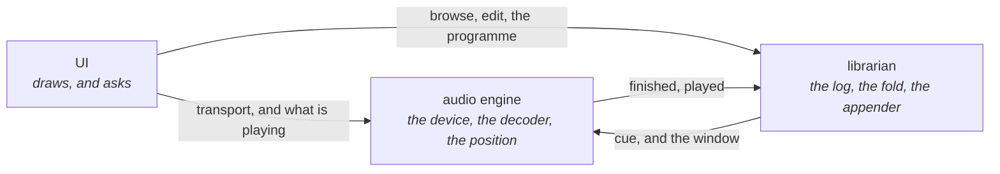
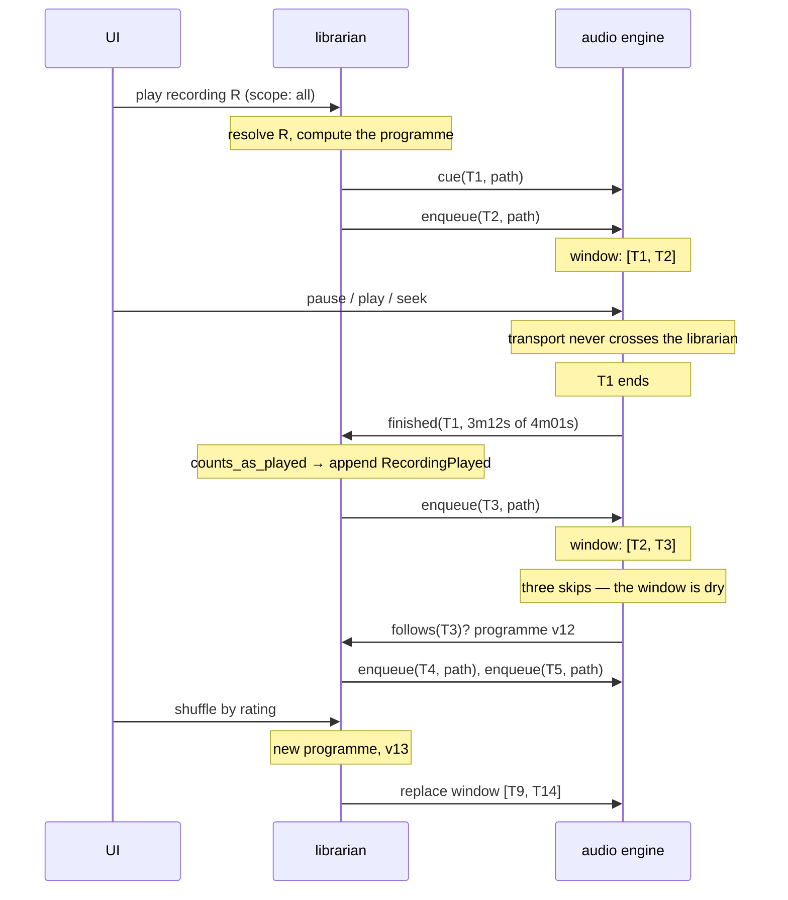

# The playback programme: who decides what plays next

**Status: settled design, not built.** The playback half of #257. The ownership half — that the librarian owns the
library and nothing else loads or changes it — is #257 itself; this document says what follows from it once music is
actually playing.

It answers one question in three parts: **who computes an order, who advances through it, and what crosses between
them.** Shuffle, repeat and "up next" are all consequences of those three answers rather than features with plumbing of
their own.

---

## 1. Three actors, and one question each

The program is three actors, not a stack. Each runs alone and each is useless alone: the audio engine plays a path it
was handed, the librarian answers questions about the library, the UI draws. None is a layer above another.



**A UI asks whichever actor is the authority on the answer**, and there is exactly one authority per question:

| the question               | asked of         | because                                                          |
| -------------------------- | ---------------- | ---------------------------------------------------------------- |
| What is playing?           | the audio engine | it is the only thing that knows what is sounding                 |
| How far in?                | the audio engine | the position is a frame count on its clock                       |
| Play, pause, seek, loop    | the audio engine | transport is playback state and never touches the library        |
| What is this track's name? | the librarian    | a name is a claim in the log                                     |
| What is up next?           | the librarian    | it owns the programme; the engine holds only a window of it      |
| Play _this_ track          | **both**         | the UI names a recording to the librarian, which cues the engine |

The last row is the only one that mixes, and it mixes in one direction: **a UI never hands the audio engine a path.** It
names a recording to the librarian, which resolves it and cues.

## 2. The programme, and the window

**The librarian owns an ordered, editable, versioned list of what will play. That is the programme.** It is what the
queue view shows, what the vim gestures edit (§"Building playlists"), and what `queue.set` replaces wholesale.

**The audio engine holds a window of two or three items as `(token, path)` pairs, and nothing else.** It has no ordering
policy, no knowledge of what the library is, and no view of the programme beyond what it is holding.

The split is what makes the interesting cases cheap:

- **A reshuffle sends no rows.** The librarian recomputes the programme and pushes a fresh window; the engine drops what
  it had. Seven thousand rows are never on the wire.
- **A librarian can die and come back.** The engine plays out its window and stops at a track boundary rather than
  mid-bar. The window is availability insurance as much as latency insurance, which is the argument for holding two or
  three rather than one.
- **"Up next" is read from the librarian**, because it is the only actor that knows more than two items ahead.

### A token names an entry, not a recording

**A programme can hold the same recording twice** — a disc that plays one recording in two places, a compilation
carrying two versions. `shelf slots` exists because that shape is real and is not a defect. So `follows(id)` would be
ambiguous: given `[A, B, A, C]`, which `A`?

**A token names an entry in the programme, and the librarian mints it.** It is opaque to the audio engine, which stores
it and hands it back. Two things follow, and the design needs both:

- **`follows(token)` is unambiguous**, which is what the cursor argument in §7 rests on. An id could not carry it.
- **The engine names no library type.** A token is a number to it — which is what lets `gmuse-engine` stop depending on
  `gmuse-library` (§9) while still reporting which entry finished.

The distinction is the one the domain model already draws between a library entry and a file: **a programme entry has
identity distinct from the recording it names.**

### Reading it is a page, not the whole thing

**The programme is the play order, and the play order is usually the library.** Under the two-tier model a queue view
showed what you had explicitly queued — nothing, or three tracks. One list makes that view the whole programme: after a
play gesture at scope `All`, 7,273 entries.

So `queue.get` answers a **page**, anchored by default at what is sounding:

```
at: 6595    next: 6695    total: 7273
entries: [the track playing, then what follows it…]
```

Which makes the default answer **"up next"** — the only one that is meaningful whether or not anything was queued by
hand — while leaving the rest reachable by paging. A caller that wants elsewhere passes `from`; a caller that wants to
continue passes the previous reply's `next`.

**Addressed by token, not by offset**, for the same reason a refill is: an index shifts when something is inserted above
it, and a token does not. A token the programme no longer holds pages from the head rather than answering with nothing,
because a view cannot tell an empty page from an empty programme — and "your queue is empty" is the wrong thing to draw
over a library that is playing.

**The anchor comes from the engine and the page from the librarian**, which is the triangle doing what §1 says: _where
am I_ is a playback question and _what is the order_ is a library one. `playback.get` reports the entry so a client can
anchor its own paging.

## 3. An order is a library computation

Every input to an interesting order is library data: a rating, a genre, a musical key, a play count, when the track was
last heard. So **the order is computed by the librarian and the engine receives a list.** The engine is never "in
shuffle mode"; it is reading a list that happens to be in an interesting order.

**The editable queue is what forces this.** A queue a person can see, reorder and undo is a queue whose order is already
decided, so an order must be materialised rather than sampled one track at a time. The alternative design is a radio —
coherent, but not reorderable, and §6 chose the other thing.

Which also means **shuffle is not a boolean.** Weighted by rating, never the same artist twice in an hour, the same key
as the last track: those are ordering _policies_, and a flag cannot hold them. A policy named by a query expression can,
which is what #235 asks for. Shuffle is then one policy among several rather than a special case.

## 4. Every playback mode is one function

A mode is not state the engine holds. It is the rule by which the librarian answers a refill:

| mode           | `follows(token)`                         |
| -------------- | ---------------------------------------- |
| once through   | the next item, or **nothing** at the end |
| repeat all     | the next item, or **the first**          |
| repeat current | **the same token**                       |

Three consequences, and they are the reason this shape was chosen over a mode flag on the engine:

- **Repeat-current is not a remembered position.** It is a rule about what "follows" _means_, so the librarian keeps no
  cursor for it, and turning it off resumes the programme because the programme was never disturbed.
- **The engine cannot tell which rule is in force**, and does not need to. There is no `repeat` message, no mode for the
  engine to be in, and nothing for a UI to read from the engine.
- **Turning a mode on or off is the window-replace message already in §6.** Repeat-current on while the window holds
  `[X, Y]` needs it to become `[X, X]`; off again needs the reverse. Both are one existing message.

### `deck.loop` is a different feature, not this one

`DeckLoop { deck, start: When, beats: u16 }` (§7.4 of the engine architecture) stays with the audio engine, because
**the units differ**:

| mechanism     | unit                                 | can it express the other?                         |
| ------------- | ------------------------------------ | ------------------------------------------------- |
| the programme | a recording — an item in a list      | no. "Repeat bars 33–40" is not an item.           |
| a loop        | a time range inside a sounding track | yes — put the in and out at the track boundaries. |

A general mechanism that can imitate a specific one does not own it. Repeat-current is a programme rule; `deck.loop` is
beat-accurate sub-track work in the RT path. They coincide at exactly one setting and belong on opposite sides of the
boundary.

**Repeat-current earns a play per lap.** `counts_as_played` is `min(duration / 2, LONG_ENOUGH)`, so twenty laps writes
twenty `RecordingPlayed` facts. That is deliberate: the track was played twenty times, and a count that ignored loops
would be lying.

## 5. Nothing decides a play except the librarian

`RecordingPlayed` is appended by whichever actor is the library's appender, which is the librarian. The engine reports
`finished(token, position)` and the librarian applies `counts_as_played`.

This is stated because it is not what the code does today: `record_play_if_earned` lives in `src/ui/mod.rs`, so **a
headless engine counts no plays** — every one of the library's existing `RecordingPlayed` facts was written by a view.
Under this design a play is earned by sound having happened, and a view is not required for that.

## 6. The messages



**The common case needs no request.** The librarian hears every `finished` because it has to, to count the play — so it
tops the window up in the same breath. One message, no round trip, and the engine is never waiting on a refill it asked
for.

**The engine's `follows` is the fallback**, for when it finds itself short unexpectedly: several skips in a row, or a
top-up that went missing. Which is the right shape for a deadline — the fast path is a push, and the actor with the
deadline can always ask.

## 7. A refill is addressed by token, not by count

The request names the last token the engine holds, plus the programme version it was built from. The token is a cursor,
in the same sense as `query.run { page: { limit, cursor } }` (§7.4).

Two properties follow from addressing it that way, and both are the reason for it:

- **It is idempotent.** `follows(T3)` is the same answer twice, so a retry after a lost message is safe and needs no
  sequence numbering of its own.
- **The librarian keeps no cursor.** It never has to track how far the engine has got, so the two cannot drift. The
  engine's window _is_ the shared state, and it is two items long.

**The version is what makes a mid-flight reshuffle safe.** If the programme moved to v13, `T3` may not be in it — so the
answer is "your position is gone, here is a fresh window" rather than a guess. That is `StaleVersion` (#233's optimistic
concurrency on the queue) and §7.10's `resync_required`; this needs no new concept.

## 8. Which actors have to be resident

"Always running" means two different things here, and conflating them is what makes the deployment question look harder
than it is.

| actor        | kind of always                                    | what breaks when it stops                                |
| ------------ | ------------------------------------------------- | -------------------------------------------------------- |
| audio engine | **continuous** — sound is                         | the music stops mid-bar. There is no graceful version.   |
| librarian    | **covering** — resident whenever the engine plays | the engine plays out its window and stops at a boundary. |
| UI           | **episodic** — attach and detach                  | nothing. This is #233, and already the default.          |

**Three actors need not be three processes.** Independence is the property that A can run without B, and that holds both
ways regardless of where the OS boundaries fall — the engine plays a window it was handed, and every `shelf` subcommand
is a librarian running with no engine. So process count is a separate decision on separate grounds, and the measured one
is the fold: **122 MB**, of which 83.5 MB is parsed records (#255). Two resident processes is two folds.

So the shape is **one resident process holding the librarian and the audio engine — one fold, one appender, one device —
and a detachable UI.** The cost is crash isolation: the engine is the only half that links C and the only half at the
mercy of a driver, and a device fault would take the log's owner with it. That trade is decided on its own merits, not
on purity; what leans against it is that there is no `unsafe` in the audio path at all (#213) and an append-only log
survives a torn write.

**A detached UI holds no fold either.** The librarian writes a projection snapshot on every commit (5.7 MB of postcard
against an 87 MB log), and I15 permits a read to open it directly. A view loads the snapshot, a `library` event
invalidates it, and every write and everything live goes to the librarian.

## 9. What is not built, and what will enforce it

Nothing in this document is implemented. Today "the librarian" is a thread standing up inside whichever role `gmuse` is
playing — `src/main.rs:2212` for a view, `src/main.rs:3393` for a server — and the audio engine resolves what plays next
itself, through `gmuse-library`'s `Shelf` and `next::`.

**The programme is not durable, and the session file is standing in for it.** §1 says the librarian owns an ordered,
editable, versioned list of what will play — and today nothing writes it down: a `gmuse engine` restart loses the queue
entirely, measured at 108 entries to 0. What survives is `session.toml`'s `queue`, which is a _view's_ record of where
it was, restored into `ui.queue` on launch.

That inversion has already cost one bug. §8.8's rule is out before in, so a read never discards an unseen edit — but the
first `read_the_queue` is the one iteration that cannot honour it, because `push_the_queue` has no version to compute
against until that reply arrives. So the read won by default and cleared the queue the session had just restored:
written correctly, read correctly, dropped one line later. A restored queue is now kept when the engine has none, and
offered on the next pass.

**That is a patch over the ownership, not a settlement of it.** If the librarian owns the programme it should be what
persists it, and a view's session file should hold no queue at all. Until then the two disagree about who remembers, and
the tie-break is "whoever is not empty".

**The check is a cargo one, not a convention:** `crates/gmuse-engine/Cargo.toml` has no `gmuse-library` line. The same
idiom that turned `layers.md`'s direction rule from a source-scraping ratchet into a compile error. An audio engine that
cannot name a `Recording` cannot quietly acquire an opinion about what follows one.

---

## Related

- [What may talk to what](layers.md) — the direction rule between systems, of which this is the actor-level case.
- [Inside the librarian](access-layers.md) — a read never touches the filesystem and never folds the log.
- [The transport vocabulary](transport-keymap-spec.md) — where `deck.loop` and the other verbs come from.
- [The query language](query-language.md) — what an ordering policy would be named in.
