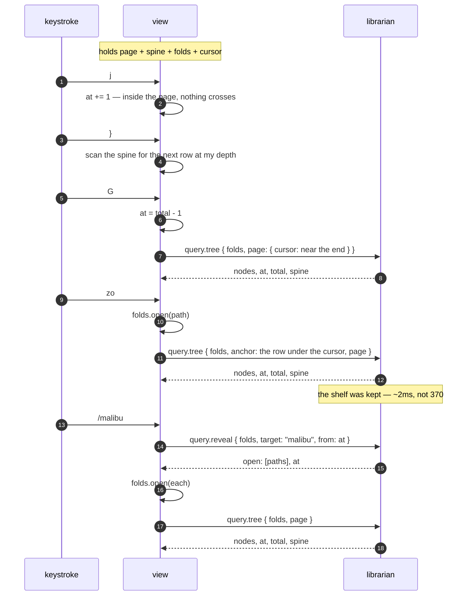

# The tree over the wire: what a view holds when it stops holding the library

**Status: settled design, not built.** The tree half of #261 Goal 1. The programme document says who decides what plays;
this one says who holds the library while somebody browses it.

One rule, and everything below follows from it: **a view holds a screenful, a cursor, and the shape — never the
library.**

---

## 1. What a view holds today, measured

`just memory-parts`, against the real library (7,273 rows, 8,932 tree nodes):

| what an attached view holds |         |
| --------------------------- | ------- |
| a follower's fold           | 14.1 MB |
| `Librarian::from_catalogue` | 26.5 MB |
| `Shelf` — view 1's tree     | 1.7 MB  |
| **total**                   | 42.3 MB |

**The `Shelf` is a rounding error, and that reorders the work.** Converting view 1 to pages buys 1.7 MB and is worth
doing for none of it. Its value is that `Shelf::grouped` takes a `&Librarian`: while the tree is built view-side, the
view must fold the log, and the other 40.6 MB cannot go.

So the two halves of Goal 1 — the tree, and the detail reads behind `ctx.library` — **free nothing separately**. The
`Librarian` is shared, and the last caller keeps it alive. That makes this one milestone with a measured endpoint rather
than a queue of small wins.

## 2. Why the fold state stays in the view

`query.tree` groups and then flattens. Timed apart (`just tree-cost`):

| step                            |         |                         |
| ------------------------------- | ------- | ----------------------- |
| `Shelf::grouped`                | 370.0ms | 614 artists             |
| `browse::flatten` over the same | 1.8ms   | 8,932 nodes             |
|                                 |         | the flatten is **0.5%** |

The expensive half does not depend on which nodes are open. So the librarian **keeps the shelf, keyed by the fold's
version, the levels and the filter — and not by the folds** — and flattens per request. A `zo` costs about 2 ms,
not 370.

Which is what `browse::tree` already said it wanted: _"Which nodes a person has folded is the view's state and the
librarian has no business holding it."_ A per-client fold state on the librarian would also make it stateful in the one
dimension it has managed to avoid.

**The fold state travels with the request, and it is small.** `Expansion` holds a `level`, an `eager` depth, and two
sets of _exceptions_ — nodes opened or closed against the level. Twenty artists open by hand is about 600 bytes. It is
not proportional to the library and never was.

## 3. The spine

Every one of the ten structural motions — `}` `{` `]]` `[[` `][` `[]` `-` `]z` `zj` `zk` — is a scan for the first row
matching a predicate. Read against `TreeState::step`, those predicates consume exactly three fields per row:

- **`depth`**, 0–3: artist, album, disc, track.
- **`is_leaf`** — needed on its own because depth 2 is ambiguous, being both a disc header and a track on a record with
  one disc.
- **`is_expanded`** — `zk` lands on a fold's _end_, and a closed fold is its own end.

Nothing else. Not a title, not an id, not a sort key.

So a view holds a **spine**: four bits a row — two of depth and two of flags — one hex digit each over the wire.

| for the whole library |            |
| --------------------- | ---------- |
| `Shelf`               | 1.7 MB     |
| the spine             | **8.9 KB** |

`j`, `k`, `gg`, `G` and `3000j` are arithmetic on `(at, total)` and need not even read it. The spine changes when the
folds change or the library does — never when the cursor moves.

It also fixes a small standing waste: `go` calls `rows(lib)` **inside** its count loop, so `3}` flattens the tree three
times. Three scans of 8.9 KB is not a cost worth naming.

## 4. What crosses

Two methods, both stateless.

```
query.tree   { levels, filter, folds, anchor?, settle?, limit, cursor }
          -> { nodes, at, total, next, spine, rows, artists, albums, library_version }

query.under  { levels, filter, path, id? }
          -> { tracks, openable }

query.reveal { levels, filter, folds, target, from?, backwards? }
          -> { open: [path], at }
```

`anchor` is a `Mark` — a container's path, or a track's id. It answers "the rows moved; where did my cursor go?", which
is the question a toggle asks and the one `mark`/`point_at` already exist to answer view-side. It beats `cursor` when
both are given, and falls through to it when the anchored line is gone — a row whose fold just closed is not on screen
to be anchored to.

**Each line comes back with its seat**, the path a toggle opens and an anchor names. Sent rather than derived, because
`Node::seat` has three exceptions a client would otherwise have to reimplement: a track that replaced its album row
seats on the artist (#135), a track under a drawn disc header seats on that disc (#169), and every other track seats on
its album. A client re-deriving those is a second copy of a rule.

**Absent folds mean everything open**, which is what a client that keeps no fold state wants and what `/` searches.

`settle` is the other half of `anchor`, and they are not the same question: an anchor is the exact line the cursor was
on, a settle is the _seat_ it sat at. A toggle knows its line and uses the first; a level change may have closed that
line entirely, and then the cursor goes where vim puts it — on the fold that swallowed it, which is the deepest visible
line whose seat is a prefix of the old one.

`query.under` answers what `a`, `e` and `x` act on and what `zR` has left to open, in one call because they cost the
same walk. **It takes a mark, not a seat.** A seat does not name a track: a track sits at its record's path and so does
the record's own line, so a lookup by seat hands back the record — which is `x` on a track playing the whole album. The
`id` is the half that tells them apart, and a container has none.

The counts come back with the page rather than having a method: a status line redraws them every frame, and the shelf
that answered the page already knows them.

`pattern` or `id`, exactly one — both, or neither, is a bad request rather than a guess, refused in the parser before a
tree gets built to find out. **The reply gives the index after the reveal, not before**: opening folds inserts rows
above the match, so an index measured against the unfolded list is wrong by the time the view can use it. `/` searching
a closed fold keeps working for the reason it always did — a closed fold still holds its rows.

**`from` and `at` are both where the cursor is on screen.** The search runs over the unfolded tree and a cursor counts
visible lines, so they are different coordinate systems — and feeding a reply straight back as the next request lands in
the wrong one, which does not error, it just makes `n` find the same line for ever. The conversion happens
librarian-side, by name rather than by index, because a name survives a fold change and a number does not. It is #131's
"the coordinates the search runs in", one layer down.

Both directions wrap. An asymmetry there is invisible with two matches and maddening with twenty.

## 5. A keystroke



The two things worth reading off it: **the common keys cross nothing**, and **a fold change is one round trip**, which
is what a rebuild already was.

## 6. `Node` grows a disc

`browse::Node` is `Outer / Inner / Track`. What view 1 draws is `Artist / Album / Disc / Track`, and its track carries
an `alone` flag and its container's keys.

**The disc row goes into `Node`.** It is a fact the library holds — #169 added it because a five-disc _Let It Be_ has
five track 1s, and drawn adjacent under identical numbering that reads as the library holding one song five times. A
second client wants it for the same reason the first did. Keeping `Node` "general" by leaving it out would mean every
client re-deriving a row the library already knows about, or view 1 needing a reply shape of its own — which is two
answers to one question, the thing #257 exists to prevent.

The kinds on the wire are therefore `artist`, `album`, `disc`, `track`, and a node carries **both its identity and its
row**: the path of sort keys a toggle and an anchor name it by, and the title, credit and length a client draws. A node
that carried only identity would send the view back to the library for every visible line, which is the thing this
document exists to stop.

**The track's line moved into `Shelf`** to make that possible, and the field beside it had already said why. The note on
`artist_names` reads: without it _"every renderer has to reach back into the `Scan` for a track under the node just to
recover the string, which is how a projection that exists to answer questions ends up unable to answer the simplest
one"_. Tracks were the level that rule had not been applied to, and the renderer did exactly that. It costs **1.0 MB** —
the shelf goes from 1.7 MB to 2.7 MB — and it is held once, librarian-side, rather than in every view.

## 7. The seam, and what is still on the wrong side of it

`ui::tree` asks a **`Browsing`**, not a `Shelf`. Seven questions, which is all twenty of its methods ever asked one, and
an eighth that is leaving:

|                             |                                                   |
| --------------------------- | ------------------------------------------------- |
| `spine(folds)`              | the shape of the whole tree, four bits a line     |
| `page(folds, at, limit)`    | the lines to draw                                 |
| `at(folds, mark)`           | where a line went when the folds changed          |
| `settle(folds, seat)`       | where the cursor goes when its line was swallowed |
| `tracks_under(node)`        | what `a`, `e` and `x` act on                      |
| `openable_under(path)`      | what `zR` still has left to open                  |
| `find(folds, target, from)` | `/`, `n`, `N`, and reveal-by-id                   |
| `lines(folds, unfolded)`    | **the one that is still leaving**                 |

They are the wire's methods, deliberately: `Shelf` implements the trait today and a socket client implements it next,
which makes the swap a line rather than a hunt. It is the move `Context::player` already made for playback (#219), for
the same reason.

Nothing in `TreeState` asks for a list any more. Acting on the cursor costs **one line**, and a motion costs **one
spine** — `go` asked for every line on every iteration of its count, so `3}` flattened 8,932 of them three times to read
two bits from each. `asks_for_what_it_needs` instruments a `Browsing` that counts what it was asked for, because whether
a method flattened the tree to read one line is not visible in its result.

**The search haystack is gone.** `/` kept a second copy of the tree — every line, its folded text, and a conversion
between that list's coordinates and the cursor's — dropped by hand whenever the fold changed. `find` answers all of it
and answers in the cursor's own coordinates, so `run_search`, `search_cursor` and `place_search` each lost their tree
branch entirely.

**The renderer draws a window.** It built a `ListItem` for every one of 8,932 lines and handed ratatui the lot, forty of
which are on screen — and called `ctx.library.listed` once per line per frame to do it. Both are now a screenful.

Taking the window meant taking the scrolling: ratatui adjusts the offset itself to bring the selection into view, and it
cannot do that over lines it is never shown. `Scroll::window` is that rule — scroll the least that puts the cursor in
view, otherwise do not scroll — and the widget is handed offset zero with the selection made relative to the window.

**`lines` has no caller left.** It stays as the tests' oracle: a claim about a page is only checkable against the whole
it came from.

So nothing in the view asks for the tree any more.

**And the view names no projection at all.** `Holding` is `Browsing` plus what view 2 and the status line ask — the flat
ordering and four counts — and `Ui::library` is one. `ui::holding` is the single place an implementation is chosen, and
`a_follower_holds_no_projection_of_its_own` walks every file under `src/ui/` and refuses a `Shelf` outside it. Found by
walking rather than listed, because a hardcoded pair passes just as well with one of them deleted from it.

**The second implementation exists.** `ui::holding_remote::Remote` answers every one of `Holding`'s questions over the
socket, and `a_remote_library_answers_what_a_local_one_does` puts the same questions to it and to a locally folded
`Shelf` over the same library and requires the same answers — the oracle trick the spine got, one layer up. The failure
that catches is not a crash but a tree that draws _nearly_ right, which reads as the library being odd rather than as a
bug.

It keeps the last reply, because a redraw asks four questions about one tree — shape, page, counts, cursor — and one
`query.tree` carries all four. Keyed by the fold state and the window, for the same reason the engine's own cache is
keyed by the question.

**And the detail reads went through the same door.** `Context::library` is a `dyn Listing`, not a `Librarian` — the
trait was already what most of them used, and the two that were not are on it now: `row`, a read about one recording,
and `chosen`, the owned half of `Librarian::open`, which handed back a borrow into the fold for a caller that wanted
three owned things out of it.

**One question needed asking rather than carrying.** Grouping a shelf needs seven of `Librarian`'s own methods — the one
thing a view does that wants the library rather than a read of it, and the one thing an attached view should not do at
all. Rather than a second trait nobody else implements, or a `Context` field every call site has to thread, the reader
is asked: `Listing::whole` — _can you give me all of it?_ A fold says yes, a socket says no, and `ui::holding` picks on
the answer. **An engine wins when there is one**, because §4.2 says an attached view's librarian is the engine and the
engine has folded this library already.

`a_follower_holds_no_projection_of_its_own` now refuses a `Shelf` **and** a `Librarian` anywhere in the view's
production code.

**The detail reads needed an owned row first, and now have one.** Most go through `Listing`, which is already a trait,
but `Listing::listed` returns a `Listed<'a>` that _borrows the fold_ — and a socket implementation has no fold to borrow
from. `Slip` is the same row written out, and it **lends a `Listed` back**, so the format template, the list styling and
every field still read exactly what they always did. Two representations, one reader.

`just query-cost`:

|                                   |             |
| --------------------------------- | ----------- |
| `Slip::of`, a screenful (40 rows) | **25.8 µs** |
| `Slip::of`, every row (7,273)     | 3.0 ms      |

Which is why `Listed` stays borrowed rather than being replaced: `query::filter` reads one per row of the whole library
on every keystroke of a picker, where 3.0 ms would cost more than the query. One row is read once and drawn; the other
is read 7,273 times and thrown away.

## 8. Where it stands, measured

Against the real library (7,273 rows, 72 MB log), an engine and a view attached to it:

|                                      |          |
| ------------------------------------ | -------- |
| engine                               | 163.3 MB |
| attached view — at the start of #261 | 123.8 MB |
| attached view — now                  | 74.9 MB  |

**The view still folds the log.** `Desk::read_only` is called at startup and prints
`librarian: 7271 recordings in 0.1s`, and `Context::library` points at what it produced — so every detail read still
goes to a second copy of a library the engine already has. That is the 40.6 MB in §1 and it is all still there.

What has gone is everything the _tree_ held: the shelf, the search's haystack, and the 8,932-line render. What is left
is one thing — a **`Listing` over the socket**. Everything it would have to answer is now answerable without a fold: the
seam lends nothing, checked by `the_read_seam_answers_without_lending`.

Three methods had to change for that, and each needed a different answer:

- **`listed`** hands back a `Slip`, the row written out. `Librarian::describe` is the borrowed one, and the hot paths
  call it by name — `query::found` reads a row per row of the library on every keystroke of a picker, and
  `Shelf::grouped` one per track.
- **`playable`** owns its locator. One `String`, and every caller took a copy or compared it anyway.
- **`subject`** left the trait. It is a _view onto_ a row rather than an answer about one, and the filter — the hot path
  — builds its own from a concrete library. A caller holding only the seam builds one over a slip it owns.

`whole` is the deliberate exception, and says so by returning an `Option`: it asks "are you the fold?", and a reader
that is not answers `None`.

**A headless smoke test cannot check this.** Running the real TUI needs a terminal, and without one every pane draws
empty — which is indistinguishable from a remote that answers nothing. So the check is
`an_attached_view_draws_the_same_pane_as_a_detached_one`, which renders both into a `TestBackend` and requires the same
buffer.

## 9. The read seam crossed, and why nothing uses it yet

`Remote` answers every one of `Listing`'s questions over the socket, and `a_remote_read_answers_what_a_local_one_does`
puts them all to it and to a locally folded library and requires the same answers.

Six methods carry eleven questions, grouped by what a caller is asking _about_ — one row, one recording, one thing in
the panel, a name, a facet, a collection. Three shapes had to stop holding `&'static str` to make the trip:
`About::kind`, `Section::title`, and `Kind`, which is not `Deserialize` at all — its concept arm names an axis out of
`facet::ALL`, and an axis is a term the library knows rather than a string a client may invent, so it is looked up by
word.

**And it is wired in — but only with the other half of the change.** Pointing `Context::library` at the remote _by
itself_ made an attached view larger, 74.9 MB to 104.1 MB, because the fold was still there beside it and the process
held two readers. What makes it a saving is that with a reader there is nothing left to read the fold's `Librarian`, so
it is never derived.

`Desk::following` is that desk: it folds the log's catalogue, because `listened` — the ratings and the plays — comes out
of it and has no crossing yet, and derives no `Librarian` from it. `Answer::library` is empty from one of those, and a
caller that reads it gets an empty library rather than a wrong one.

`just memory-parts` says why that is where the weight sits:

|                                          |         |
| ---------------------------------------- | ------- |
| `Projected::advance`, the catalogue      | 11.8 MB |
| `Librarian::from_catalogue` on top of it | 26.5 MB |

And the whole thing, against the real library with an engine running — **two runs each, sampled at 12 s and 47 s, stable
across both**:

|                                             |          |
| ------------------------------------------- | -------- |
| attached view, at the start of #261         | 123.8 MB |
| after the tree moved over the wire          | 74.9 MB  |
| after the `Librarian` stopped being derived | 74.9 MB  |
| after the rows stopped being hoarded        | 63.1 MB  |

**The third row is a correction.** Not deriving the `Librarian` was published as 28.3 MB and that figure does not
reproduce: a single sample of a process whose row cache was still filling. Repeated, it is 74.9 MB — the same as before
— because `Remote` kept every row a caller touched, and the startup filter touches all 7,273. A 26.5 MB `Librarian` had
been traded for a 43 MB pile of rows.

So the saving is the cap, not the desk: `KEEP` bounds the cache at five hundred rows, which is what a screenful and the
panes beside it need, and a walk blows through it rather than leaving itself behind.

| after the commonest view stopped resolving | 61.3 MB |

**The commonest view has no terms**, and resolving it cost two walks of the library: `Stack::resolve` turned every row
into its recording, and `Resolved::copies` turned every recording back into its rows. In this process that was merely
wasteful; through a socket it is 14,546 asks to answer "all of them", which is the one answer that needs no asking.
`Stack::members` says it in one call.

What is left:

- **the catalogue** — 11.8 MB of ratings, plays, collections and saved views, folded here because `Listened` has no
  crossing;
- **a filter that does have terms**, which still walks every row at 574 ms. That is the shape `query.run` exists to
  replace, and it is a design step rather than more batching: a view stack is not a filter string, and what crosses has
  to carry the terms, the saved-view definitions and the ordering;
- **`Remote::open`'s own walk**, which reads all 7,273 lines of a flat tree to keep their ids. Transient, but RSS
  follows the peak — that is a guess at where some of the 61 MB is, and it is unmeasured.

## 10. What this does not decide

- **Where the query worker lives.** §7.11 says a query runs off the job queue over an `Arc<Answer>`; `query.tree` is
  served on the socket thread today. That is #261's first done-when and it is independent of everything here.
- **The 41 detail reads behind `ctx.library`** — `row`, `listed`, `open`, `label_of`, `about`, `history`. They are the
  info panel's territory and `info-panel.md` has the rule for them. §1 is why they have to land in the same milestone.
- **The picker.** `query.found` already exists and is ~1 ms; match positions on its rows are a separate done-when.
