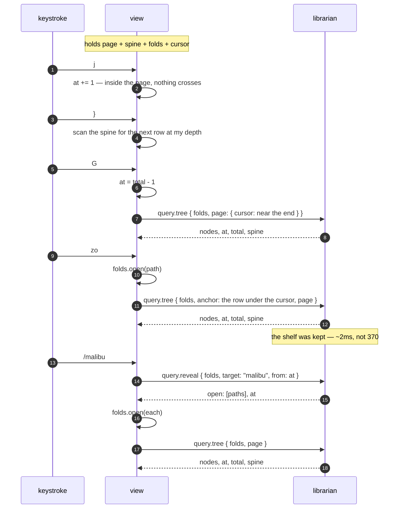

# The tree over the wire: what a view holds when it stops holding the library

**Status: settled design, not built.** The tree half of #261 Goal 1. The programme document says who decides what plays;
this one says who holds the library while somebody browses it.

One rule, and everything below follows from it: **a view holds a screenful, a cursor, and the shape — never the
library.**

---

## 1. What a view holds today, measured

`just memory-parts`, against the real library (7,273 rows, 8,932 tree nodes):

| what an attached view holds |         |
| --------------------------- | ------- |
| a follower's fold           | 14.1 MB |
| `Librarian::from_catalogue` | 26.5 MB |
| `Shelf` — view 1's tree     | 1.7 MB  |
| **total**                   | 42.3 MB |

**The `Shelf` is a rounding error, and that reorders the work.** Converting view 1 to pages buys 1.7 MB and is worth
doing for none of it. Its value is that `Shelf::grouped` takes a `&Librarian`: while the tree is built view-side, the
view must fold the log, and the other 40.6 MB cannot go.

So the two halves of Goal 1 — the tree, and the detail reads behind `ctx.library` — **free nothing separately**. The
`Librarian` is shared, and the last caller keeps it alive. That makes this one milestone with a measured endpoint rather
than a queue of small wins.

## 2. Why the fold state stays in the view

`query.tree` groups and then flattens. Timed apart (`just tree-cost`):

| step                            |         |                         |
| ------------------------------- | ------- | ----------------------- |
| `Shelf::grouped`                | 370.0ms | 614 artists             |
| `browse::flatten` over the same | 1.8ms   | 8,932 nodes             |
|                                 |         | the flatten is **0.5%** |

The expensive half does not depend on which nodes are open. So the librarian **keeps the shelf, keyed by the fold's
version, the levels and the filter — and not by the folds** — and flattens per request. A `zo` costs about 2 ms,
not 370.

Which is what `browse::tree` already said it wanted: _"Which nodes a person has folded is the view's state and the
librarian has no business holding it."_ A per-client fold state on the librarian would also make it stateful in the one
dimension it has managed to avoid.

**The fold state travels with the request, and it is small.** `Expansion` holds a `level`, an `eager` depth, and two
sets of _exceptions_ — nodes opened or closed against the level. Twenty artists open by hand is about 600 bytes. It is
not proportional to the library and never was.

## 3. The spine

Every one of the ten structural motions — `}` `{` `]]` `[[` `][` `[]` `-` `]z` `zj` `zk` — is a scan for the first row
matching a predicate. Read against `TreeState::step`, those predicates consume exactly three fields per row:

- **`depth`**, 0–3: artist, album, disc, track.
- **`is_leaf`** — needed on its own because depth 2 is ambiguous, being both a disc header and a track on a record with
  one disc.
- **`is_expanded`** — `zk` lands on a fold's _end_, and a closed fold is its own end.

Nothing else. Not a title, not an id, not a sort key.

So a view holds a **spine**: four bits a row — two of depth and two of flags — one hex digit each over the wire.

| for the whole library |            |
| --------------------- | ---------- |
| `Shelf`               | 1.7 MB     |
| the spine             | **8.9 KB** |

`j`, `k`, `gg`, `G` and `3000j` are arithmetic on `(at, total)` and need not even read it. The spine changes when the
folds change or the library does — never when the cursor moves.

It also fixes a small standing waste: `go` calls `rows(lib)` **inside** its count loop, so `3}` flattens the tree three
times. Three scans of 8.9 KB is not a cost worth naming.

## 4. What crosses

Two methods, both stateless.

```
query.tree   { levels, filter, folds, anchor?, settle?, limit, cursor }
          -> { nodes, at, total, next, spine, rows, artists, albums, library_version }

query.under  { levels, filter, path, id? }
          -> { tracks, openable }

query.reveal { levels, filter, folds, target, from?, backwards? }
          -> { open: [path], at }
```

`anchor` is a `Mark` — a container's path, or a track's id. It answers "the rows moved; where did my cursor go?", which
is the question a toggle asks and the one `mark`/`point_at` already exist to answer view-side. It beats `cursor` when
both are given, and falls through to it when the anchored line is gone — a row whose fold just closed is not on screen
to be anchored to.

**Each line comes back with its seat**, the path a toggle opens and an anchor names. Sent rather than derived, because
`Node::seat` has three exceptions a client would otherwise have to reimplement: a track that replaced its album row
seats on the artist (#135), a track under a drawn disc header seats on that disc (#169), and every other track seats on
its album. A client re-deriving those is a second copy of a rule.

**Absent folds mean everything open**, which is what a client that keeps no fold state wants and what `/` searches.

`settle` is the other half of `anchor`, and they are not the same question: an anchor is the exact line the cursor was
on, a settle is the _seat_ it sat at. A toggle knows its line and uses the first; a level change may have closed that
line entirely, and then the cursor goes where vim puts it — on the fold that swallowed it, which is the deepest visible
line whose seat is a prefix of the old one.

`query.under` answers what `a`, `e` and `x` act on and what `zR` has left to open, in one call because they cost the
same walk. **It takes a mark, not a seat.** A seat does not name a track: a track sits at its record's path and so does
the record's own line, so a lookup by seat hands back the record — which is `x` on a track playing the whole album. The
`id` is the half that tells them apart, and a container has none.

The counts come back with the page rather than having a method: a status line redraws them every frame, and the shelf
that answered the page already knows them.

`pattern` or `id`, exactly one — both, or neither, is a bad request rather than a guess, refused in the parser before a
tree gets built to find out. **The reply gives the index after the reveal, not before**: opening folds inserts rows
above the match, so an index measured against the unfolded list is wrong by the time the view can use it. `/` searching
a closed fold keeps working for the reason it always did — a closed fold still holds its rows.

**`from` and `at` are both where the cursor is on screen.** The search runs over the unfolded tree and a cursor counts
visible lines, so they are different coordinate systems — and feeding a reply straight back as the next request lands in
the wrong one, which does not error, it just makes `n` find the same line for ever. The conversion happens
librarian-side, by name rather than by index, because a name survives a fold change and a number does not. It is #131's
"the coordinates the search runs in", one layer down.

Both directions wrap. An asymmetry there is invisible with two matches and maddening with twenty.

## 5. A keystroke



The two things worth reading off it: **the common keys cross nothing**, and **a fold change is one round trip**, which
is what a rebuild already was.

## 6. `Node` grows a disc

`browse::Node` is `Outer / Inner / Track`. What view 1 draws is `Artist / Album / Disc / Track`, and its track carries
an `alone` flag and its container's keys.

**The disc row goes into `Node`.** It is a fact the library holds — #169 added it because a five-disc _Let It Be_ has
five track 1s, and drawn adjacent under identical numbering that reads as the library holding one song five times. A
second client wants it for the same reason the first did. Keeping `Node` "general" by leaving it out would mean every
client re-deriving a row the library already knows about, or view 1 needing a reply shape of its own — which is two
answers to one question, the thing #257 exists to prevent.

The kinds on the wire are therefore `artist`, `album`, `disc`, `track`, and a node carries **both its identity and its
row**: the path of sort keys a toggle and an anchor name it by, and the title, credit and length a client draws. A node
that carried only identity would send the view back to the library for every visible line, which is the thing this
document exists to stop.

**The track's line moved into `Shelf`** to make that possible, and the field beside it had already said why. The note on
`artist_names` reads: without it _"every renderer has to reach back into the `Scan` for a track under the node just to
recover the string, which is how a projection that exists to answer questions ends up unable to answer the simplest
one"_. Tracks were the level that rule had not been applied to, and the renderer did exactly that. It costs **1.0 MB** —
the shelf goes from 1.7 MB to 2.7 MB — and it is held once, librarian-side, rather than in every view.

## 7. The seam, and what is still on the wrong side of it

`ui::tree` asks a **`Browsing`**, not a `Shelf`. Seven questions, which is all twenty of its methods ever asked one, and
an eighth that is leaving:

|                             |                                                   |
| --------------------------- | ------------------------------------------------- |
| `spine(folds)`              | the shape of the whole tree, four bits a line     |
| `page(folds, at, limit)`    | the lines to draw                                 |
| `at(folds, mark)`           | where a line went when the folds changed          |
| `settle(folds, seat)`       | where the cursor goes when its line was swallowed |
| `tracks_under(node)`        | what `a`, `e` and `x` act on                      |
| `openable_under(path)`      | what `zR` still has left to open                  |
| `find(folds, target, from)` | `/`, `n`, `N`, and reveal-by-id                   |
| `lines(folds, unfolded)`    | **the one that is still leaving**                 |

They are the wire's methods, deliberately: `Shelf` implements the trait today and a socket client implements it next,
which makes the swap a line rather than a hunt. It is the move `Context::player` already made for playback (#219), for
the same reason.

Nothing in `TreeState` asks for a list any more. Acting on the cursor costs **one line**, and a motion costs **one
spine** — `go` asked for every line on every iteration of its count, so `3}` flattened 8,932 of them three times to read
two bits from each. `asks_for_what_it_needs` instruments a `Browsing` that counts what it was asked for, because whether
a method flattened the tree to read one line is not visible in its result.

**The search haystack is gone.** `/` kept a second copy of the tree — every line, its folded text, and a conversion
between that list's coordinates and the cursor's — dropped by hand whenever the fold changed. `find` answers all of it
and answers in the cursor's own coordinates, so `run_search`, `search_cursor` and `place_search` each lost their tree
branch entirely.

**The renderer draws a window.** It built a `ListItem` for every one of 8,932 lines and handed ratatui the lot, forty of
which are on screen — and called `ctx.library.listed` once per line per frame to do it. Both are now a screenful.

Taking the window meant taking the scrolling: ratatui adjusts the offset itself to bring the selection into view, and it
cannot do that over lines it is never shown. `Scroll::window` is that rule — scroll the least that puts the cursor in
view, otherwise do not scroll — and the widget is handed offset zero with the selection made relative to the window.

**`lines` has no caller left.** It stays as the tests' oracle: a claim about a page is only checkable against the whole
it came from.

So nothing in the view asks for the tree any more.

**And the view names no projection at all.** `Holding` is `Browsing` plus what view 2 and the status line ask — the flat
ordering and four counts — and `Ui::library` is one. `ui::holding` is the single place an implementation is chosen, and
`a_follower_holds_no_projection_of_its_own` walks every file under `src/ui/` and refuses a `Shelf` outside it. Found by
walking rather than listed, because a hardcoded pair passes just as well with one of them deleted from it.

**The second implementation exists.** `ui::holding_remote::Remote` answers every one of `Holding`'s questions over the
socket, and `a_remote_library_answers_what_a_local_one_does` puts the same questions to it and to a locally folded
`Shelf` over the same library and requires the same answers — the oracle trick the spine got, one layer up. The failure
that catches is not a crash but a tree that draws _nearly_ right, which reads as the library being odd rather than as a
bug.

It keeps the last reply, because a redraw asks four questions about one tree — shape, page, counts, cursor — and one
`query.tree` carries all four. Keyed by the fold state and the window, for the same reason the engine's own cache is
keyed by the question.

**And the detail reads went through the same door.** `Context::library` is a `dyn Listing`, not a `Librarian` — the
trait was already what most of them used, and the two that were not are on it now: `row`, a read about one recording,
and `chosen`, the owned half of `Librarian::open`, which handed back a borrow into the fold for a caller that wanted
three owned things out of it.

**One question needed asking rather than carrying.** Grouping a shelf needs seven of `Librarian`'s own methods — the one
thing a view does that wants the library rather than a read of it, and the one thing an attached view should not do at
all. Rather than a second trait nobody else implements, or a `Context` field every call site has to thread, the reader
is asked: `Listing::whole` — _can you give me all of it?_ A fold says yes, a socket says no, and `ui::holding` picks on
the answer. **An engine wins when there is one**, because §4.2 says an attached view's librarian is the engine and the
engine has folded this library already.

`a_follower_holds_no_projection_of_its_own` now refuses a `Shelf` **and** a `Librarian` anywhere in the view's
production code.

**The detail reads needed an owned row first, and now have one.** Most go through `Listing`, which is already a trait,
but `Listing::listed` returns a `Listed<'a>` that _borrows the fold_ — and a socket implementation has no fold to borrow
from. `Slip` is the same row written out, and it **lends a `Listed` back**, so the format template, the list styling and
every field still read exactly what they always did. Two representations, one reader.

`just query-cost`:

|                                   |             |
| --------------------------------- | ----------- |
| `Slip::of`, a screenful (40 rows) | **25.8 µs** |
| `Slip::of`, every row (7,273)     | 3.0 ms      |

Which is why `Listed` stays borrowed rather than being replaced: `query::filter` reads one per row of the whole library
on every keystroke of a picker, where 3.0 ms would cost more than the query. One row is read once and drawn; the other
is read 7,273 times and thrown away.

## 8. Where it stands, measured

Against the real library (7,273 rows, 72 MB log), an engine and a view attached to it:

|                                      |          |
| ------------------------------------ | -------- |
| engine                               | 163.3 MB |
| attached view — at the start of #261 | 123.8 MB |
| attached view — now                  | 74.9 MB  |

**The view still folds the log.** `Desk::read_only` is called at startup and prints
`librarian: 7271 recordings in 0.1s`, and `Context::library` points at what it produced — so every detail read still
goes to a second copy of a library the engine already has. That is the 40.6 MB in §1 and it is all still there.

What has gone is everything the _tree_ held: the shelf, the search's haystack, and the 8,932-line render. What is left
is one thing — a **`Listing` over the socket**. Everything it would have to answer is now answerable without a fold: the
seam lends nothing, checked by `the_read_seam_answers_without_lending`.

Three methods had to change for that, and each needed a different answer:

- **`listed`** hands back a `Slip`, the row written out. `Librarian::describe` is the borrowed one, and the hot paths
  call it by name — `query::found` reads a row per row of the library on every keystroke of a picker, and
  `Shelf::grouped` one per track.
- **`playable`** owns its locator. One `String`, and every caller took a copy or compared it anyway.
- **`subject`** left the trait. It is a _view onto_ a row rather than an answer about one, and the filter — the hot path
  — builds its own from a concrete library. A caller holding only the seam builds one over a slip it owns.

`whole` is the deliberate exception, and says so by returning an `Option`: it asks "are you the fold?", and a reader
that is not answers `None`.

**A headless smoke test cannot check this.** Running the real TUI needs a terminal, and without one every pane draws
empty — which is indistinguishable from a remote that answers nothing. So the check is
`an_attached_view_draws_the_same_pane_as_a_detached_one`, which renders both into a `TestBackend` and requires the same
buffer.

## 9. The read seam crossed, and why nothing uses it yet

`Remote` answers every one of `Listing`'s questions over the socket, and `a_remote_read_answers_what_a_local_one_does`
puts them all to it and to a locally folded library and requires the same answers.

Six methods carry eleven questions, grouped by what a caller is asking _about_ — one row, one recording, one thing in
the panel, a name, a facet, a collection. Three shapes had to stop holding `&'static str` to make the trip:
`About::kind`, `Section::title`, and `Kind`, which is not `Deserialize` at all — its concept arm names an axis out of
`facet::ALL`, and an axis is a term the library knows rather than a string a client may invent, so it is looked up by
word.

**And it is wired in — but only with the other half of the change.** Pointing `Context::library` at the remote _by
itself_ made an attached view larger, 74.9 MB to 104.1 MB, because the fold was still there beside it and the process
held two readers. What makes it a saving is that with a reader there is nothing left to read the fold's `Librarian`, so
it is never derived.

`Desk::following` is that desk: it folds the log's catalogue, because `listened` — the ratings and the plays — comes out
of it and has no crossing yet, and derives no `Librarian` from it. `Answer::library` is empty from one of those, and a
caller that reads it gets an empty library rather than a wrong one.

`just memory-parts` says why that is where the weight sits:

|                                          |         |
| ---------------------------------------- | ------- |
| `Projected::advance`, the catalogue      | 11.8 MB |
| `Librarian::from_catalogue` on top of it | 26.5 MB |

And the whole thing, against the real library with an engine running — **two runs each, sampled at 12 s and 47 s, stable
across both**:

|                                             |          |
| ------------------------------------------- | -------- |
| attached view, at the start of #261         | 123.8 MB |
| after the tree moved over the wire          | 74.9 MB  |
| after the `Librarian` stopped being derived | 74.9 MB  |
| after the rows stopped being hoarded        | 63.1 MB  |

**The third row is a correction.** Not deriving the `Librarian` was published as 28.3 MB and that figure does not
reproduce: a single sample of a process whose row cache was still filling. Repeated, it is 74.9 MB — the same as before
— because `Remote` kept every row a caller touched, and the startup filter touches all 7,273. A 26.5 MB `Librarian` had
been traded for a 43 MB pile of rows.

So the saving is the cap, not the desk: `KEEP` bounds the cache at five hundred rows, which is what a screenful and the
panes beside it need, and a walk blows through it rather than leaving itself behind.

| after the commonest view stopped resolving | 61.3 MB |

**The commonest view has no terms**, and resolving it cost two walks of the library: `Stack::resolve` turned every row
into its recording, and `Resolved::copies` turned every recording back into its rows. In this process that was merely
wasteful; through a socket it is 14,546 asks to answer "all of them", which is the one answer that needs no asking.
`Stack::members` says it in one call.

What is left:

- **the catalogue** — folded here because `Listened` has no crossing. Measured below, because what it is for and what it
  costs turned out to be different questions;
- **a filter that does have terms**, which still walks every row at 574 ms. That is the shape `query.run` exists to
  replace, and it is a design step rather than more batching: a view stack is not a filter string, and what crosses has
  to carry the terms, the saved-view definitions and the ordering;
- **`Remote::open`'s own walk**, which reads all 7,273 lines of a flat tree to keep their ids. Transient, but RSS
  follows the peak — that is a guess at where some of the 61 MB is, and it is unmeasured.

## 10. What a `Listened` crossing would carry, measured

The view keeps an `Arc<Catalogue>` — the whole fold — to answer seven `Listened` questions and read three maps. What
those actually need, from `just memory-parts`:

|                                                                            |            |
| -------------------------------------------------------------------------- | ---------- |
| plays, ratings, acquired, last played                                      | 0.3 MB     |
| the assertion graph — assertions, concept labels, the four derivation sets | 1.7 MB     |
| views, collections, entries                                                | 0.7 MB     |
| **what `Listened` and the view's three reads need**                        | **2.7 MB** |
| the rest of the catalogue's maps                                           | 2.7 MB     |
| what `Projected::advance` keeps                                            | 11.8 MB    |

**This changes the shape of the crossing, and it is not what I expected.** The plan had been to split `Listened` into a
cheap half to ship and an expensive half to ask per recording — `claims` and the two derivation walks read a graph, and
a filter asks them per row, which is the access pattern that made `Listing::listed` cost 226 µs a row.

The graph is **1.7 MB**. All of it. There is no expensive half to ask about: the whole of what `Listened` needs is 2.7
MB, which ships in one reply and refreshes on a `library` event, exactly as `Remote::open` already does for the flat
ordering. **No per-recording round trips, no hot path, and no dependency on moving the filter first.**

Two things that follow:

- The question "how many filters use `genre[…]` brackets" does not need answering. It was the right question for a
  per-row crossing and there is no reason to build one.
- The saving is the fold, not the tables: 11.8 MB kept, 2.7 MB shipped instead. The other 9.1 MB is the projection's own
  state and the catalogue maps nothing in the view reads — `recordings`, `encodings`, `bound`, `artist_names`,
  `measurements`, `groups`.

## 11. Shipping the tables was built, measured, and thrown away

§10 said the crossing was a straight matter of sending 2.7 MB. It was built — a `Heard` holding the seventeen catalogue
fields `Listened` reads, the `Listened` and `Definitions` impls moved onto it so there was one copy, a `query.listened`
method, and an attached view given a desk that folds nothing at all. It worked, the gate was green, and it made the view
**worse**:

|                               |          |
| ----------------------------- | -------- |
| main                          | 61.3 MB  |
| with `listened` over the wire | 116.2 MB |

**The data is 2.7 MB and the JSON is 4.5 MB, so neither is the cost.** The cost is the path: `gmuse-client`'s `call`
returns a `serde_json::Value`, so a 4.5 MB document becomes a `Value` tree before it becomes a `Heard` — and an RSS that
follows the peak keeps the high-water mark. Every `Remote` method pays this; `listened` is only the first one large
enough to notice.

So the next thing is not `listened` at all. It is a **typed reply path in the client** — a `call_typed::<T>` that
deserialises from the wire without building a `Value` — and `listened` after it, unchanged.

Three smaller things the attempt is worth remembering for:

- **A serialisation bug presented as a hang.** Two of `Heard`'s maps are keyed by `(subject, concept, source)`, and a
  JSON object takes string keys only. serde_json refuses with `key must be a string` — inside `json!`, which unwraps, in
  the engine's handler, which panicked and dropped the connection without a reply. The client waited. `Slip` had a
  round-trip test from the day it was written and `Heard` did not; that is the whole difference.
- **A measurement taken while it was broken read 37.6 MB**, because the hung fetch left `listened` empty. Stable over
  two runs and at two sample times, and still wrong — "repeat it" is not enough when the thing being measured is not
  running.
- **`Answer::listened` as a `Heard` costs 2.7 MB and saves nothing on its own**, because the desk holds the catalogue
  regardless. The same shape as §9: a crossing is worth nothing until the thing it replaces goes with it, in the same
  commit.

## 12. The typed reply path

§11 found the cost and named the fix: a client that deserialises from the wire without building a `serde_json::Value` on
the way. It is `Client::call_typed`, and the demultiplexer carries a `serde_json::value::RawValue` — the bytes with
their span remembered — instead of parsing every reply and cloning `result` out of the tree.

Two of `Remote`'s asks were converted, the two that fetch most: the block of fifty rows a miss reads ahead, and the walk
of every line that `Remote::open` does to keep the flat ordering.

|                            |         |
| -------------------------- | ------- |
| main                       | 61.3 MB |
| with the row block typed   | 54.9 MB |
| and the walk typed as well | 39.2 MB |

Startup went with it: 1.0 s to 0.6 s.

**The remaining asks were left alone deliberately.** `about`, `find`, `places`, `entries`, `under`, `reveal` and the
anchored `tree` all answer in kilobytes, and a `Value` costs nothing at that size. The rule this suggests is worth
stating: a reply that can be as large as the library goes through `call_typed`; one that answers about a thing does not
have to.

And `listened` — the 4.5 MB reply that started this — has a path that would carry it now. That is §10 and §11's work, to
be redone on top of this.

## 13. `listened` crosses, on the second attempt

§12's typed path is what made it affordable. `Heard` carries the seventeen catalogue fields `Listened` reads, the
`Listened` and `Definitions` impls live on it so there is one copy, and `query.listened` sends the lot — read with
`call_typed`, which is the whole difference from §11.

An attached view now holds **no fold at all**: `Desk::elsewhere` has no data directory, so nothing to read, derives no
`Librarian`, and appends nothing — `ui::record` finds no door and goes to the engine, which is §4.4's rule.

|                                     |             |
| ----------------------------------- | ----------- |
| attached view, at the start of #261 | 123.8 MB    |
| before `listened` crossed           | 39.2 MB     |
| **now**                             | **31.4 MB** |

Startup is 0.7 s, from 1.0 s.

Two things the second attempt did that the first did not, and they are the whole difference:

- **A round-trip test written before anything sent one.** Two of `Heard`'s maps are keyed by tuples and JSON objects
  take string keys only; the first attempt found that out as a nine-minute hang, because `json!` unwraps and the
  engine's handler panicked without replying.
- **An oracle that names its fields.** `what_the_library_has_heard_crosses_whole` rates a track and gives it a genre
  through the engine, then compares what crossed with the same fold taken locally — and asserts on `ratings`,
  `assertions` and `concepts` _by name_ first. Both sides go through `Heard::of`, so a field it forgets agrees with
  itself and the comparison sees nothing.

It also caught a race the first attempt would have shipped: a `library` event says the log grew, and the engine folds
and republishes on its own thread, so a fetch can beat the publish it was told about. Asking once passed four times and
failed the fifth.

## 14. The panes the tree's change did not reach

Reported, not measured into existence: _"if I am in the queue view it is very laggy feeling, and also lags when I go
back to view 1."_

§7 windowed the **tree** pane. Views 2, 3 and 4 draw through `draw_track_list`, which still built a `ListItem` for every
row and read each one from the library — a map lookup while the library was local, and a socket round trip each once it
was not.

The queue is where it showed, because "up next" is the whole projection rather than a playlist: four thousand reads a
frame. And it explains the second half of the report — the row cache holds five hundred, so walking past four thousand
empties it, and the tree then refetched everything it had.

They draw a window now, by the same rule and with the same two mistakes available: the gutter counts **tracks from the
top of the list**, so `RowStyle::from` says how many are above the window; and the widget is handed the window, so its
selection index is the window's.

**Two tests, because one of them cannot see the other's bug.** `a_track_pane_reads_a_screenful_ not_the_list` counts
what the pane asks the library for — a window that never moves satisfies it just as well as one that works.
`a_track_pane_follows_its_cursor_and_numbers_the_list` asks _which_ rows, by scrolling a long queue and reading the
gutter, and checks the highlight through the buffer's styles rather than its symbols.

Both traps from §7 recurred exactly: a cursor at the bottom of a list is where a selection index that was never made
relative lands correctly anyway, and a highlight is a colour, so a text comparison cannot see it.

## 15. A window is not one read, and that was the rest of the lag

§14 made every pane draw a screenful, and the report came back _"much better, but I still notice a small lag when
j/k/gg/G around — very noticeable versus the tree view."_

**It was measured in the running binary, driven through a pty, because every cheaper instrument said there was no
problem.** A counting `Listing` in a unit test reported six reads per draw. An example against the engine reported a
draw of 270µs and a keystroke of 300ns. Both were true and both were about the wrong thing: the unit test's fixture
holds seven rows, and the example's `TestBackend` is not a terminal.

The instrument that worked was a `pty.fork()` with **`TIOCSWINSZ` actually set**. Without it the pty is 0×0, the buffer
is empty, and the frame-to-frame cell diff is `0` for every sample — the §13 shape exactly, a harness silently doing
less than it claims, and it is what made the first three runs agree that nothing was slow.

At 140×45, per keystroke, against the live library:

| view               | key→redraw p50 | p99   | `query.row` trips per frame | rows asked |
| ------------------ | -------------- | ----- | --------------------------- | ---------- |
| tree (view 1)      | 2.3ms          | 299ms | 0                           | 0          |
| playlist (empty)   | 266µs          | 409µs | 0                           | 0          |
| **queue (view 4)** | **198ms**      | 324ms | **40**                      | **2,000**  |

Forty round trips to draw forty rows. Three things compounded, and only the first is obvious:

1. **`Listing::listed` answers one row.** A map lookup locally; a round trip remotely.
2. **`Remote`'s read-ahead follows library order**, which is right for a walk down the library and wrong for a queue.
   Each of the forty missed on its own and dragged in fifty neighbours nobody would draw.
3. **The cache clears rather than evicts.** 2,000 rows over a 500-row cap wiped it four times a frame, so the next frame
   missed everything again — including the rows still on screen.

`Listing::ahead` is the fix: a hint that says which rows are about to be read, a **no-op by default** because a local
library has nothing to fetch, and one `query.row` for the whole window on `Remote`. `draw_track_list` names its window
before `list::items` walks it, and names the whole list before `list::rows` groups it by album.

**Queue: 198ms → 382µs**, and `wire x0` on a steady frame, because the window it named is still cached.

It is a hint and not a read, deliberately: it returns nothing, promises nothing, and every caller still asks `listed`
per row and still copes with `None`. Nothing is correct only because `ahead` ran — which is why the default can be empty
and why `a_track_pane_names_its_window_before_it_reads_it` asserts the property that actually matters, that **nothing
was read which had not been named**, rather than that `ahead` was called at all.

### What this did not fix

`holdings_here`: `read_the_queue` calls it, it asks `recording_of` for all 7,273 rows, and that was **706–956ms** at
startup. It is a map of the whole library rather than a screenful, so `ahead` is the wrong tool — it wants a method that
answers the pairing in one reply.

## 16. The spine and the page evicted each other every frame

**First, a correction.** §15 reported the tree spiking to 305ms on `j` and 519ms on `g`, and said a jump fetched a page
that nothing kept. That was wrong, and it was the harness again: the pty driver drained its output once per keystroke, a
pty holds about 16KB, and once it filled the child blocked inside `write()`. Every one of those spikes was gmuse waiting
to be read from — which is why they were quantised at ~303ms, ~605ms, ~2.6s, and why only 0.3ms of a "303ms draw" was
ever on the wire. Draining on a separate thread removed **every** slow frame. Three harness bugs in one investigation,
all of the same §13 shape: an instrument that was not attached to the thing it claimed to measure.

What was real is smaller and exact. A tree frame asks three questions —

| caller          | question          |
| --------------- | ----------------- |
| `tree.len(lib)` | `(folds, 0, 0)`   |
| `tree.page(…)`  | `(folds, 0, 41)`  |
| `tree.row(lib)` | `(folds, sel, 1)` |

— and the cache held **one reply keyed by the exact question**, so each evicted the last and none ever hit. Logged:
`ASK at=0 limit=0 (held Some((0, 41)))` then `ASK at=0 limit=41 (held Some((0, 0)))`, alternating, **521 fetches over a
run that needed one**.

Two things were wrong with the key, and both are about a reply describing itself rather than the question it answered:

1. **The spine arrives with every reply**, whatever window was asked for — it is four bits a line for the whole tree and
   the navigator's only input. Keyed beside the window, the page threw it away. It is keyed by `folds` alone now.
2. **A held window answers any window inside it.** `row()` asks for the one line under the cursor, which is a slice of
   the forty-one just fetched. Matching the question exactly meant the narrower one evicted the wider one it had been
   cut from.

The range check is against the window **held**, not the window asked for: the engine answers from wherever it put the
cursor — `at` comes back in the reply because an anchor beats a cursor and both are clamped — so `nodes[0]` is at the
returned `at`, not the requested one. And `total` is carried so that a page which stops because the _tree_ stops is told
apart from one that was cut short; without it, a cursor resting on the last line refetched on every frame.

| view 1, per key | before                     | after                           |
| --------------- | -------------------------- | ------------------------------- |
| `j` / `k`       | 1.8ms, 1.0 trips/frame     | **0.28ms, 0.0 trips/frame**     |
| `g` / `G`       | 2.3ms, 1.0–1.5 trips/frame | **0.31ms, 0.2–0.3 trips/frame** |

**Asserted on `Last` directly rather than through a pane**, because neither failure is visible from outside: a
wrongly-refused question draws the same lines a round trip later, and a wrongly-accepted one draws the wrong lines with
nothing reporting it. Four mutations, each killing exactly the test that claims it — slicing from the asked window,
dropping the end-of-tree case, letting the spine ignore its folds, and accepting any window under the same folds.

## 17. The pairing was a whole-library walk to answer a hundred lookups

The last thing §15 left: `holdings_here` inverted the entire library — 7,273 rows, one `recording_of` each — and its
three callers then did about a hundred lookups in the map it built. **706–956 ms** over the socket, on every launch and
on every queue event.

The comment on it defended exactly the right trade for the wrong world: _"built once rather than asked per row: it is a
walk of the store either way."_ True in this process, where the walk is map lookups. Over a socket, where the walk was a
round trip per row, it is the reason the startup stall existed at all.

**Every caller already knows which recordings it is holding.** The engine's queue names about a hundred; a restored
session names its queue and the track it was playing; a collection names its entries. None of them wanted the library
inverted — they wanted those recordings paired. So `Listing::copies_of` takes the recordings and answers those, with a
default that does today's walk restricted to what was asked, and a `Remote` that sends them in one `query.holdings`.

| asked for                 | before    | after     |
| ------------------------- | --------- | --------- |
| a queue of 110            | 706–956ms | **2.5ms** |
| the whole library (7,273) | —         | 50.3ms    |

`just pairing-cost` is the measurement.

A recording held as several encodings still answers with one of them, which is what the whole-library walk did and what
a pane can draw. Which copy to prefer is `shelf copies`' question and stays undecided here.

**One caller wanted more than it asked for, and a test said so.** Restoring a session asks about `saved.queue`, but the
track being resumed is usually _not_ in the queue — it has just been taken off it — so asking only about the queue left
`saved.current` unpairable and a resume silently restored nothing.
`resuming_does_not_immediately_save_over_the_position_it_restored` caught it, which is the case for a test that asserts
a guard was raised rather than that nothing blew up: the old code could not have this bug, because a whole-library map
contains everything by construction. **Narrowing what you ask for makes "what else did this depend on?" a live
question**, and a map built from everything answers it silently.

## 18. The view never crossed, so an attached one drew the whole library

The last item #261 listed: _"the filter-with-terms walk that still reads 7,273 rows to keep forty."_ It was a
performance bug on top of a correctness one, and the correctness one was load-bearing.

`holding::of` reads: **"the engine wins when there is one"** — and it does, by discarding the `members` set the caller
just spent 732–824 ms computing. `Remote` then sent no filter with `query.tree`, so the engine grouped the whole
library. **An attached gmuse could not narrow its tree at all**, and paid most of a second per `:view` not to.

Proven rather than inferred. `an_attached_view_draws_the_same_pane_as_a_detached_one` passed throughout, because it
handed both views the whole library — the one view an implementation can match by ignoring the question, which is
exactly what the attached one did. Given a narrowed view it fails.

### What crosses now

The composed view, as its own source. `Stack::label()` is the text `:view` accepts and `Stack::parse` reads back, and a
bare filter is a view of one term — so `view` replaces the `filter` those three methods carried and is strictly wider.
The engine parses it, resolves it against the fold it already holds, and groups the shelf for the rows it selects.

Two things the librarian now knows and the client cannot:

- **`problems`.** A `saved=` term naming a definition that has gone, or one that reaches itself. #119 is explicit that
  this must be said rather than shown as an empty library, and a client that no longer resolves its terms cannot
  discover it.
- **`widened`.** Which terms made the view wider, and so lost the list order. It comes from combining the row sets the
  terms select, so unlike `problems` it cannot be recovered cheaply — there is no names-only shortcut.

Both ride in the `query.tree` reply and are kept in the tree cache **beside the shelf they explain**. A cache hit does
not resolve again, so a shelf handed back without its complaint would be a view that silently stopped complaining.

Resolving server-side also fixed something nobody asked about: `query::found` passed `listened: None`, so `rating>=4`
and `days_since_played` evaluated against nothing. `answer.listened` is both the `Listened` a filter reads and the
`Definitions` a `saved=` term names, and it was always there.

| `:view …`                   | before                   | after                  |
| --------------------------- | ------------------------ | ---------------------- |
| `artist="Boards of Canada"` | 733ms, **7,273 rows**    | 12ms, **1 row**        |
| `rating>=4`                 | 823ms, **7,273 rows**    | 14ms, **35 rows**      |
| `saved="no such view"`      | 7,273 rows, no complaint | 0.9ms, 0 rows, says so |

`just view-cost`. Confirmed end to end in the real binary: `:view artist="Autechre"` draws 46 tracks and 1 artist,
`:view all` returns to 7,273 and 614, and `:view saved="no such view"` draws nothing and says `no saved view`.

### One cost moved rather than vanished

A reader is built per view rather than retuned, because `Holding::sorted` lends and the flat ordering is the view's — a
narrowed view scrolls fewer rows in view 2. Paging the unnarrowed flat list is ~0.8 s, so it became a `OnceLock` filled
the first time anybody asks; the tree never does, and a narrowed view's is tiny.

**A rebuild still asks**, to put view 2's cursor back by index, which is why returning to the whole library costs about
what it did before. Restoring that cursor by mark rather than by index would remove it, and is not done.

## 19. The picker asked a library that had never been played

`query.run` builds its filter environment in `query::found`, and it passed `listened: None`. So every field backed by
history answered as though nothing had ever been played — `rating`, `plays`, `last_played`, `days_since_*`.

On the real library, `rating>=4`:

| asked through | rows  |
| ------------- | ----- |
| `query.tree`  | 35    |
| `query.run`   | **0** |

**Silently, which is the whole of it.** A filter over a field nothing can satisfy matches nothing, and an empty picker
is exactly what a filter that is merely too narrow looks like. Nothing errored, nothing was logged, and the two paths
simply disagreed about the same library.

It is an oracle now rather than a number: `a_picker_and_a_tree_agree_about_a_rating` rates a track over the wire and
asks both ways, having first asserted that both say nothing before the rating lands — because two paths that answer zero
for different wrong reasons agree perfectly.

`answer.listened` was always there; §16's tree fix had already started passing it, and this is the same omission one
call along.

## 20. A read loads the fold, it does not wait for it

§7.11 asks for `query.run` "answered by a worker over an `Arc<Answer>` — so it does not queue behind the appender", and
that turned out to be **already true and unchecked**. The engine spawns a thread per non-session line, and
`Desk::current()` is one `ArcSwap` load returning a pointer to the published fold. Nothing had to move.

What was missing is anything that would notice it stopping being true, and losing it is one line. `Desk::settled()`
blocks until everything queued has been published, and it looks entirely reasonable in a handler that wants to answer
about the write that just happened — `Stop::Refold` calls it for that reason, one screen away in the same file. A read
that called it would put the fold back on the caller's thread by another route and **nothing would fail**: the answer
would be right, merely late, and only under a concurrent write.

`a_read_never_waits_for_the_appender` reads the six handlers' bodies out of `main.rs` and asserts the absence, with the
instrument beside it — a body the brace-scan failed to delimit contains no `settled()` either, and neither does one that
no longer loads a fold at all. Both of those were mutated and seen to fail, along with the absence itself.

## 21. What this does not decide

- **Where the query worker lives.** §7.11 says a query runs off the job queue over an `Arc<Answer>`; `query.tree` is
  served on the socket thread today. That is #261's first done-when and it is independent of everything here.
- **The 41 detail reads behind `ctx.library`** — `row`, `listed`, `open`, `label_of`, `about`, `history`. They are the
  info panel's territory and `info-panel.md` has the rule for them. §1 is why they have to land in the same milestone.
- **The picker.** `query.found` already exists and is ~1 ms; match positions on its rows are a separate done-when.
- **Where view 2's cursor comes back from.** It is restored by index, which forces the flat ordering on every rebuild —
  see §18. A mark would not, and marks are what the tree already uses.
