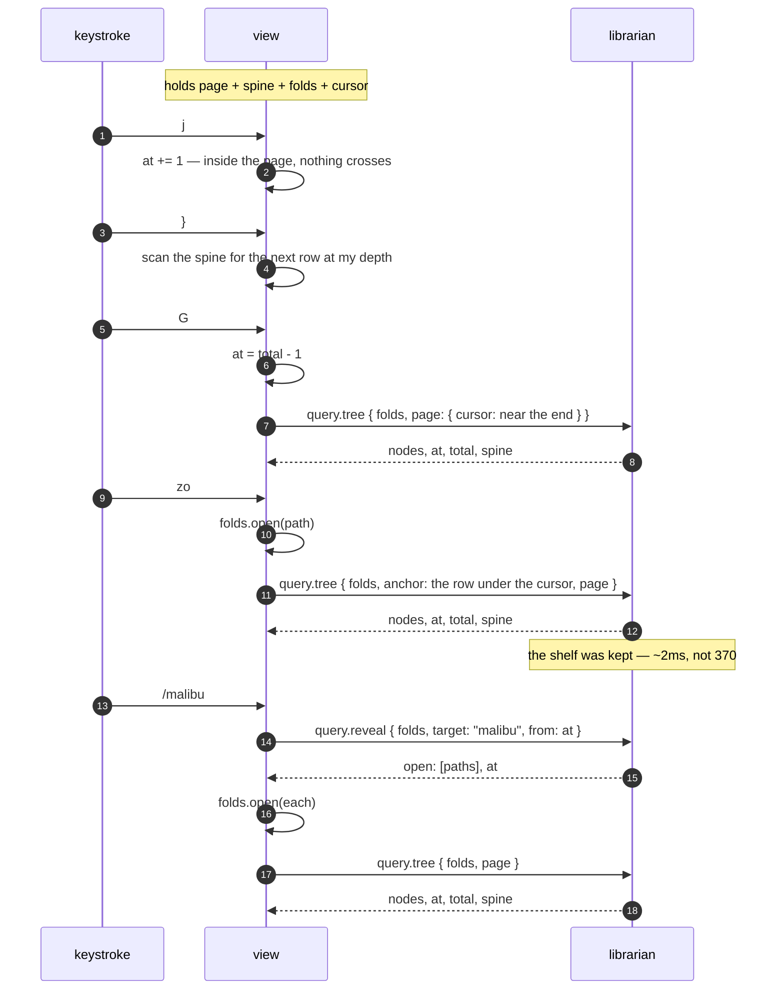

# The tree over the wire: what a view holds when it stops holding the library

**Status: settled design, not built.** The tree half of #261 Goal 1. The programme document says who decides what plays;
this one says who holds the library while somebody browses it.

One rule, and everything below follows from it: **a view holds a screenful, a cursor, and the shape — never the
library.**

---

## 1. What a view holds today, measured

`just memory-parts`, against the real library (7,273 rows, 8,932 tree nodes):

| what an attached view holds |         |
| --------------------------- | ------- |
| a follower's fold           | 14.1 MB |
| `Librarian::from_catalogue` | 26.5 MB |
| `Shelf` — view 1's tree     | 1.7 MB  |
| **total**                   | 42.3 MB |

**The `Shelf` is a rounding error, and that reorders the work.** Converting view 1 to pages buys 1.7 MB and is worth
doing for none of it. Its value is that `Shelf::grouped` takes a `&Librarian`: while the tree is built view-side, the
view must fold the log, and the other 40.6 MB cannot go.

So the two halves of Goal 1 — the tree, and the detail reads behind `ctx.library` — **free nothing separately**. The
`Librarian` is shared, and the last caller keeps it alive. That makes this one milestone with a measured endpoint rather
than a queue of small wins.

## 2. Why the fold state stays in the view

`query.tree` groups and then flattens. Timed apart (`just tree-cost`):

| step                            |         |                         |
| ------------------------------- | ------- | ----------------------- |
| `Shelf::grouped`                | 370.0ms | 614 artists             |
| `browse::flatten` over the same | 1.8ms   | 8,932 nodes             |
|                                 |         | the flatten is **0.5%** |

The expensive half does not depend on which nodes are open. So the librarian **keeps the shelf, keyed by the fold's
version, the levels and the filter — and not by the folds** — and flattens per request. A `zo` costs about 2 ms,
not 370.

Which is what `browse::tree` already said it wanted: _"Which nodes a person has folded is the view's state and the
librarian has no business holding it."_ A per-client fold state on the librarian would also make it stateful in the one
dimension it has managed to avoid.

**The fold state travels with the request, and it is small.** `Expansion` holds a `level`, an `eager` depth, and two
sets of _exceptions_ — nodes opened or closed against the level. Twenty artists open by hand is about 600 bytes. It is
not proportional to the library and never was.

## 3. The spine

Every one of the ten structural motions — `}` `{` `]]` `[[` `][` `[]` `-` `]z` `zj` `zk` — is a scan for the first row
matching a predicate. Read against `TreeState::step`, those predicates consume exactly three fields per row:

- **`depth`**, 0–3: artist, album, disc, track.
- **`is_leaf`** — needed on its own because depth 2 is ambiguous, being both a disc header and a track on a record with
  one disc.
- **`is_expanded`** — `zk` lands on a fold's _end_, and a closed fold is its own end.

Nothing else. Not a title, not an id, not a sort key.

So a view holds a **spine**: four bits a row — two of depth and two of flags — one hex digit each over the wire.

| for the whole library |            |
| --------------------- | ---------- |
| `Shelf`               | 1.7 MB     |
| the spine             | **8.9 KB** |

`j`, `k`, `gg`, `G` and `3000j` are arithmetic on `(at, total)` and need not even read it. The spine changes when the
folds change or the library does — never when the cursor moves.

It also fixes a small standing waste: `go` calls `rows(lib)` **inside** its count loop, so `3}` flattens the tree three
times. Three scans of 8.9 KB is not a cost worth naming.

## 4. What crosses

Two methods, both stateless.

```
query.tree   { levels, filter, folds, anchor?, limit, cursor }
          -> { nodes, at, total, next, spine, library_version }

query.reveal { levels, filter, folds, target, from?, backwards? }
          -> { open: [path], at }
```

`anchor` is a `Mark` — a container's path, or a track's id. It answers "the rows moved; where did my cursor go?", which
is the question a toggle asks and the one `mark`/`point_at` already exist to answer view-side. It beats `cursor` when
both are given, and falls through to it when the anchored line is gone — a row whose fold just closed is not on screen
to be anchored to.

**Each line comes back with its seat**, the path a toggle opens and an anchor names. Sent rather than derived, because
`Node::seat` has three exceptions a client would otherwise have to reimplement: a track that replaced its album row
seats on the artist (#135), a track under a drawn disc header seats on that disc (#169), and every other track seats on
its album. A client re-deriving those is a second copy of a rule.

**Absent folds mean everything open**, which is what a client that keeps no fold state wants and what `/` searches.

`pattern` or `id`, exactly one — both, or neither, is a bad request rather than a guess, refused in the parser before a
tree gets built to find out. **The reply gives the index after the reveal, not before**: opening folds inserts rows
above the match, so an index measured against the unfolded list is wrong by the time the view can use it. `/` searching
a closed fold keeps working for the reason it always did — a closed fold still holds its rows.

**`from` and `at` are both where the cursor is on screen.** The search runs over the unfolded tree and a cursor counts
visible lines, so they are different coordinate systems — and feeding a reply straight back as the next request lands in
the wrong one, which does not error, it just makes `n` find the same line for ever. The conversion happens
librarian-side, by name rather than by index, because a name survives a fold change and a number does not. It is #131's
"the coordinates the search runs in", one layer down.

Both directions wrap. An asymmetry there is invisible with two matches and maddening with twenty.

## 5. A keystroke



The two things worth reading off it: **the common keys cross nothing**, and **a fold change is one round trip**, which
is what a rebuild already was.

## 6. `Node` grows a disc

`browse::Node` is `Outer / Inner / Track`. What view 1 draws is `Artist / Album / Disc / Track`, and its track carries
an `alone` flag and its container's keys.

**The disc row goes into `Node`.** It is a fact the library holds — #169 added it because a five-disc _Let It Be_ has
five track 1s, and drawn adjacent under identical numbering that reads as the library holding one song five times. A
second client wants it for the same reason the first did. Keeping `Node` "general" by leaving it out would mean every
client re-deriving a row the library already knows about, or view 1 needing a reply shape of its own — which is two
answers to one question, the thing #257 exists to prevent.

The kinds on the wire are therefore `artist`, `album`, `disc`, `track`, and a node carries **both its identity and its
row**: the path of sort keys a toggle and an anchor name it by, and the title, credit and length a client draws. A node
that carried only identity would send the view back to the library for every visible line, which is the thing this
document exists to stop.

**The track's line moved into `Shelf`** to make that possible, and the field beside it had already said why. The note on
`artist_names` reads: without it _"every renderer has to reach back into the `Scan` for a track under the node just to
recover the string, which is how a projection that exists to answer questions ends up unable to answer the simplest
one"_. Tracks were the level that rule had not been applied to, and the renderer did exactly that. It costs **1.0 MB** —
the shelf goes from 1.7 MB to 2.7 MB — and it is held once, librarian-side, rather than in every view.

## 7. What this does not decide

- **Where the query worker lives.** §7.11 says a query runs off the job queue over an `Arc<Answer>`; `query.tree` is
  served on the socket thread today. That is #261's first done-when and it is independent of everything here.
- **The 41 detail reads behind `ctx.library`** — `row`, `listed`, `open`, `label_of`, `about`, `history`. They are the
  info panel's territory and `info-panel.md` has the rule for them. §1 is why they have to land in the same milestone.
- **The picker.** `query.found` already exists and is ~1 ms; match positions on its rows are a separate done-when.
